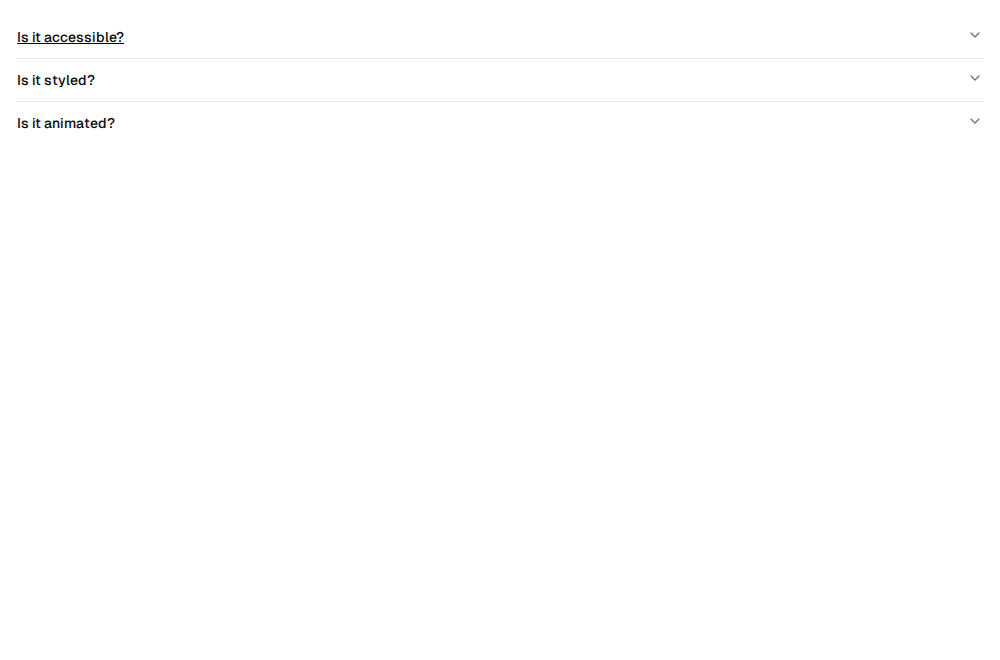
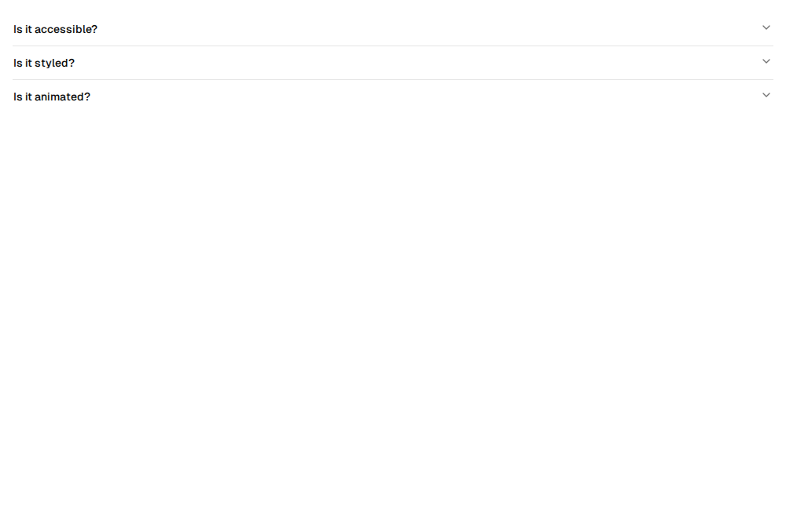
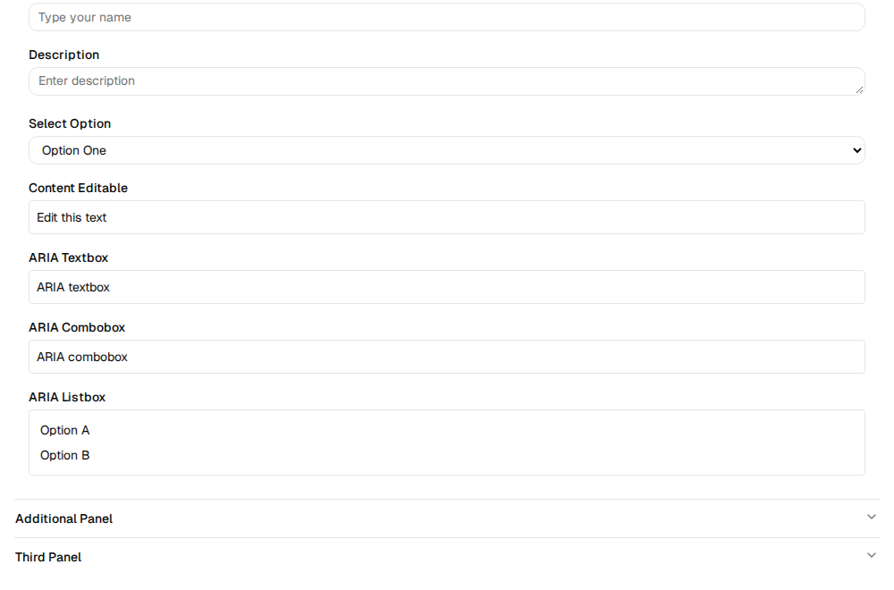

# accordion

[All checks](README.md)

## ✅ accordion › ARIA semantics › buttons act as headers with proper ARIA attributes

## ✅ accordion › ARIA semantics › header button is wrapped in semantic heading

## ✅ accordion › ARIA semantics › panel uses role="region" with aria-labelledby when open

## ✅ accordion › single accordion (default) › starts closed and is vertical by default

## ✅ accordion › single accordion (default) › only one open at a time (click)

## ✅ accordion › single accordion (default) › Space/Enter toggles like a button

## ✅ accordion › multiple accordion › allows multiple items to remain open

## ✅ accordion › keyboard navigation between headers › ArrowDown/ArrowUp move focus between headers (vertical)

## ✅ accordion › keyboard navigation between headers › Home to first; End to last

## ✅ accordion › keyboard navigation between headers › Tab/Shift+Tab include inner focusables in page order

## ✅ accordion › keyboard guarding with form inputs › typing in an input does not toggle accordion

## ✅ accordion › keyboard guarding with form inputs › textarea accepts newlines and accordion stays open

## ✅ accordion › keyboard guarding with form inputs › select changes with arrows and does not toggle

## ✅ accordion › keyboard guarding with form inputs › contenteditable text edits do not toggle

## ✅ accordion › keyboard guarding with form inputs › modifier combos (Ctrl/Meta/Alt) do not toggle

## ✅ accordion › inert behavior for closed panels › button should not be focusable when panel is closed (inert)

## ✅ accordion › button state sync › should have the first item open by default, toggle all 3 items by pressing on them, close third item on button click, open third item on button click, close third item on click on its own trigger

## ✅ accordion › default accessibility › should have no accessibility violations in default story

## ✅ accordion › default accessibility › should have no accessibility violations in multiple story

## ✅ accordion › default accessibility › should have no accessibility violations in with-form-inputs story

## ✅ accordion › default accessibility › should have no accessibility violations in with-tapable story

## ✅ accordion › default accessibility › should have no accessibility violations in button-state-sync story

