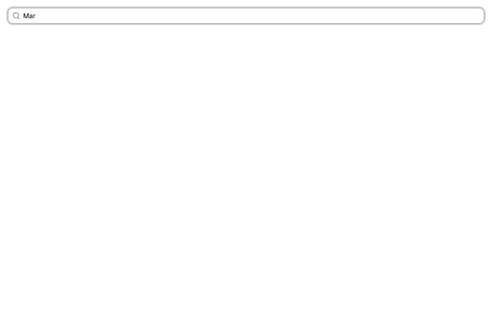
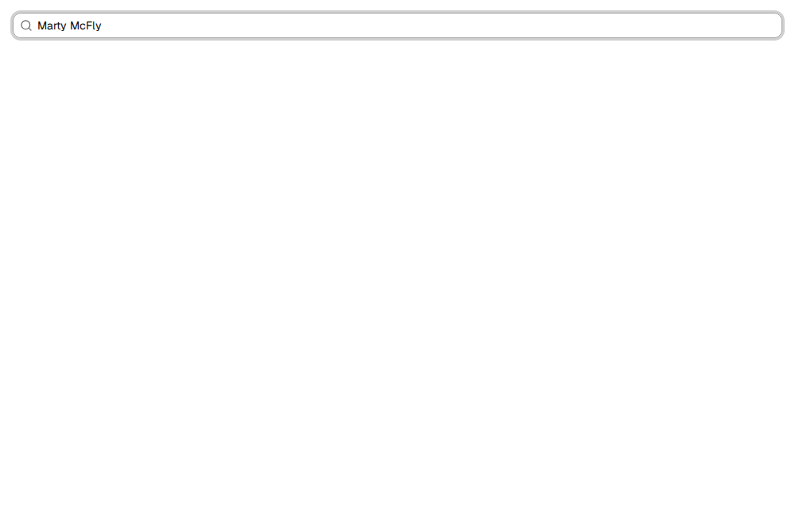
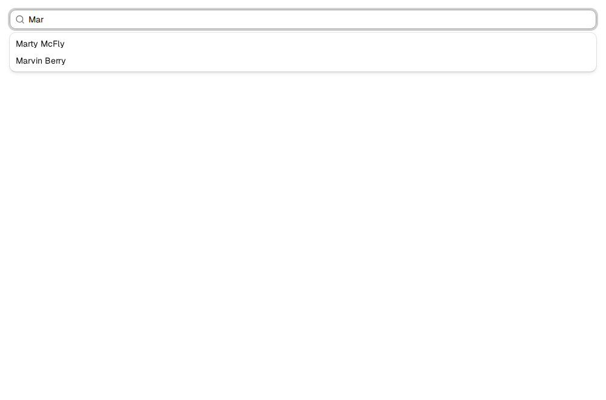
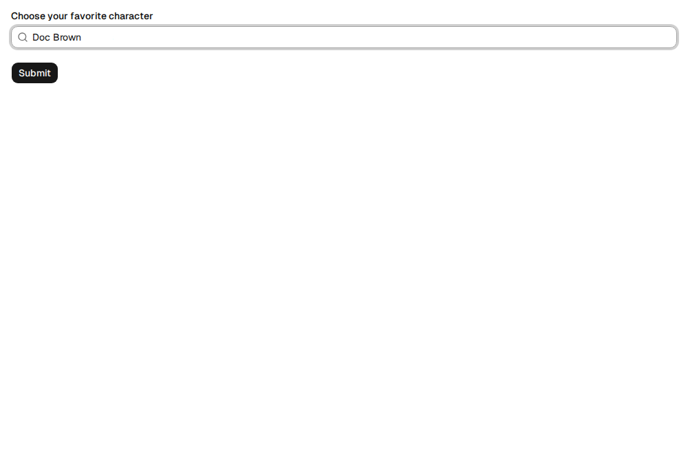
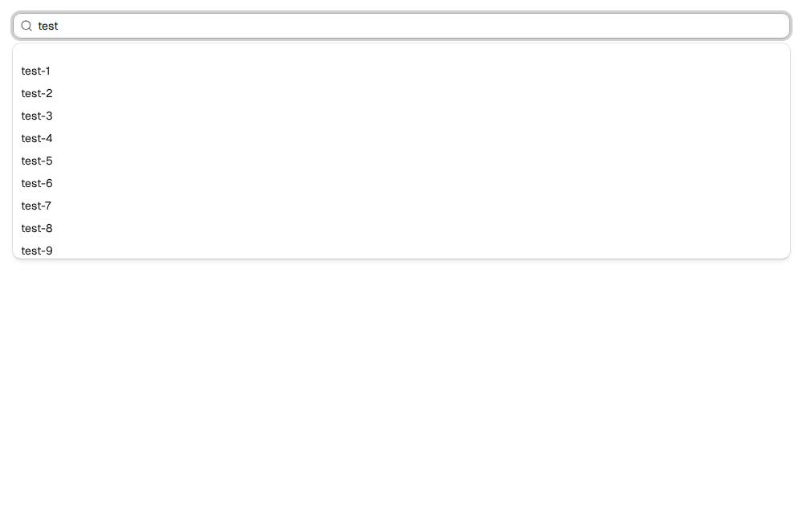

# autocomplete

[All checks](README.md)

## ✅ autocomplete › Default › should close popup when tabbing out

## ✅ autocomplete › Default › should not select the highlighted option on tab out

## ✅ autocomplete › Default › should select highlighted option on enter

## ✅ autocomplete › Default › should render autocomplete input

## ✅ autocomplete › Default › should show options when typing

## ✅ autocomplete › Default › should select an option

## ✅ autocomplete › Default › should pass accessibility checks

## ✅ autocomplete › Default › should pass accessibility checks when opened

## ✅ autocomplete › Form › should work within a form

## ✅ autocomplete › Async › should show loading state

