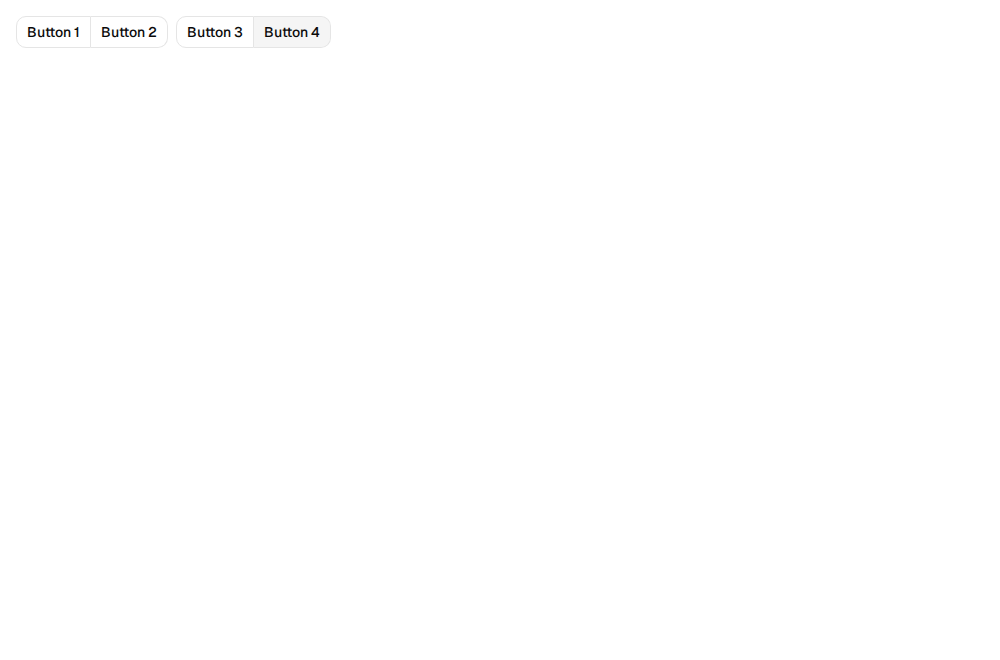
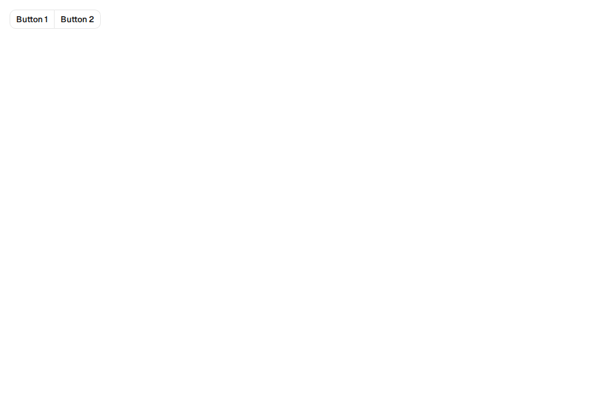
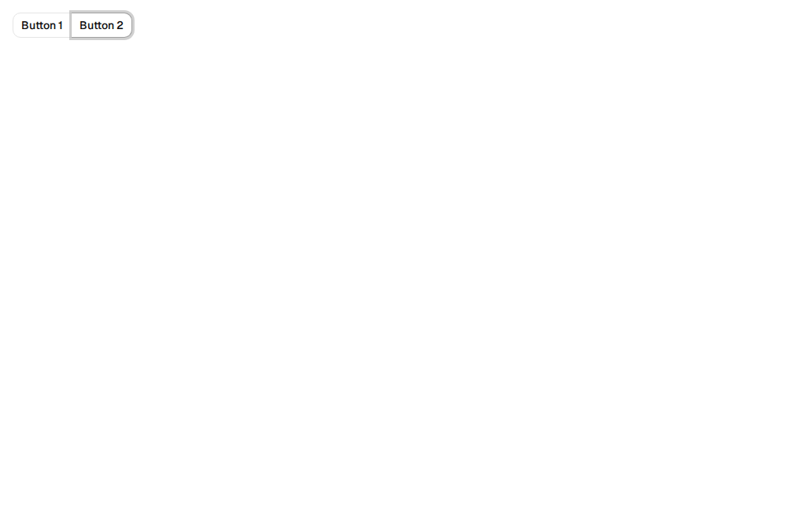
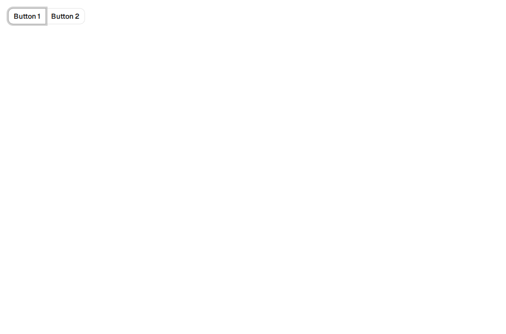
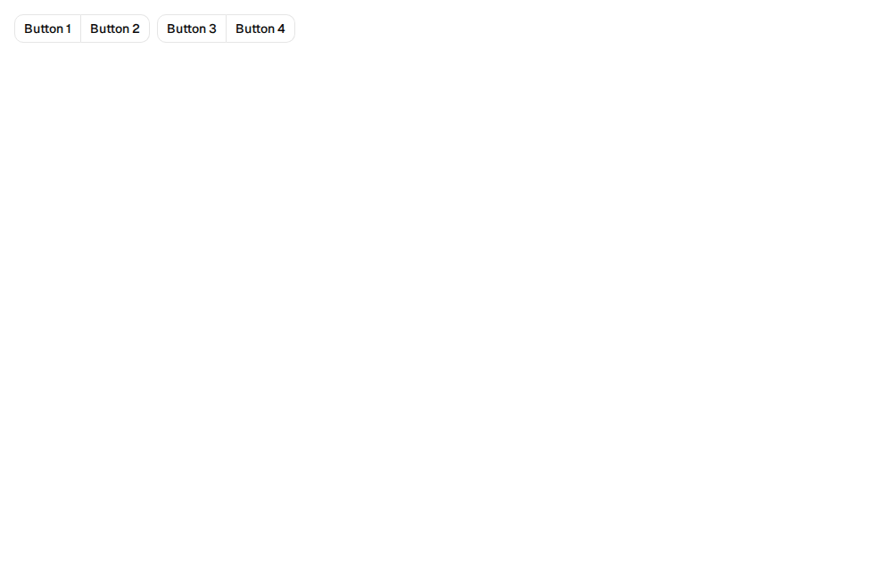
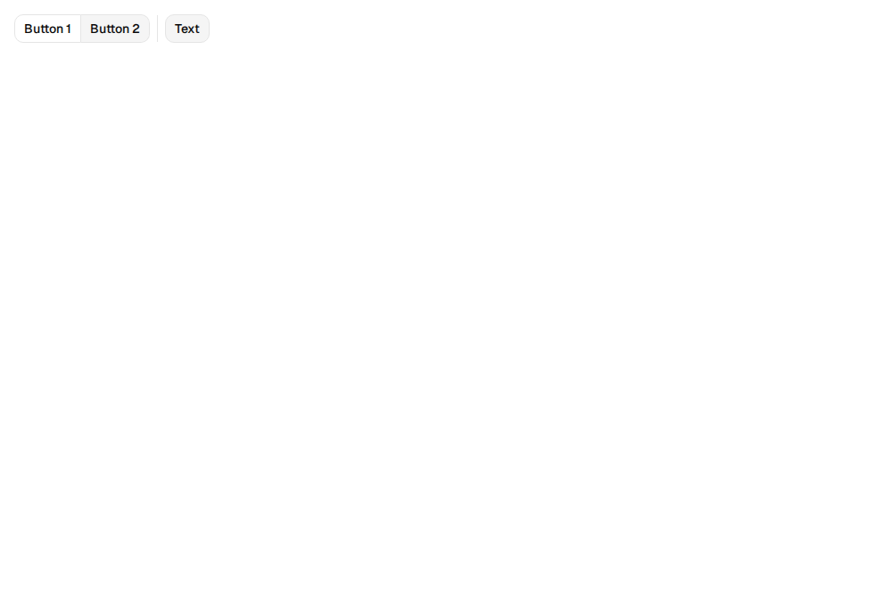
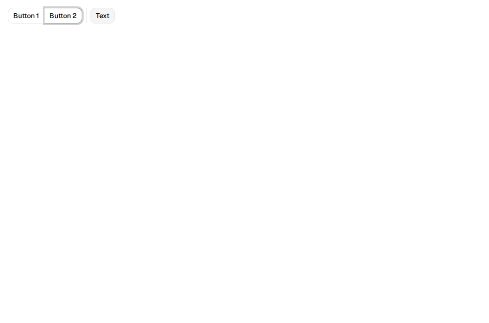
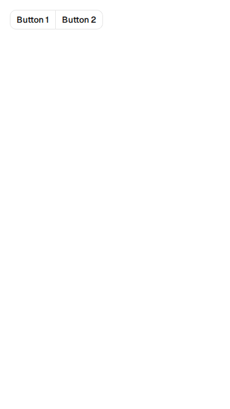

# button-group

[All checks](README.md)

## ✅ button-group › Default Button Group › should have outline variant buttons

## ✅ button-group › Split Button Group › should have secondary variant buttons

## ✅ button-group › Split Button Group › should have separator between buttons

## ✅ button-group › Nested Button Group › should support interactions in nested groups

## ✅ button-group › Nested Button Group › should maintain proper keyboard navigation in nested structure

## ✅ button-group › Nested Button Group › should maintain proper grouping semantics

## ✅ button-group › WithText Button Group › should have proper structure with text group

## ✅ button-group › Button Group Visual and Layout Tests › should have proper visual styling

## ✅ button-group › Button Group Accessibility Tests › should have proper focus indicators

## ✅ button-group › Default Button Group › should render the default button group correctly

## ✅ button-group › Default Button Group › should support button interactions

## ✅ button-group › Default Button Group › should support keyboard navigation

## ✅ button-group › Default Button Group › should maintain proper focus management

## ✅ button-group › Split Button Group › should render the split button group correctly

## ✅ button-group › Split Button Group › should maintain accessibility with separator

## ✅ button-group › Nested Button Group › should render nested button groups correctly

## ✅ button-group › Nested Button Group › should have all buttons in nested groups

## ✅ button-group › WithText Button Group › should render button group with text correctly

## ✅ button-group › WithText Button Group › should have separator and text element

## ✅ button-group › WithText Button Group › should support button interactions with text element

## ✅ button-group › WithText Button Group › should maintain proper keyboard navigation with text

## ✅ button-group › WithText Button Group › should maintain accessibility with text element

## ✅ button-group › Button Group Visual and Layout Tests › should be responsive

## ✅ button-group › Button Group Accessibility Tests › should meet WCAG accessibility standards

