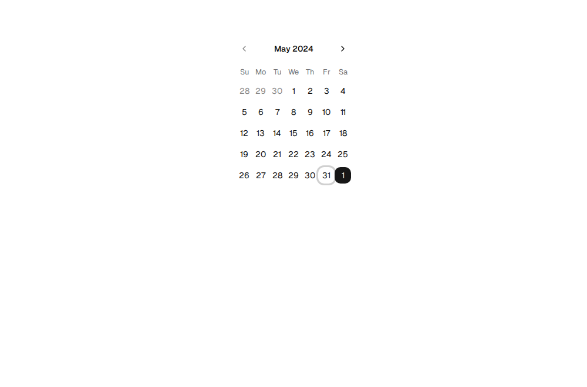

# calendar

[All checks](README.md)

## ✅ calendar › default › should select the date

## ✅ calendar › default › should select a date when clicked

## ✅ calendar › default › should select the date when the enter key is pressed

## ✅ calendar › default › should allow keyboard navigation on arrow right

## ✅ calendar › default › should allow keyboard navigation on arrow left

## ✅ calendar › default › should allow keyboard navigation on arrow up

## ✅ calendar › default › should allow keyboard navigation on arrow down

## ✅ calendar › default › should allow keyboard navigation on home and end

## ✅ calendar › default › should select focus the selected date

## ✅ calendar › default › should navigate to the previous month

## ✅ calendar › default › should navigate to the next month

