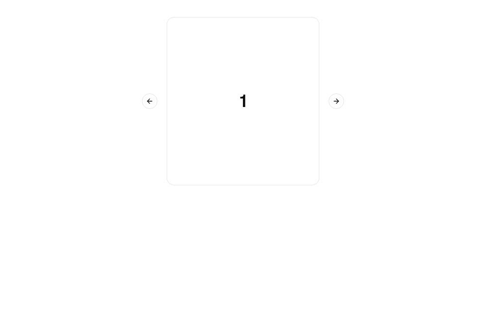

# carousel

[All checks](README.md)

## ✅ label › default › should have correct aria attributes on the root element

## ✅ label › default › should have correct aria attributes on the item elements

