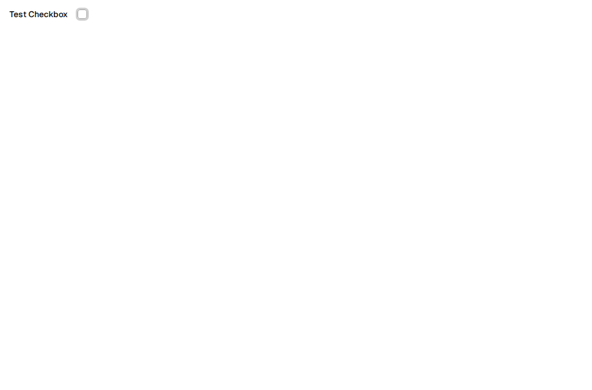
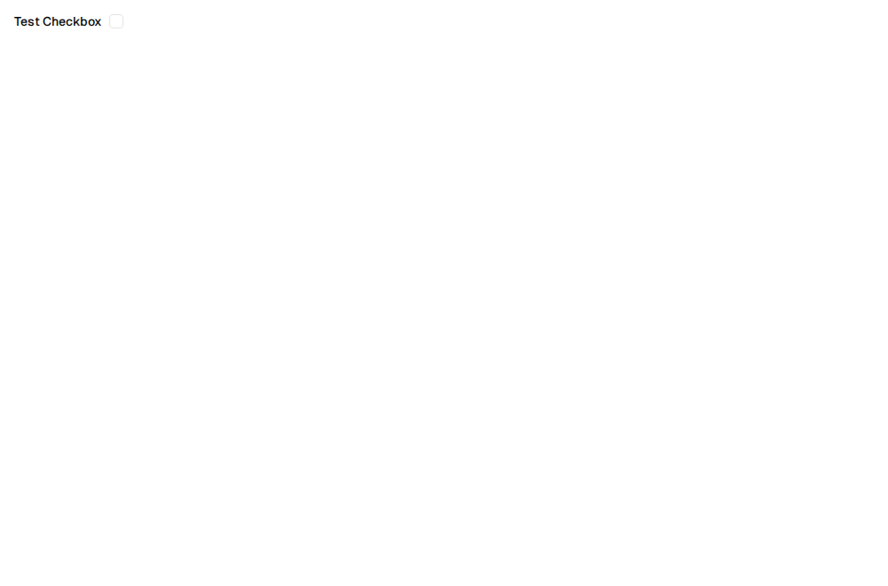

# checkbox

[All checks](README.md)

## ✅ checkbox › default › click interactions should render as unchecked, become checked on label click, become unchecked on checkbox click

## ✅ checkbox › default › [Tab][Enter] interactions should render as unchecked, become checked when pressing enter, become unchecked when pressing enter again

## ✅ checkbox › default › [Tab][Space] interactions should render as unchecked, become checked when pressing space, become unchecked when pressing enter space

## ✅ checkbox › inside label › click interactions should render as unchecked, become checked on label click, become unchecked on checkbox click

## ✅ checkbox › inside label › [Tab][Enter] interactions should render as unchecked, become checked when pressing enter, become unchecked when pressing enter again

## ✅ checkbox › inside label › [Tab][Space] interactions should render as unchecked, become checked when pressing space, become unchecked when pressing enter space

## ✅ checkbox › labeled with aria-labelledby › click interactions should render as unchecked, become checked on label click, become unchecked on checkbox click

## ✅ checkbox › labeled with aria-labelledby › [Tab][Enter] interactions should render as unchecked, become checked when pressing enter, become unchecked when pressing enter again

## ✅ checkbox › labeled with aria-labelledby › [Tab][Space] interactions should render as unchecked, become checked when pressing space, become unchecked when pressing enter space

## ✅ checkbox › indeterminate › click interactions should render as indeterminate, become checked on label click, become unchecked on checkbox click

## ✅ checkbox › indeterminate › [Tab][Enter] interactions should render as indeterminate, become checked when pressing enter, become unchecked when pressing enter again

## ✅ checkbox › indeterminate › [Tab][Space] interactions should render as indeterminate, become checked when pressing space, become unchecked when pressing enter space

