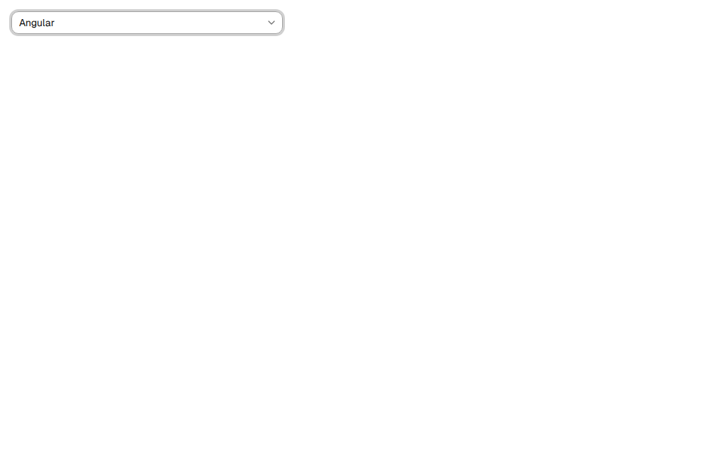
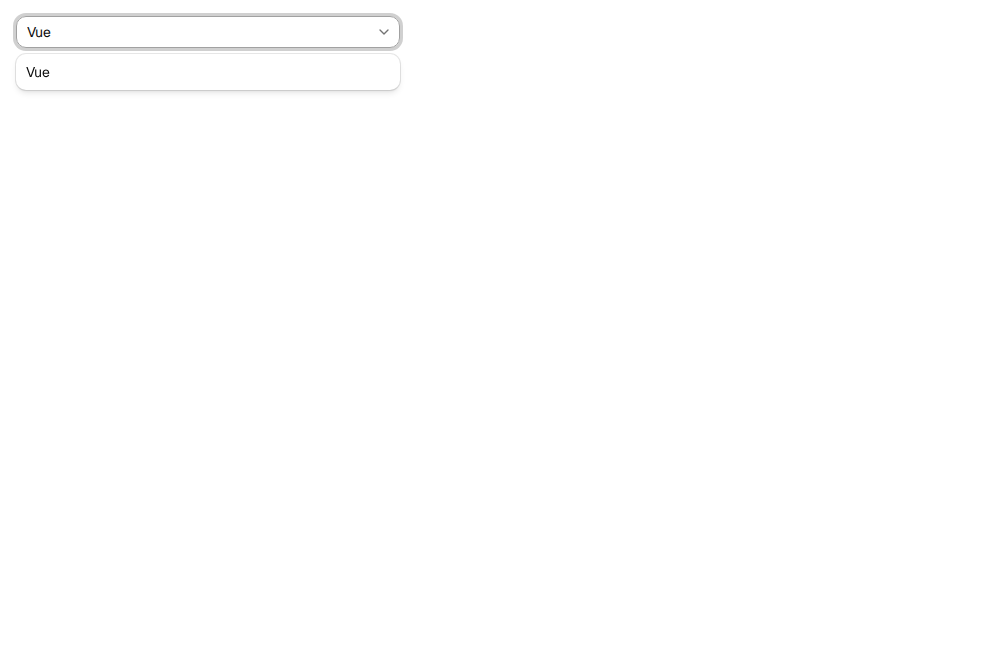

# combobox

[All checks](README.md)

## ✅ combobox--default › default › should open the framework dropdown, and the list should be scrollable

## ✅ combobox--default › default › clicking outside should close the content

## ✅ combobox--popup › clicking outside should close the content

## ✅ combobox--default › default › click on combobox should open, click on Angular option should closed

## ✅ combobox--default › default › should open the framework dropdown, type "Vue", and ensure "Angular" is hidden

## ✅ combobox--default › default › clicking the input while open keeps it open (closeOnTriggerClick is false)

## ✅ combobox--default › default › should pass accessibility checks when opened

## ✅ combobox--popup › clicking the button trigger again should close the content (closeOnTriggerClick is true)

