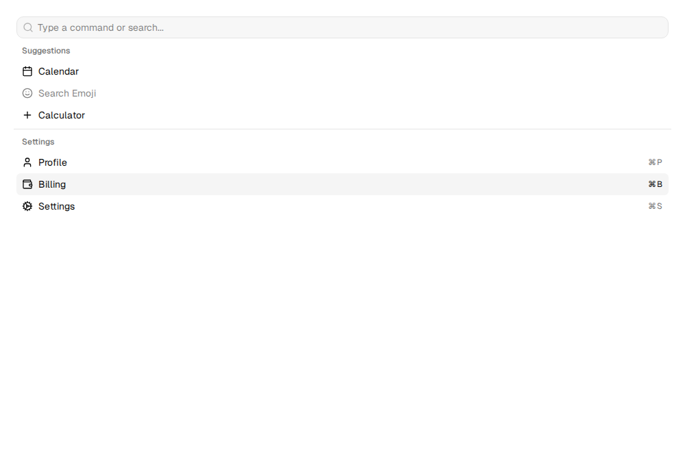
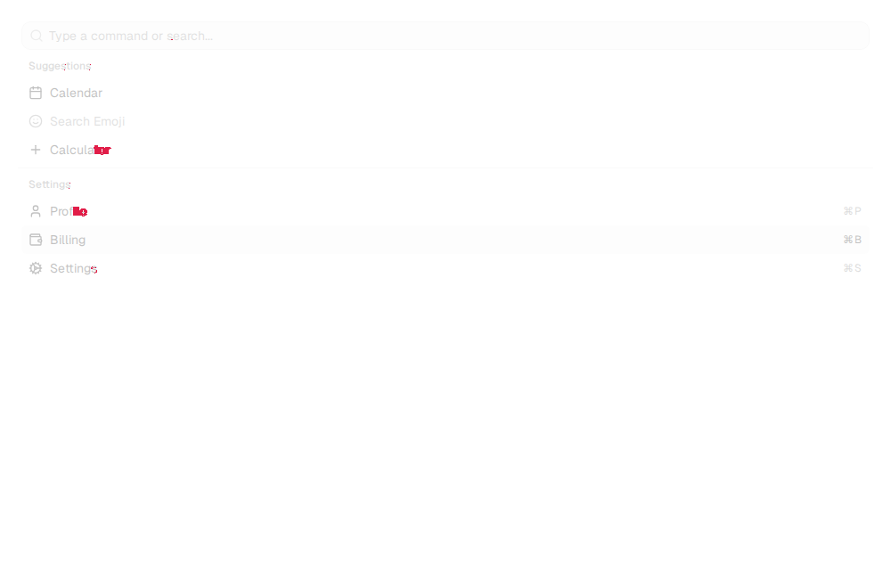
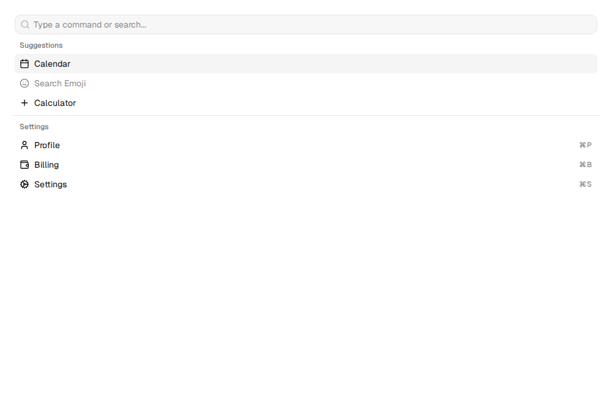
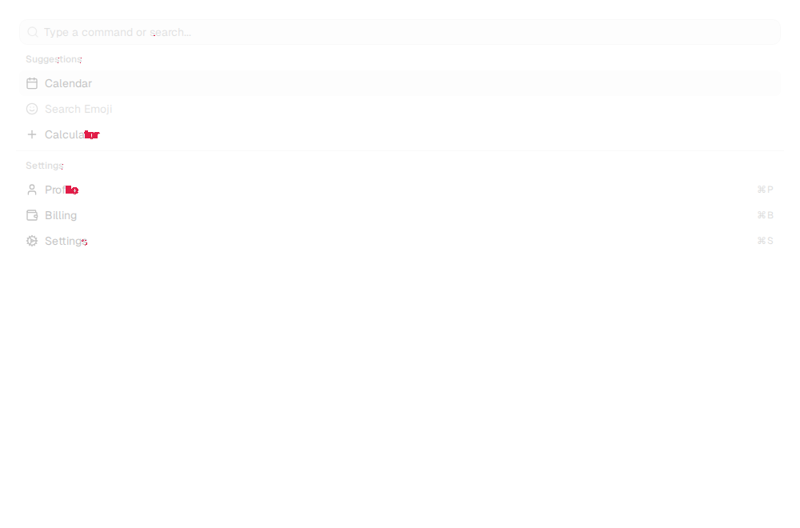
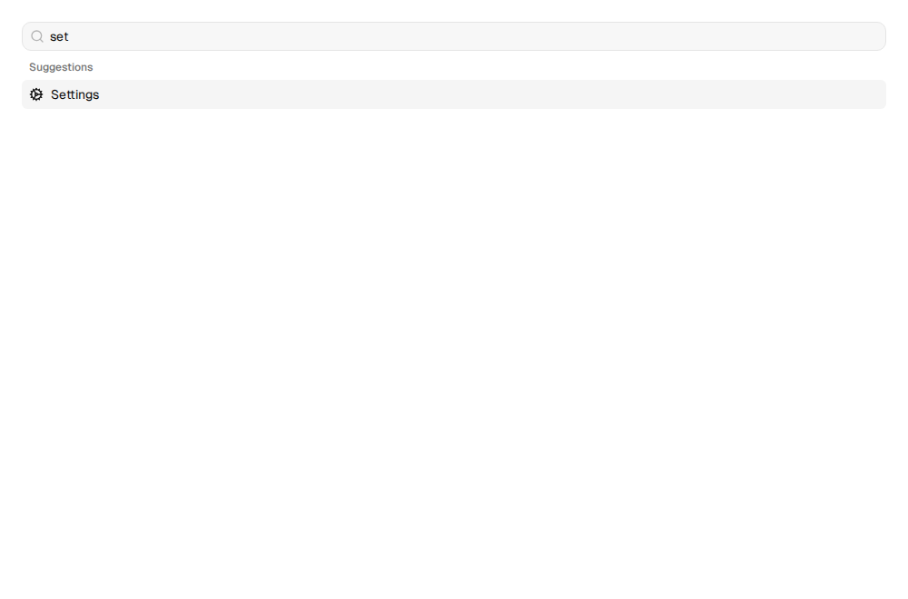
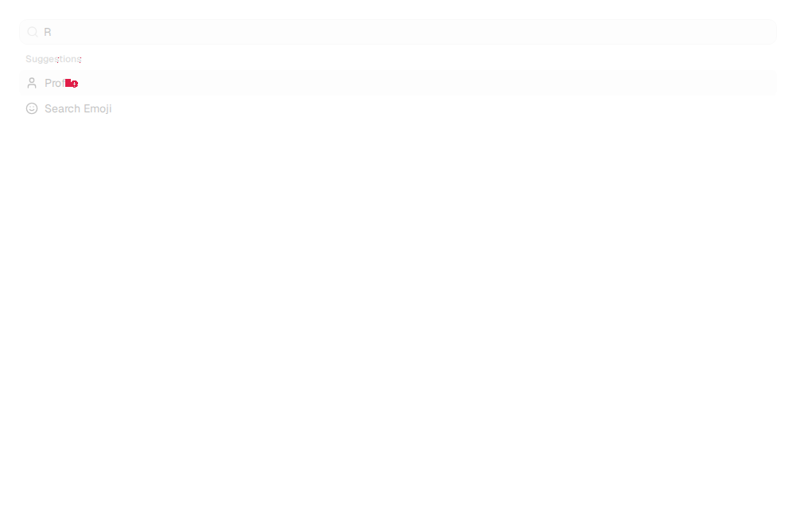

# command

[All checks](README.md)

## ✅ command › default › 
	  first option should be selected by default.
	  Typing bil, should show and select only billing
	  Typing BIL, should show and select only billing
	  Typing ca should show calendar and calculator and select calendar because it comes first
	  Typing CA should show calendar and calculator and select calendar because it comes first
	  Click on billing should select billing
	  

| Before | After | Difference |
| --- | --- | --- |
|  |  |  |

## ✅ command › default › 
	  first option should be selected by default.
	  Typing bil, should show and select only billing
	  Typing BIL, should show and select only billing
	  Typing ca should show calendar and calculator and select calendar because it comes first
	  Typing CA should show calendar and calculator and select calendar because it comes first
	  Arrow down on billing should select billing
	  Arrow up to calculator should select calculator
	  Arrow up should skip disabled search emoji and select calendar
	  

| Before | After | Difference |
| --- | --- | --- |
|  |  |  |

## ✅ command › default › 
	Input, list, and items should be accessible and have no WCAG A/AA violations.
	  

| Before | After | Difference |
| --- | --- | --- |
|  |  |  |

## ✅ command › dynamic with ngModel › should show items based on input value without error.

| Before | After | Difference |
| --- | --- | --- |
|  |  |  |

## ✅ command › dynamic with reactive form › should show items based on input value without error.

| Before | After | Difference |
| --- | --- | --- |
|  |  |  |

## ✅ command › dynamic with direct value binding › should show items based on input value without error.

