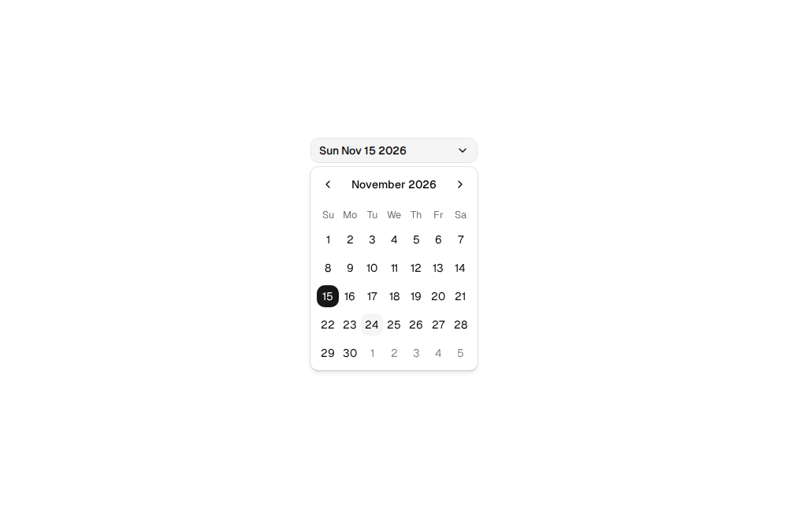
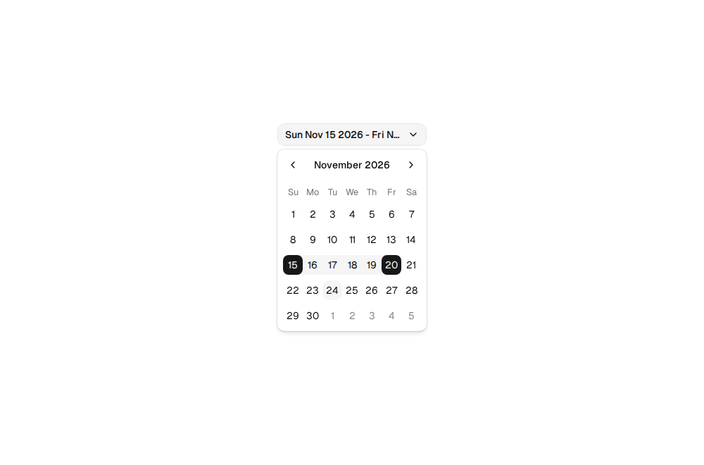
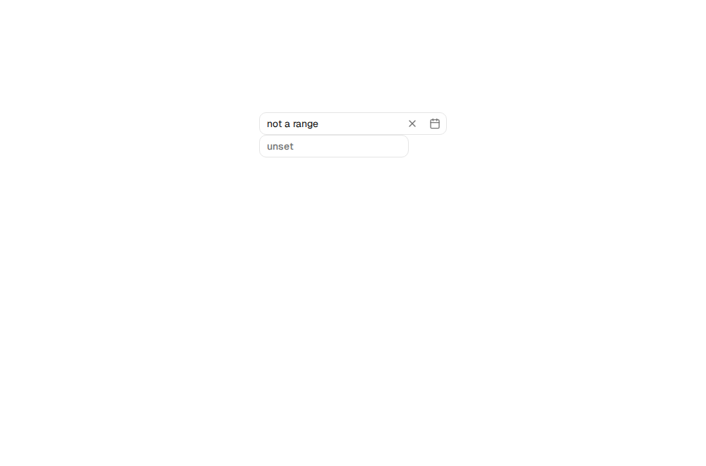
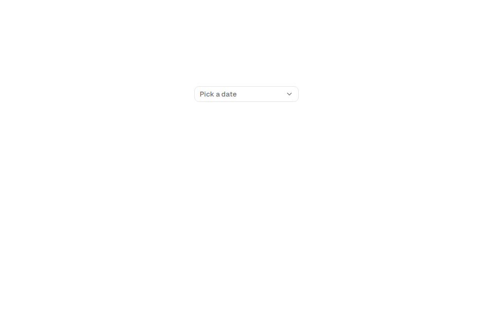
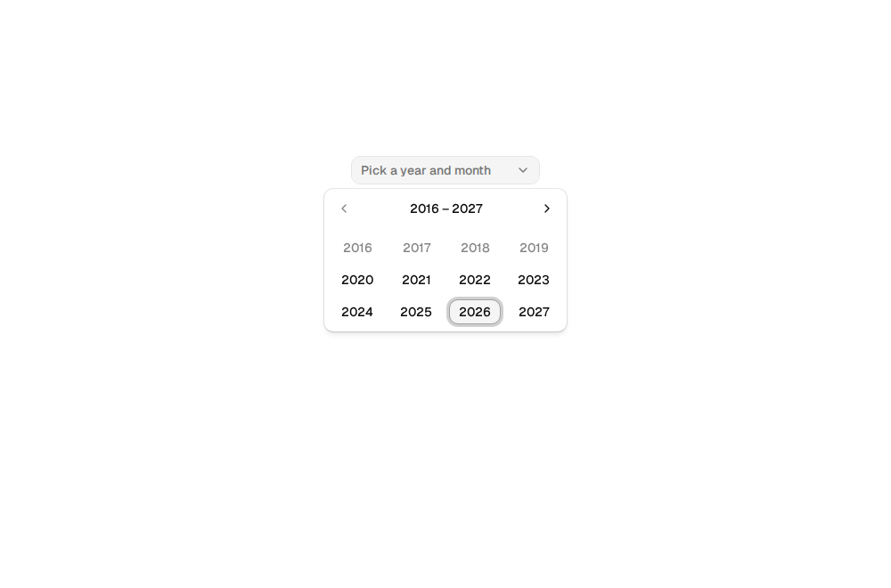

# date-picker

[All checks](README.md)

## ✅ date picker › single - trigger › opens the calendar and selects a date

## ✅ date picker › single - trigger - navigating from a month-end date › keeps the focused month when navigating to a shorter month via the dropdown

## ✅ date picker › single - trigger - navigating to a month whose same day is before min › shows the picked month and focuses the min date instead of staying on the old month

## ✅ date picker › single - input › keeps the caret position while editing in the middle

## ✅ date picker › single - input › commits a typed date on blur and shows the display format

## ✅ date picker › single - input › commits on Enter and keeps focus, then blur shows the display format

## ✅ date picker › single - input › keeps the value when blurring after Enter (regression)

## ✅ date picker › single - input › clears the value with the clear button

## ✅ date picker › single - input › keeps invalid text but leaves the model empty

## ✅ date picker › multi - trigger › opens the calendar and selects a date

## ✅ date picker › multi - input › keeps the caret position while editing in the middle

## ✅ date picker › multi - input › commits typed dates on blur and shows the display format

## ✅ date picker › multi - input › keeps the value when blurring after Enter (regression)

## ✅ date picker › multi - input › keeps invalid text but leaves the model empty

## ✅ date picker › range - trigger › opens the calendar and selects a range

## ✅ date picker › range - input › keeps the caret position while editing in the middle

## ✅ date picker › range - input › commits a typed range on blur and shows the display format

## ✅ date picker › range - input › keeps the value when blurring after Enter (regression)

## ✅ date picker › range - input › keeps invalid text but leaves the model empty

## ✅ date picker › month-year - input › keeps the caret position while editing in the middle

## ✅ date picker › month-year - input › commits a typed month/year on blur and shows the display format

## ✅ date picker › month-year - input › keeps the value when blurring after Enter (regression)

## ✅ date picker › month-year - input › keeps invalid text but leaves the model empty

## ✅ date picker › single - trigger › passes accessibility checks

## ✅ date picker › single - input › renders the input

## ✅ date picker › multi - input › renders the input

## ✅ date picker › range - input › renders the input

## ✅ date picker › month-year - trigger › opens the month-year calendar

## ✅ date picker › month-year - input › renders the input

