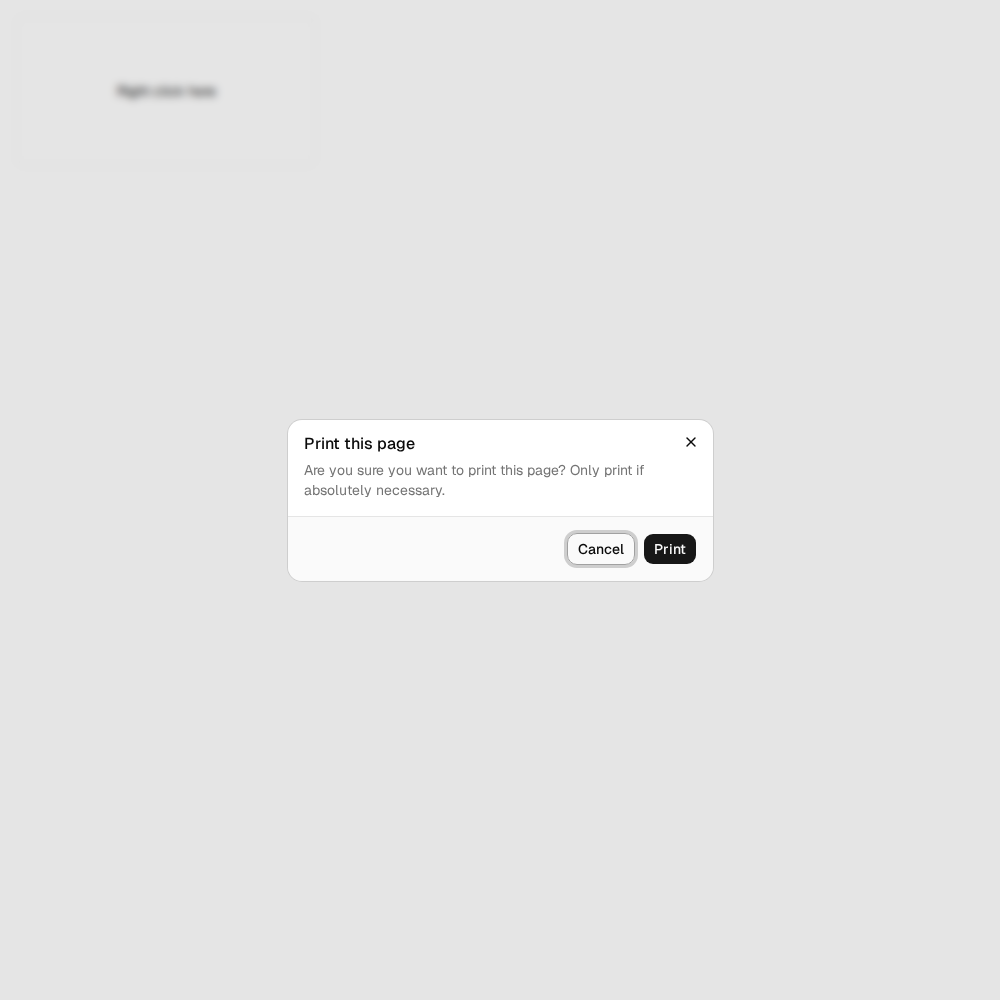
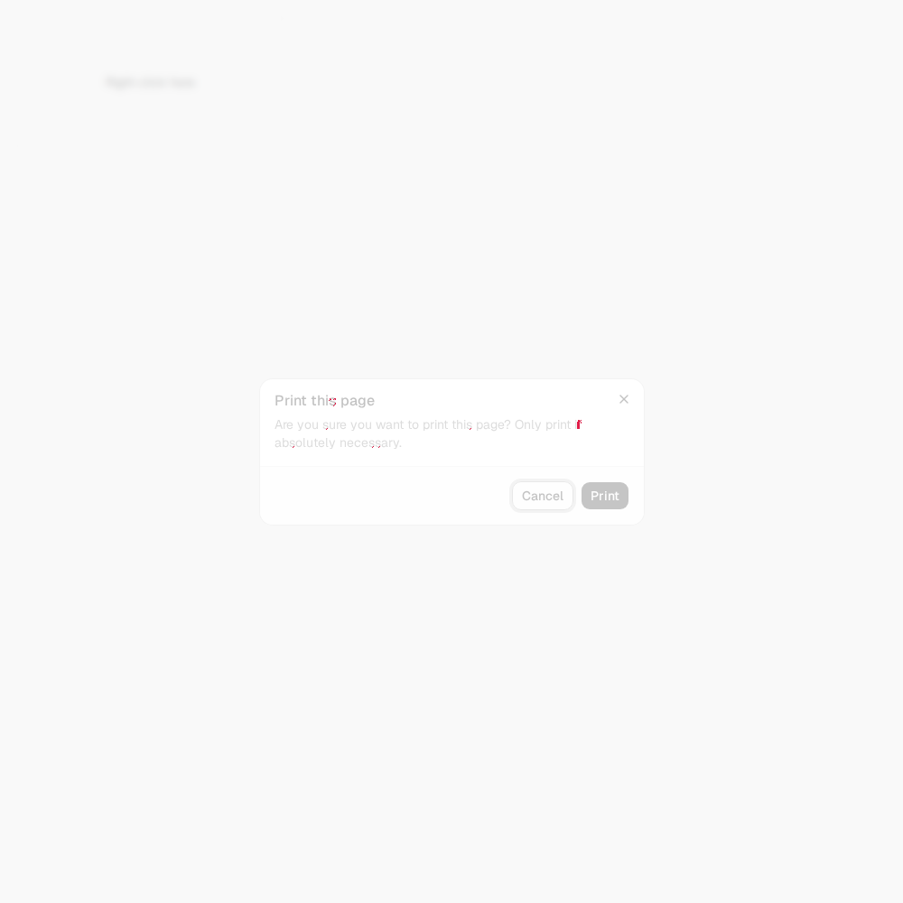
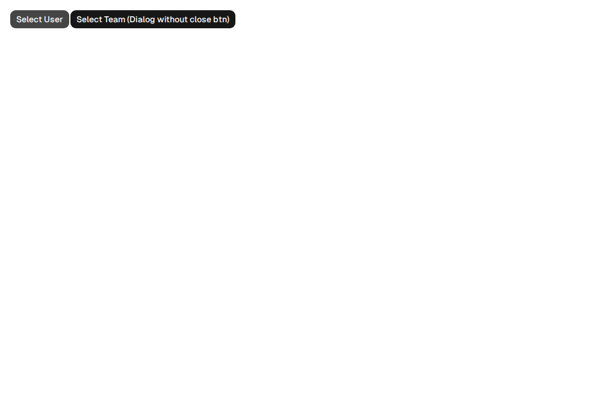
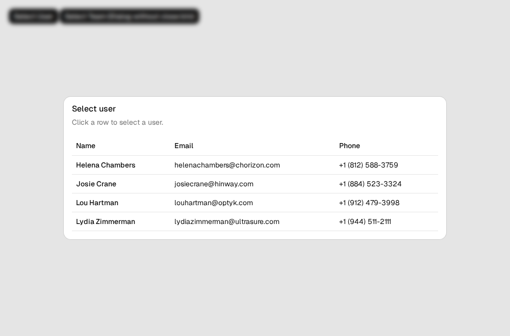
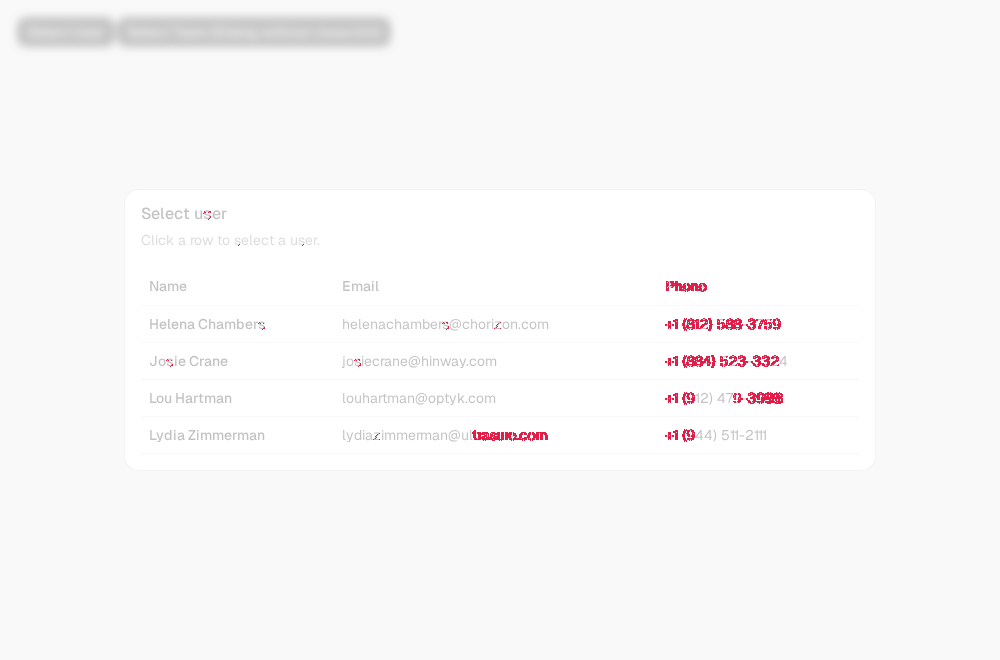

# dialog

[All checks](README.md)

## ✅ dialog--default › default › click on trigger should open, click on close should close, click outside should close

| Before | After | Difference |
| --- | --- | --- |
|  |  |  |

## ✅ dialog--default › default › tab and enter on trigger should open, enter on close should close, escape should close

| Before | After | Difference |
| --- | --- | --- |
|  |  |  |

## ✅ dialog--default › default › tab and space on trigger should open, tabs should wrap, space on close should close

| Before | After | Difference |
| --- | --- | --- |
|  |  |  |

## ✅ dialog--default › nested dialog › click on trigger should open the first dialog, click on button inside first dialog should open a nested dialog, click on button inside nested dialog closes nested dialog

## ✅ dialog--default › context menu › opens and renders dialog content when launched from a context menu item

| Before | After | Difference |
| --- | --- | --- |
|  |  |  |

## ✅ dialog--dynamic-component › dynamic-component › click on button should open dynamic component, click on close should close, click outside should close

## ✅ dialog--dynamic-component › dynamic-component › click on teams button should open dynamic component without close button

| Before | After | Difference |
| --- | --- | --- |
|  |  |  |

## ✅ dialog--dynamic-component › nested dialog › click on trigger should open the first dialog, click on button inside first dialog should open a nested dialog, click on button inside nested dialog closes nested dialog

