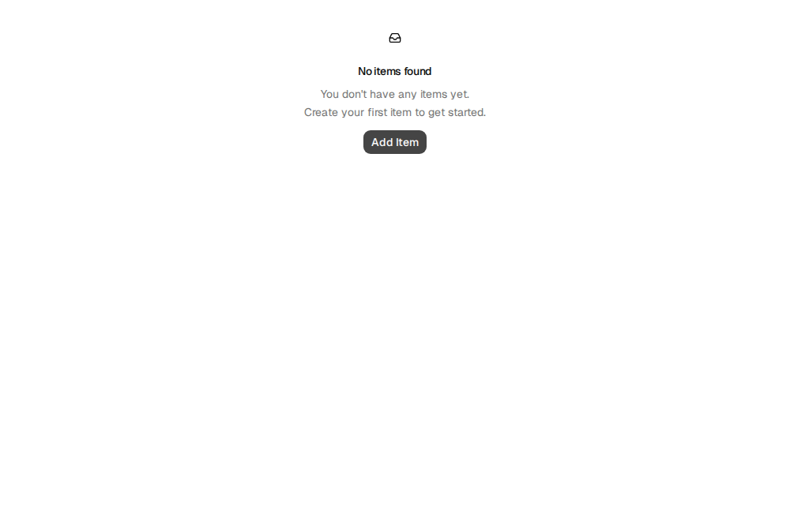

# empty

[All checks](README.md)

## ✅ Empty › Default Story › should have proper structure

## ✅ Empty › Visual Regression › should match visual snapshot for default

## ✅ Empty › Visual Regression › should match visual snapshot for with-action

## ✅ Empty › Visual Regression › should match visual snapshot for search-results

## ✅ Empty › Visual Regression › should match visual snapshot for no-connection

## ✅ Empty › Visual Regression › should match visual snapshot for file-not-found

## ✅ Empty › Visual Regression › should match visual snapshot for minimal-text

## ✅ Empty › Visual Regression › should match visual snapshot for custom-layout

## ✅ Empty › Default Story › should display the empty state with icon and content

## ✅ Empty › With Action Story › should display empty state with action button

## ✅ Empty › With Action Story › should have clickable action button

## ✅ Empty › Search Results Story › should display search results empty state

## ✅ Empty › Search Results Story › should display multiple action buttons

## ✅ Empty › Search Results Story › should have clickable action buttons

## ✅ Empty › No Connection Story › should display no connection empty state

## ✅ Empty › No Connection Story › should display retry button

## ✅ Empty › File Not Found Story › should display file not found empty state

## ✅ Empty › File Not Found Story › should display navigation buttons

## ✅ Empty › Minimal Text Story › should display minimal empty state without icon

## ✅ Empty › Custom Layout Story › should display custom layout empty state

## ✅ Empty › Custom Layout Story › should display grid layout buttons

## ✅ Empty › Custom Layout Story › should have proper responsive layout

## ✅ Empty › Accessibility › should be accessible with proper ARIA attributes

## ✅ Empty › Accessibility › should support keyboard navigation for interactive elements

