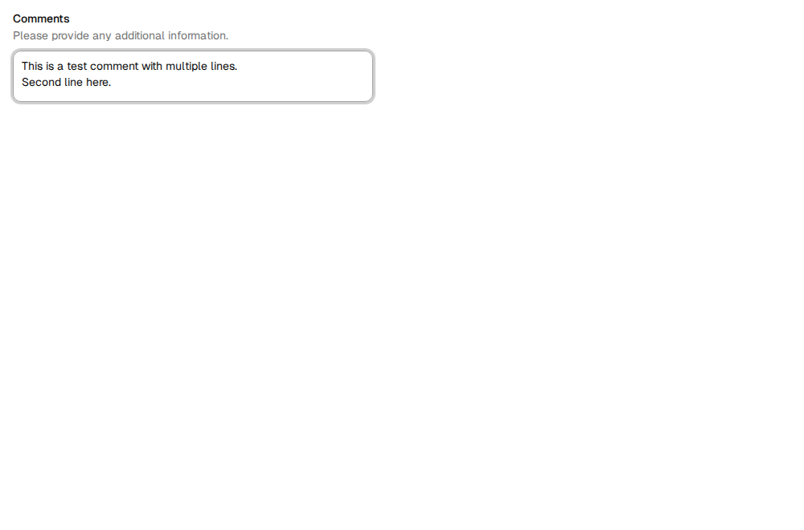
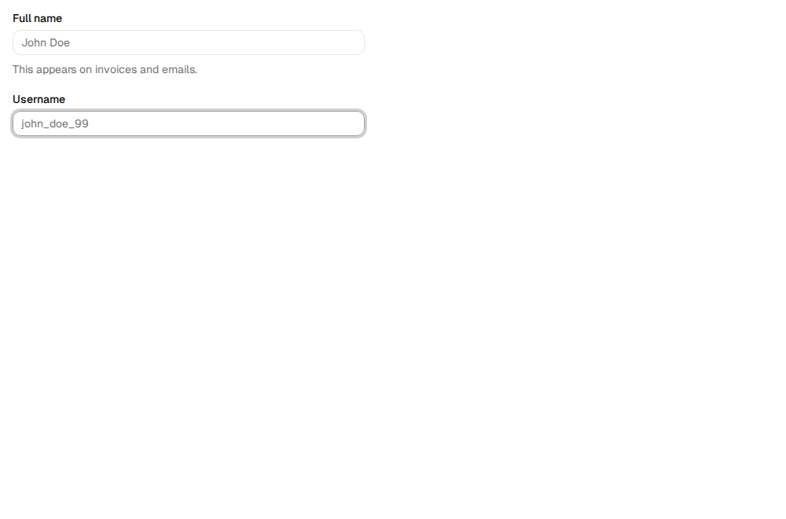
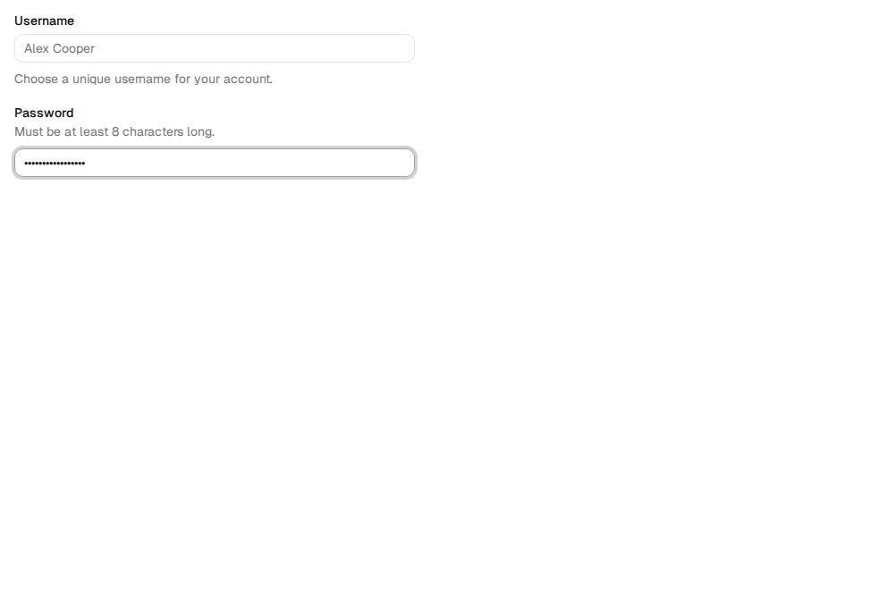

# field

[All checks](README.md)

## ✅ field › with textarea › should allow typing in textarea



## ✅ field › default › should render field with label, input, and description


## ✅ field › default › should allow typing in inputs


## ✅ field › default › should support keyboard navigation



## ✅ field › with input › should render multiple fields with descriptions


## ✅ field › with input › should allow input in password field



## ✅ field › with checkbox › should render fieldset with legend and checkboxes


## ✅ field › with checkbox › should allow checking and unchecking checkboxes


## ✅ field › with checkbox › should render checkbox with field content


## ✅ field › with checkbox › should have separator between field groups


## ✅ field › with switch › should render field with switch in horizontal orientation


## ❌ field › with switch › should toggle switch

```
Error: expect(locator).toHaveAttribute(expected) failed

Locator:  getByRole('switch', { name: /multi-factor authentication/i })
Expected: "true"
Received: "false"
Timeout:  5000ms

Call log:
  - Expect "toHaveAttribute" getByRole('switch', { name: /multi-factor authentication/i }) with timeout 5000ms
  - waiting for getByRole('switch', { name: /multi-factor authentication/i })
    14 × locator resolved to <button name="" value="off" tabindex="0" role="switch" type="button" id="field-2fa" data-focus="true" data-size="default" aria-checked="false" data-disabled="false" data-state="unchecked" data-focus-visible="false" aria-labelledby="brn-label-1" class="data-disabled:cursor-not-allowed data-disabled:opacity-50 group/switch inline-flex items-center outline-none shrink-0 spartan-switch transition-all">…</button>
       - unexpected value "false"
```


| Before | After | Difference |
| --- | --- | --- |
|  |  |  |

## ✅ field › with radio › should render fieldset with radio group


## ✅ field › with select › should allow selecting an option


## ✅ field › with textarea › should render field with textarea


## ✅ field › with error › should render fields with error states


## ✅ field › with error › should have data-invalid attribute on field wrapper


## ✅ field › field group › should handle disabled checkbox in first group


## ✅ field › horizontal orientation › should render fields with horizontal layout


## ❌ field › horizontal orientation › should allow interaction with horizontal fields

```
Error: expect(locator).toHaveAttribute(expected) failed

Locator:  getByRole('switch', { name: /Enable notifications/i })
Expected: "true"
Received: "false"
Timeout:  5000ms

Call log:
  - Expect "toHaveAttribute" getByRole('switch', { name: /Enable notifications/i }) with timeout 5000ms
  - waiting for getByRole('switch', { name: /Enable notifications/i })
    14 × locator resolved to <button name="" value="off" tabindex="0" role="switch" type="button" data-focus="true" data-size="default" aria-checked="false" data-disabled="false" data-state="unchecked" data-focus-visible="false" aria-labelledby="brn-label-1" id="field-horizontal-notifications" class="data-disabled:cursor-not-allowed data-disabled:opacity-50 group/switch inline-flex items-center outline-none shrink-0 spartan-switch transition-all">…</button>
       - unexpected value "false"
```


| Before | After | Difference |
| --- | --- | --- |
|  |  |  |

## ✅ field › with field content › should render field content with label and description


## ✅ field › with field content › should have checkbox checked by default


## ✅ field › with field title › should render field title above fieldset


## ✅ field › with field title › should allow input in fields under title


