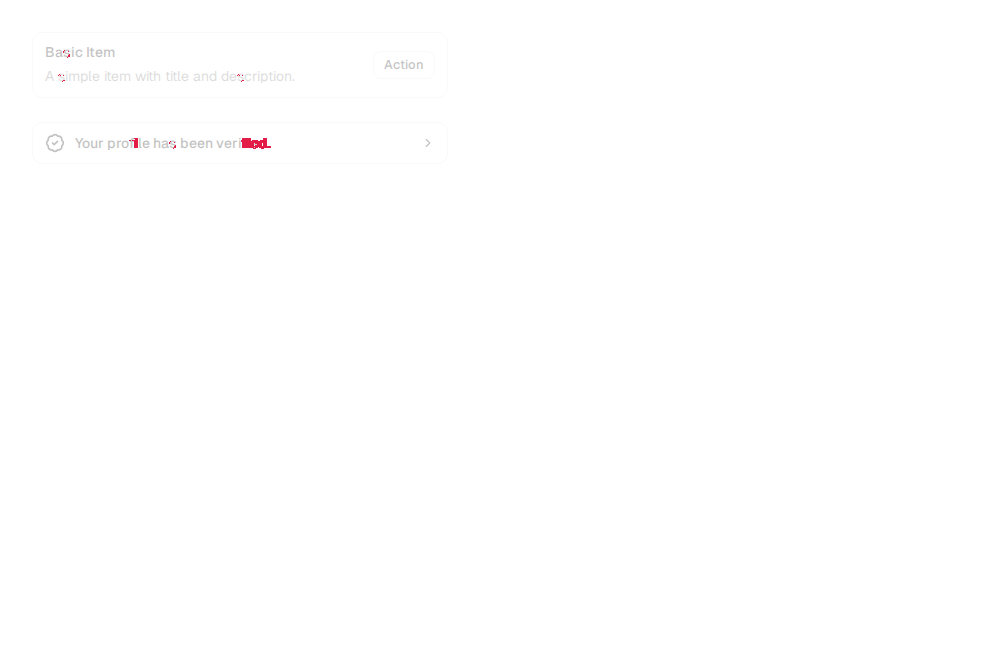
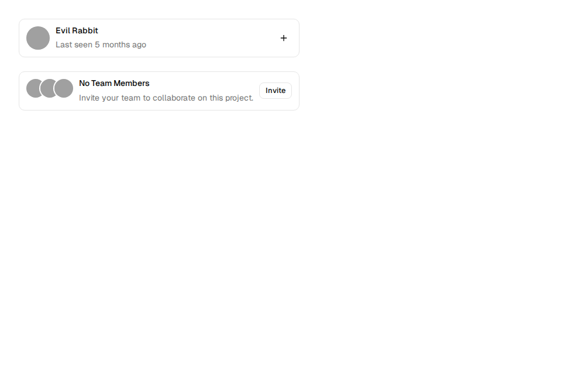
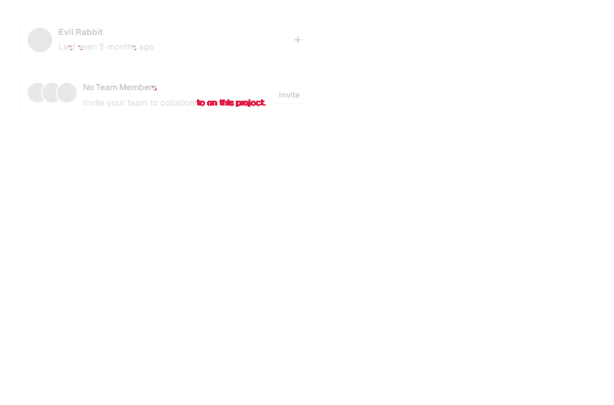
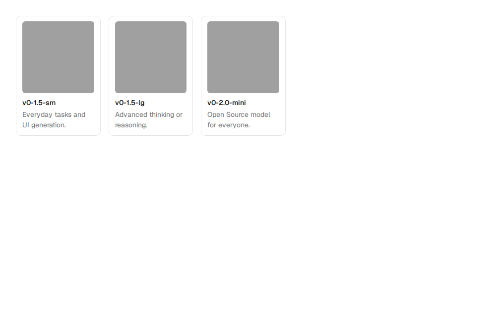
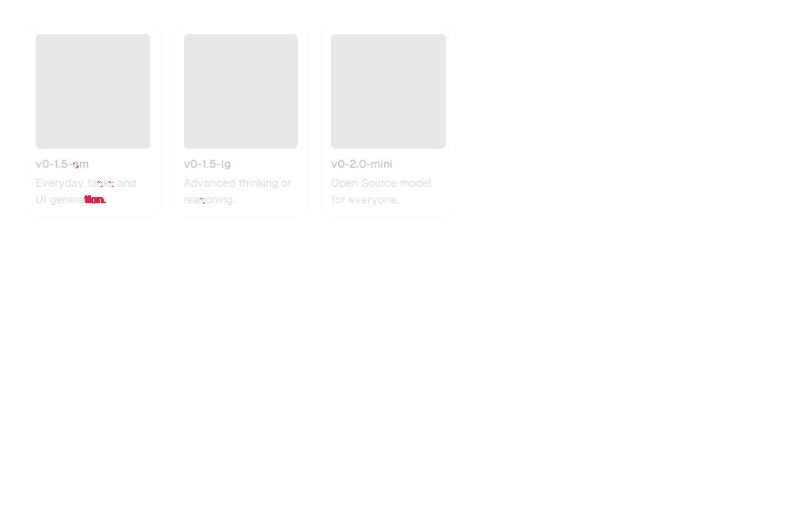
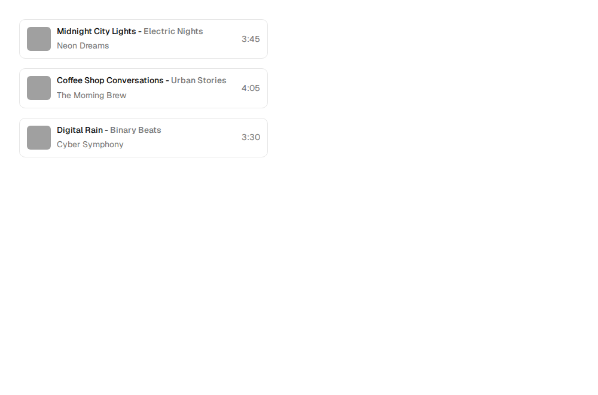
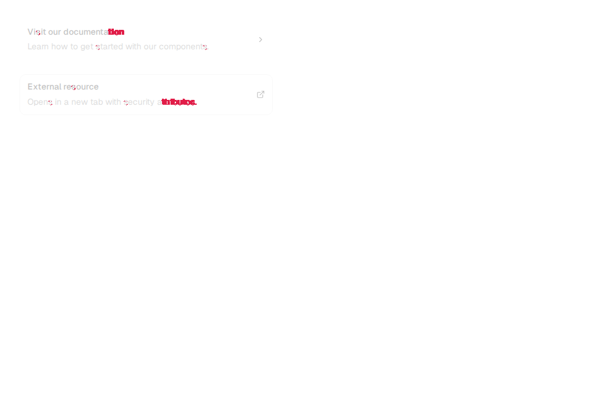
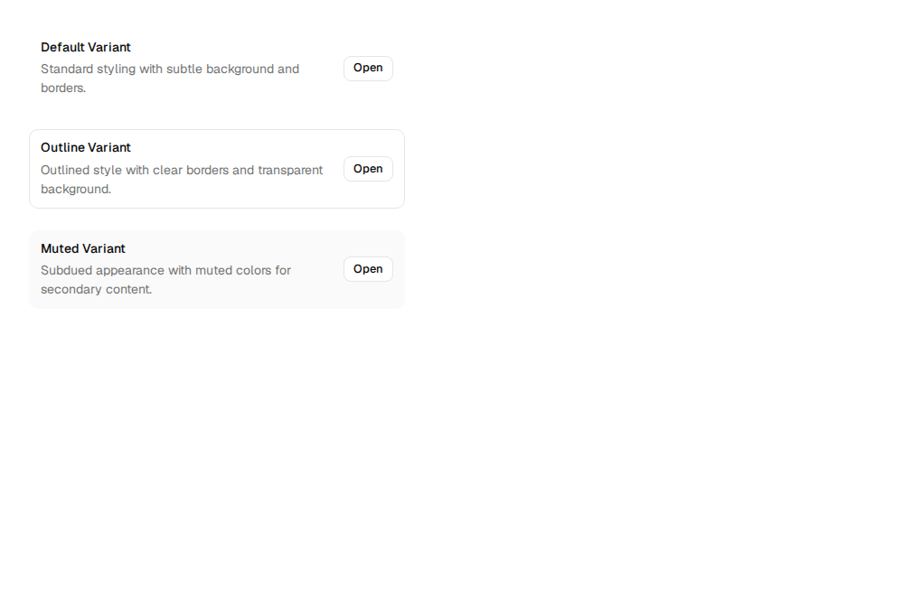

# item

[All checks](README.md)

## ✅ item › Group › should pass accessibility checks

## ✅ item › Default › should render basic item correctly

| Before | After | Difference |
| --- | --- | --- |
|  |  |  |

## ✅ item › Default › should render link item correctly

| Before | After | Difference |
| --- | --- | --- |
|  |  |  |

## ✅ item › Default › should pass accessibility checks

| Before | After | Difference |
| --- | --- | --- |
|  |  |  |

## ✅ item › Avatar › should render items with avatars

| Before | After | Difference |
| --- | --- | --- |
|  |  |  |

## ✅ item › Avatar › should pass accessibility checks

| Before | After | Difference |
| --- | --- | --- |
|  |  |  |

## ✅ item › Dropdown › should open dropdown and show items

## ✅ item › Dropdown › should pass accessibility checks

## ✅ item › Group › should render item group

## ✅ item › Header › should render items with headers

| Before | After | Difference |
| --- | --- | --- |
|  |  |  |

## ✅ item › Header › should pass accessibility checks

| Before | After | Difference |
| --- | --- | --- |
|  |  |  |

## ✅ item › Icon › should render item with icon media

## ✅ item › Icon › should pass accessibility checks

## ✅ item › Image › should render items with image media

| Before | After | Difference |
| --- | --- | --- |
|  |  |  |

## ✅ item › Link › should render link items

| Before | After | Difference |
| --- | --- | --- |
|  |  |  |

## ✅ item › Link › should pass accessibility checks

| Before | After | Difference |
| --- | --- | --- |
|  |  |  |

## ✅ item › Size › should render items

| Before | After | Difference |
| --- | --- | --- |
|  |  |  |

## ✅ item › Size › should pass accessibility checks

| Before | After | Difference |
| --- | --- | --- |
|  |  |  |

## ✅ item › Variants › should render different variants

| Before | After | Difference |
| --- | --- | --- |
|  |  |  |

## ✅ item › Variants › should pass accessibility checks

| Before | After | Difference |
| --- | --- | --- |
|  |  |  |
