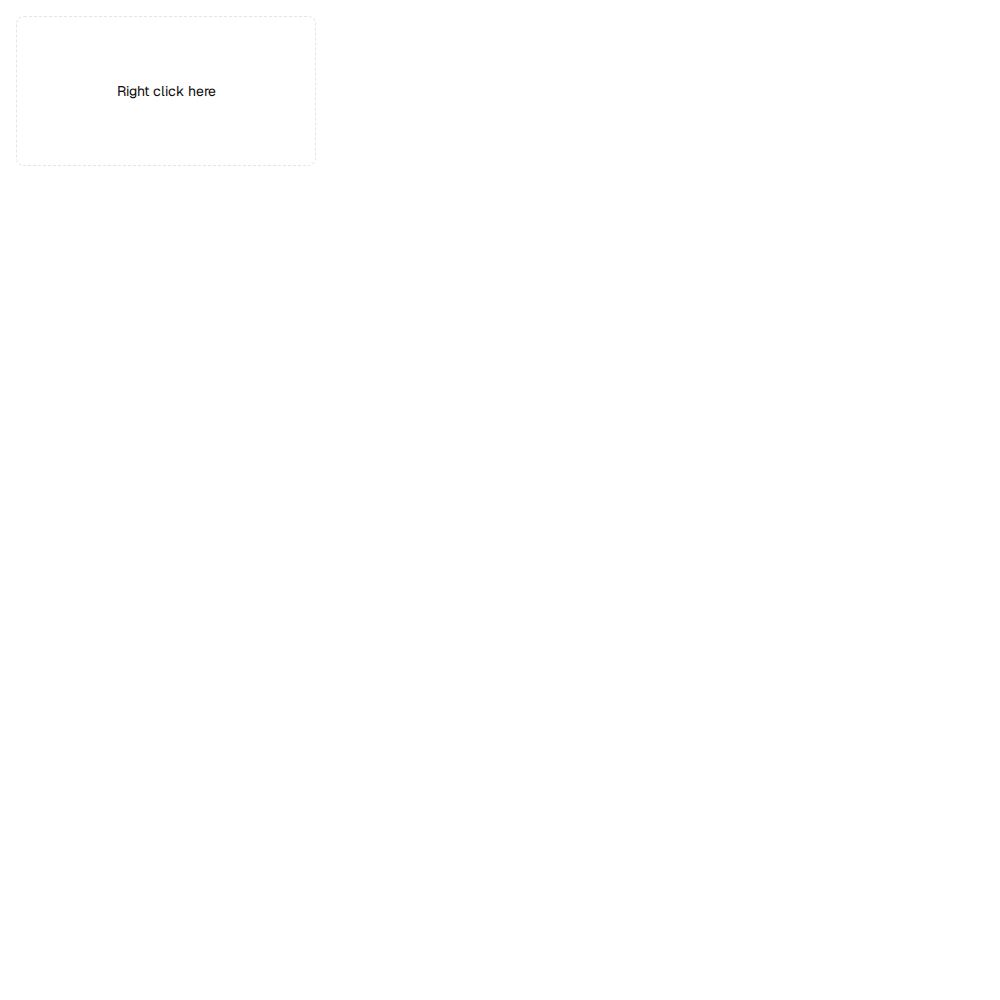
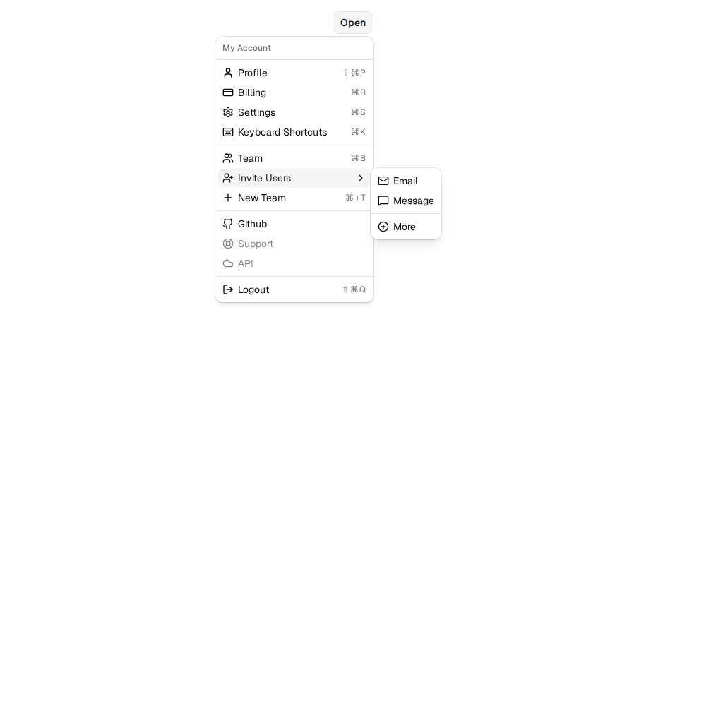
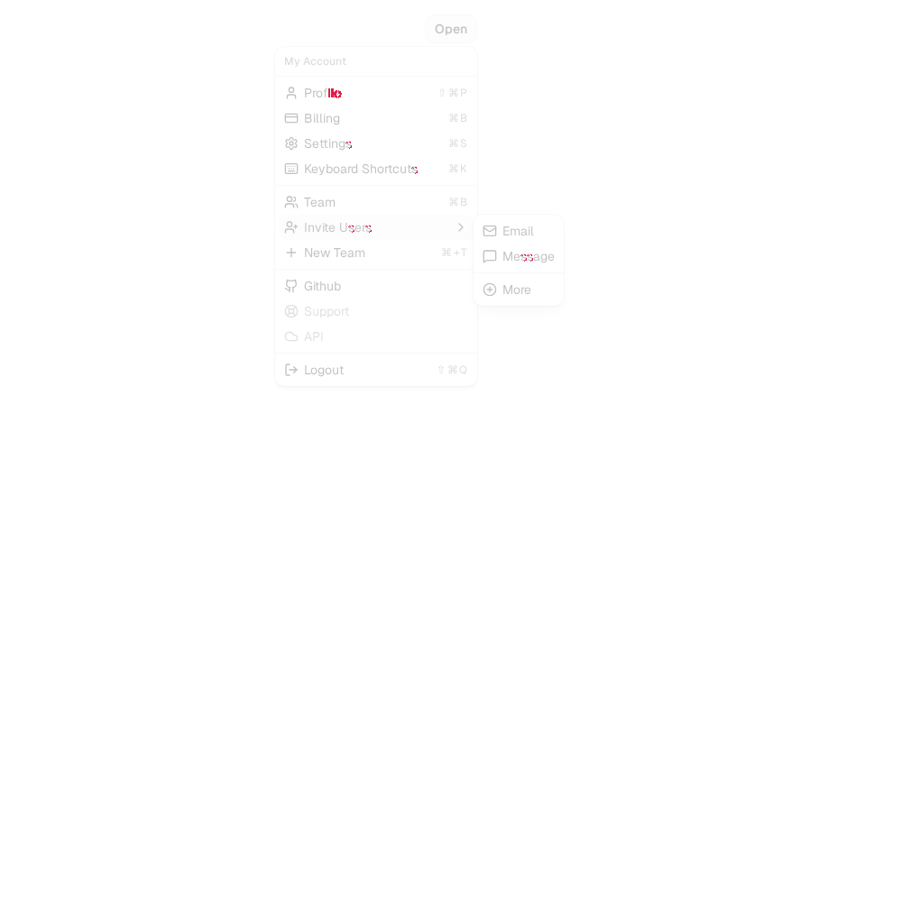
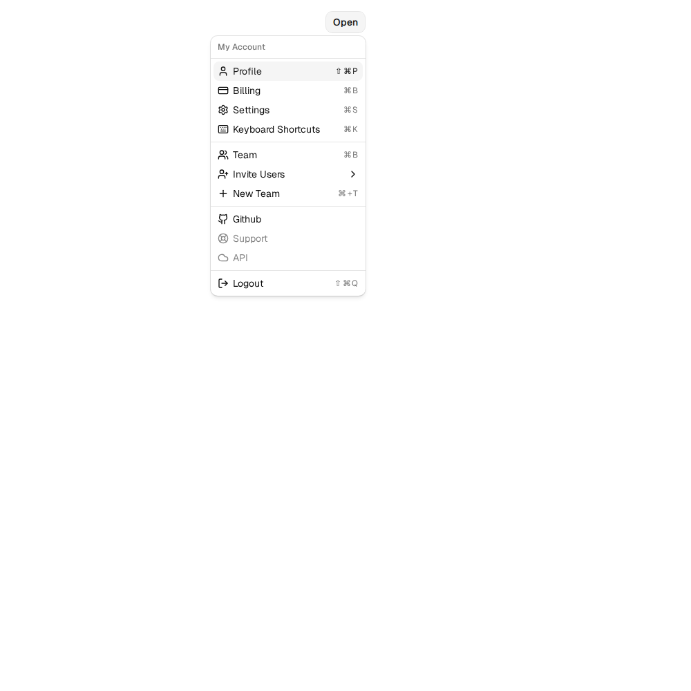
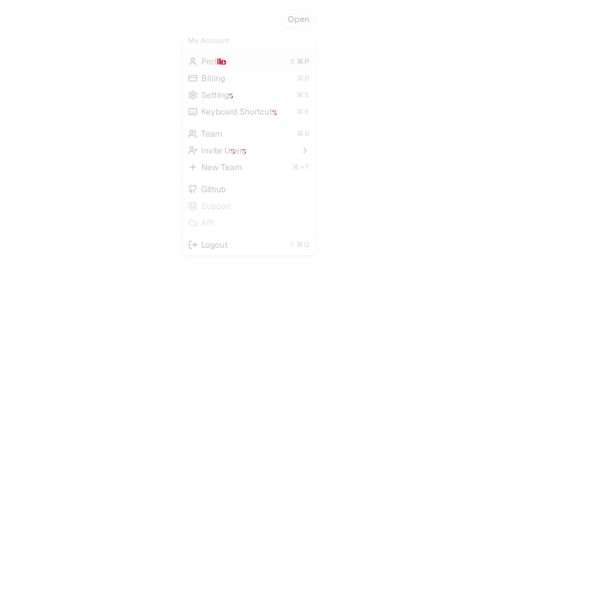
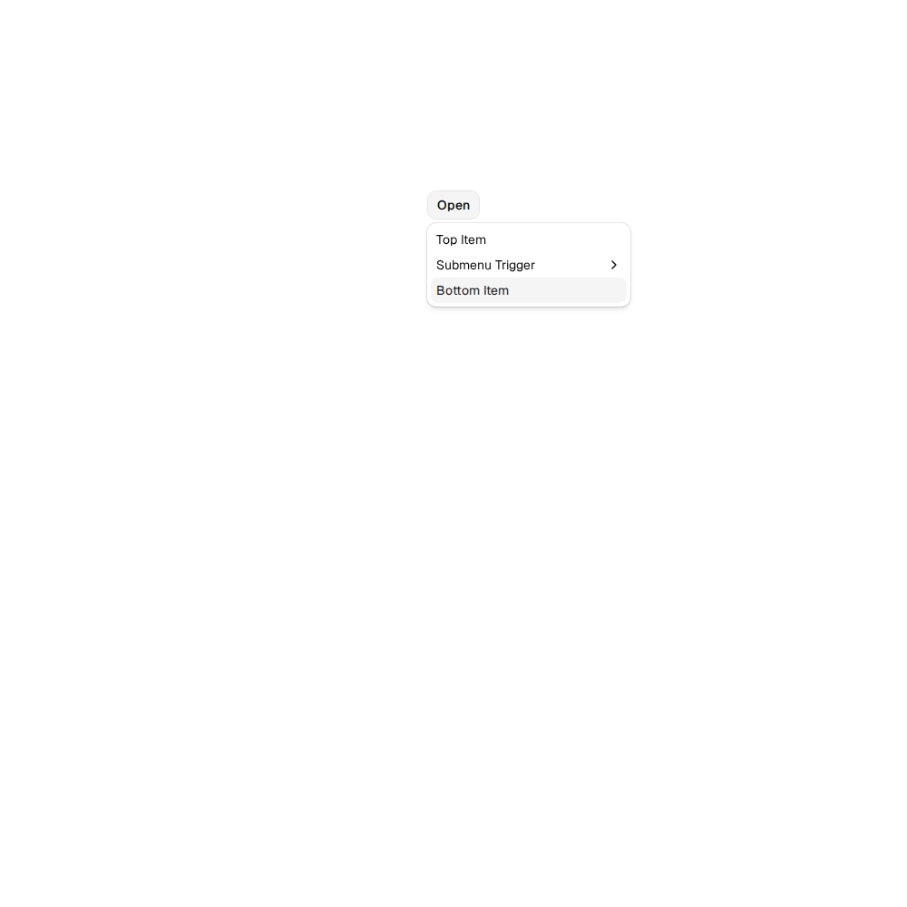
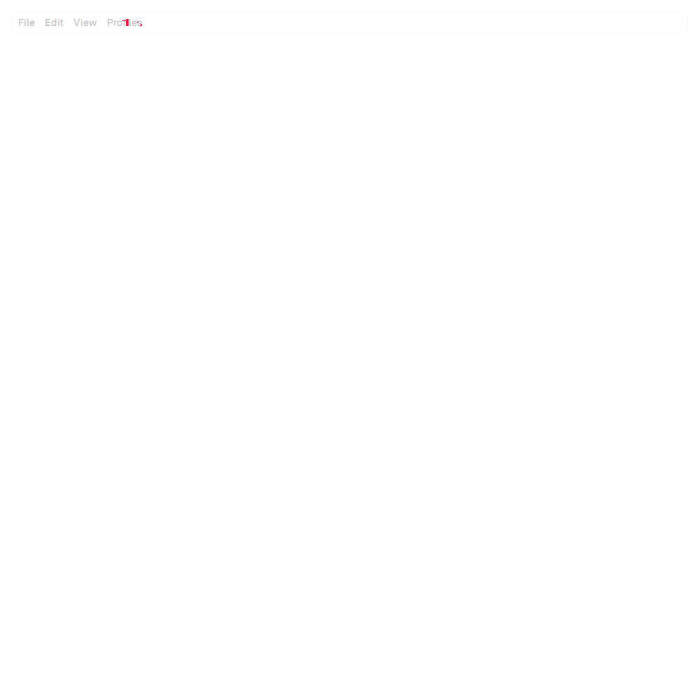

# menu

[All checks](README.md)

## ✅ context-menu › default › right click on area should open, hover over sub menu should open submenu, and click on open button again should close

## ✅ dropdown-menu data-side › derives data-side for the root menu and submenu from the resolved position

| Before | After | Difference |
| --- | --- | --- |
|  |  |  |

## ✅ dropdown-menu › default › down on open button should open, up and down should navigate, right over sub menu should open submenu, and left on sub should close it, and escape open should close dropdown completely

## ✅ dropdown-menu › default › click on open button should open, menu item GitHub that has [disabled]="false" should not be disabled. Support that has [disabled]="true" should be disabled

| Before | After | Difference |
| --- | --- | --- |
|  |  |  |

## ✅ dropdown-menu › default › click on open button should open, hover over sub menu should open submenu, and click on open button again should close

## ✅ dropdown-menu › submenu (issue #1333) › hovering from an open submenu to a sibling item closes only the submenu, not the dropdown

## ✅ dropdown-menu › submenu (issue #1333) › opening a submenu with the keyboard then moving the mouse keeps the dropdown open

## ✅ menubar › default › arrowdown on file should open menu and arrow left/right around should open/close appropriate menus

| Before | After | Difference |
| --- | --- | --- |
|  |  |  |

## ✅ menubar › default › click on file should open menu and hovering around should open/close appropriate menus

| Before | After | Difference |
| --- | --- | --- |
|  |  |  |
