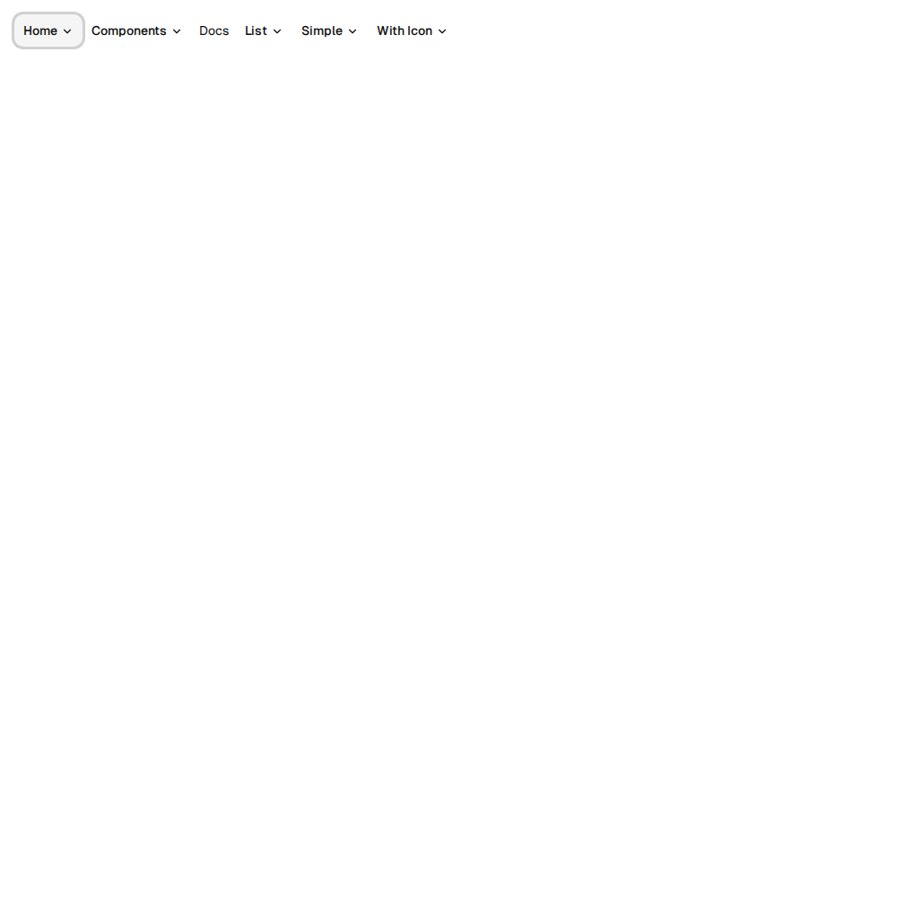
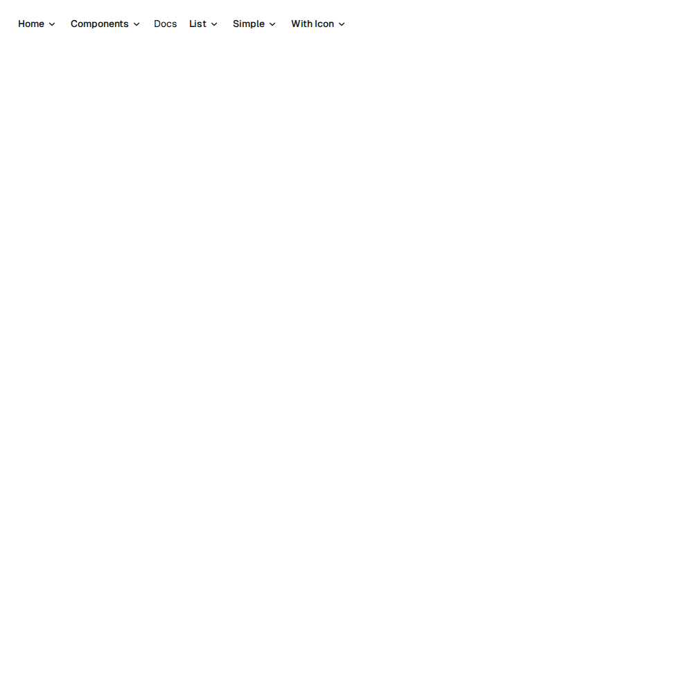

# navigation-menu

[All checks](README.md)

## ✅ navigation-menu › default (open on hover) › has no a11y violations and wires aria-expanded/controls only while open

## ✅ navigation-menu › default (open on hover) › enters the panel with ArrowDown

## ✅ navigation-menu › default (open on hover) › enters the panel when tabbing from the trigger

## ✅ navigation-menu › default (open on hover) › walks through the panel items with Tab / Shift+Tab

## ✅ navigation-menu › default (open on hover) › keeps focus in the menu when tabbing past the last item (issue #1484)

## ✅ navigation-menu › default (open on hover) › returns focus to the trigger on Shift+Tab from the first item

## ✅ navigation-menu › default (open on hover) › closes on Escape and restores focus to the trigger

## ✅ navigation-menu › default (open on hover) › renders a single chevron per trigger

## ✅ navigation-menu › click to open › opens on click and toggles closed on a second click

