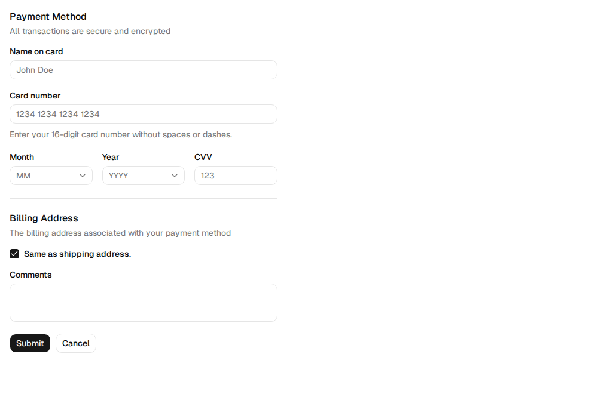
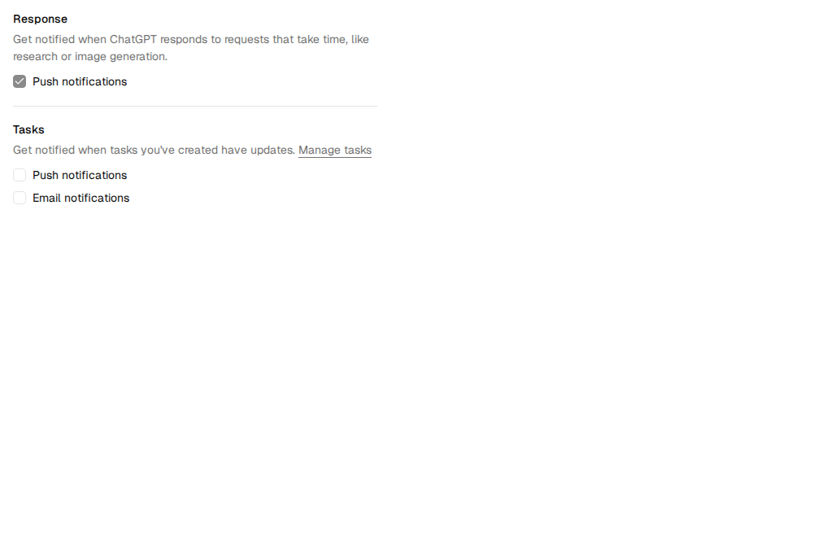

# Every page loads

[All checks](README.md)

## ✅ test pages render without errors › field--complex-form

## ✅ test pages render without errors › field--default

## ✅ test pages render without errors › field--field-group

## ✅ test pages render without errors › field--horizontal-orientation

## ✅ test pages render without errors › field--with-checkbox

## ✅ test pages render without errors › field--with-error

## ✅ test pages render without errors › field--with-field-content

## ✅ test pages render without errors › field--with-field-title

## ✅ test pages render without errors › field--with-input

## ✅ test pages render without errors › field--with-radio

## ✅ test pages render without errors › field--with-select

## ✅ test pages render without errors › field--with-switch

## ✅ test pages render without errors › field--with-textarea

## ✅ test pages render without errors › input-group--default

## ✅ test pages render without errors › select--custom-placeholder

## ✅ test pages render without errors › select--default

## ✅ test pages render without errors › select--disabled-option

## ✅ test pages render without errors › select--dynamic-options-multi-select

## ✅ test pages render without errors › select--falsy-value

## ✅ test pages render without errors › select--multiple

## ✅ test pages render without errors › select--ng-model-form-control

## ✅ test pages render without errors › select--ng-model-form-control-initial-value

## ✅ test pages render without errors › select--reactive-form-control

## ✅ test pages render without errors › select--reactive-form-control-with-for-and-initial-value

## ✅ test pages render without errors › select--reactive-form-control-with-for-and-initial-value-and-multiple

## ✅ test pages render without errors › select--reactive-form-control-with-validation

## ✅ test pages render without errors › select--reactive-form-control-with-validation-with-label

## ✅ test pages render without errors › select--scrollable

## ✅ test pages render without errors › select--select-item-to-string

## ✅ test pages render without errors › select--select-with-label

## ✅ test pages render without errors › select--with-hint-and-error

## ✅ test pages render without errors › select--with-label-and-form

## ✅ test pages render without errors › sidebar--default

- Accessibility: **landmark-main-is-top-level** (moderate), Main landmark should not be contained in another landmark. 1 elements.
- Accessibility: **landmark-no-duplicate-main** (moderate), Document should not have more than one main landmark. 1 elements.
- Accessibility: **list** (serious), <ul> and <ol> must only directly contain <li>, <script> or <template> elements. 1 elements.

## ✅ test pages render without errors › sidebar--right-side

- Accessibility: **landmark-main-is-top-level** (moderate), Main landmark should not be contained in another landmark. 1 elements.
- Accessibility: **landmark-no-duplicate-main** (moderate), Document should not have more than one main landmark. 1 elements.
- Accessibility: **list** (serious), <ul> and <ol> must only directly contain <li>, <script> or <template> elements. 1 elements.

## ✅ test pages render without errors › tooltip--default

## ✅ test pages render without errors › tooltip--disabled

## ✅ test pages render without errors › tooltip--simple

