# Every page loads

[All checks](README.md)

## ✅ test pages render without errors › accordion--accordion-with-input

## ✅ test pages render without errors › accordion--button-state-sync

## ✅ test pages render without errors › accordion--default

## ✅ test pages render without errors › accordion--multiple

## ✅ test pages render without errors › accordion--set-open-state

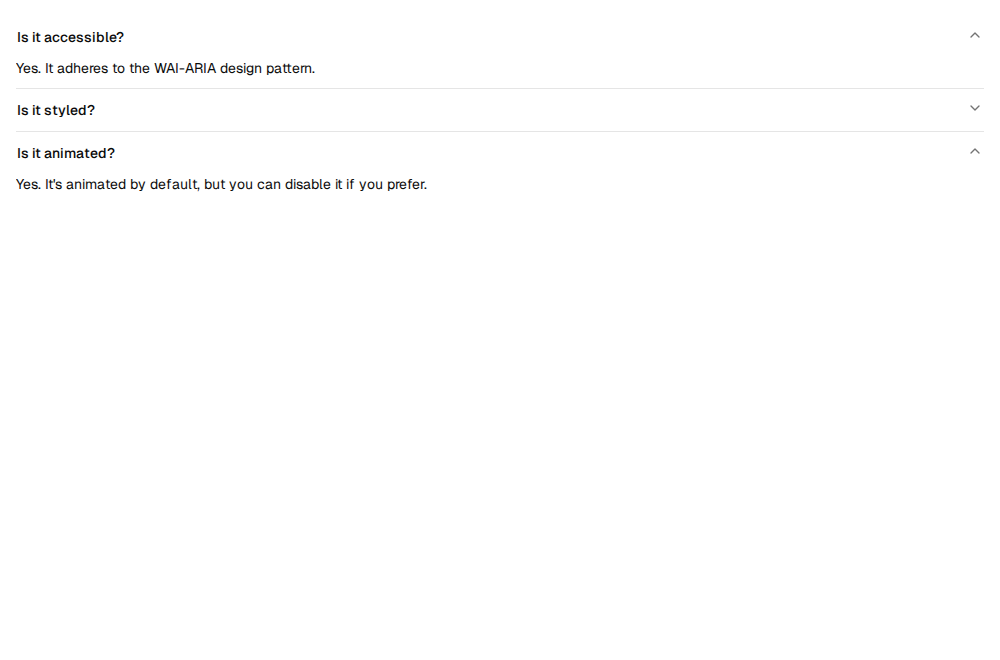

## ✅ test pages render without errors › accordion--test-aria-valid-with-icon

## ✅ test pages render without errors › accordion--two-accordions

## ✅ test pages render without errors › accordion--with-form-inputs

## ✅ test pages render without errors › accordion--with-tapable

## ✅ test pages render without errors › alert--default

## ✅ test pages render without errors › alert--destructive

## ✅ test pages render without errors › alert-dialog--default

## ✅ test pages render without errors › aspect-ratio--default

## ✅ test pages render without errors › attachment--default

## ✅ test pages render without errors › autocomplete--async

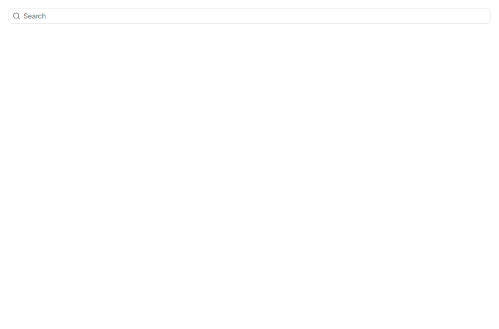

## ✅ test pages render without errors › autocomplete--config

## ✅ test pages render without errors › autocomplete--countries

## ✅ test pages render without errors › autocomplete--default

## ✅ test pages render without errors › autocomplete--form

## ✅ test pages render without errors › autocomplete--search-with-hint-and-error

## ✅ test pages render without errors › autocomplete--transform-option-value

- Accessibility: **button-name** (critical), Buttons must have discernible text. 1 elements.

## ✅ test pages render without errors › autocomplete--with-hint-and-error

## ✅ test pages render without errors › autocomplete--with-reactive-form

## ✅ test pages render without errors › avatar--default

- Accessibility: **color-contrast** (serious), Elements must meet minimum color contrast ratio thresholds. 1 elements.

## ✅ test pages render without errors › badge--default

## ✅ test pages render without errors › badge--destructive

- Accessibility: **color-contrast** (serious), Elements must meet minimum color contrast ratio thresholds. 1 elements.

## ✅ test pages render without errors › badge--outline

## ✅ test pages render without errors › badge--secondary

## ✅ test pages render without errors › breadcrumb--custom

## ✅ test pages render without errors › breadcrumb--default

## ✅ test pages render without errors › bubble--demo

## ✅ test pages render without errors › bubble--variants

- Accessibility: **color-contrast** (serious), Elements must meet minimum color contrast ratio thresholds. 1 elements.

## ✅ test pages render without errors › button--default

## ✅ test pages render without errors › button--destructive

- Accessibility: **color-contrast** (serious), Elements must meet minimum color contrast ratio thresholds. 1 elements.

## ✅ test pages render without errors › button--ghost

## ✅ test pages render without errors › button--link

## ✅ test pages render without errors › button--outline

## ✅ test pages render without errors › button--secondary

## ✅ test pages render without errors › button-group--default

## ✅ test pages render without errors › button-group--nested

## ✅ test pages render without errors › button-group--split

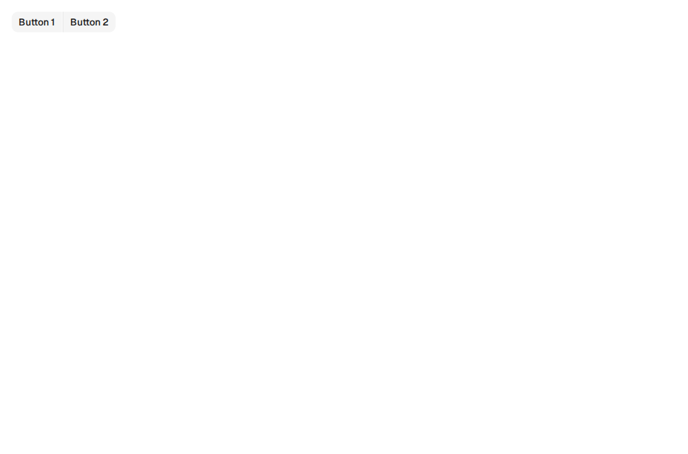

## ✅ test pages render without errors › button-group--with-text

## ✅ test pages render without errors › calendar--default

- Accessibility: **color-contrast** (serious), Elements must meet minimum color contrast ratio thresholds. 6 elements.

## ✅ test pages render without errors › card--default

## ✅ test pages render without errors › card--transposed

## ✅ test pages render without errors › carousel--default

## ✅ test pages render without errors › carousel--orientation

## ✅ test pages render without errors › carousel--plugins

## ✅ test pages render without errors › carousel--sizes

## ✅ test pages render without errors › carousel--spacing

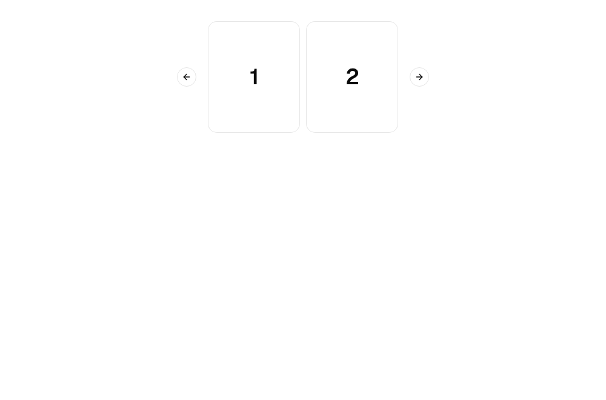

## ✅ test pages render without errors › checkbox--default

## ✅ test pages render without errors › checkbox--disabled

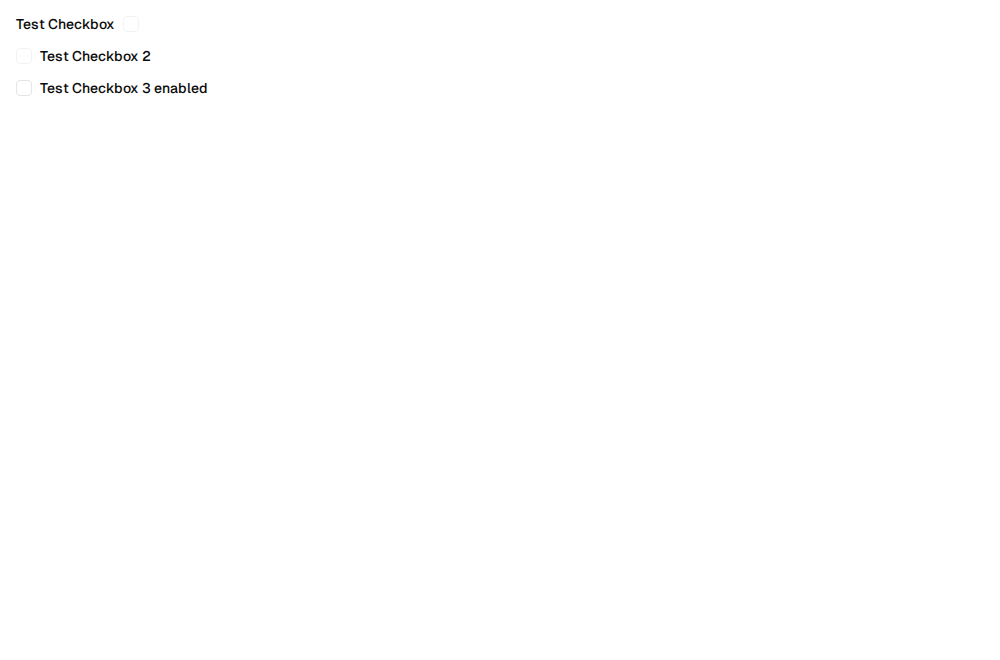

## ✅ test pages render without errors › checkbox--disabled-with-forms

## ✅ test pages render without errors › checkbox--indeterminate

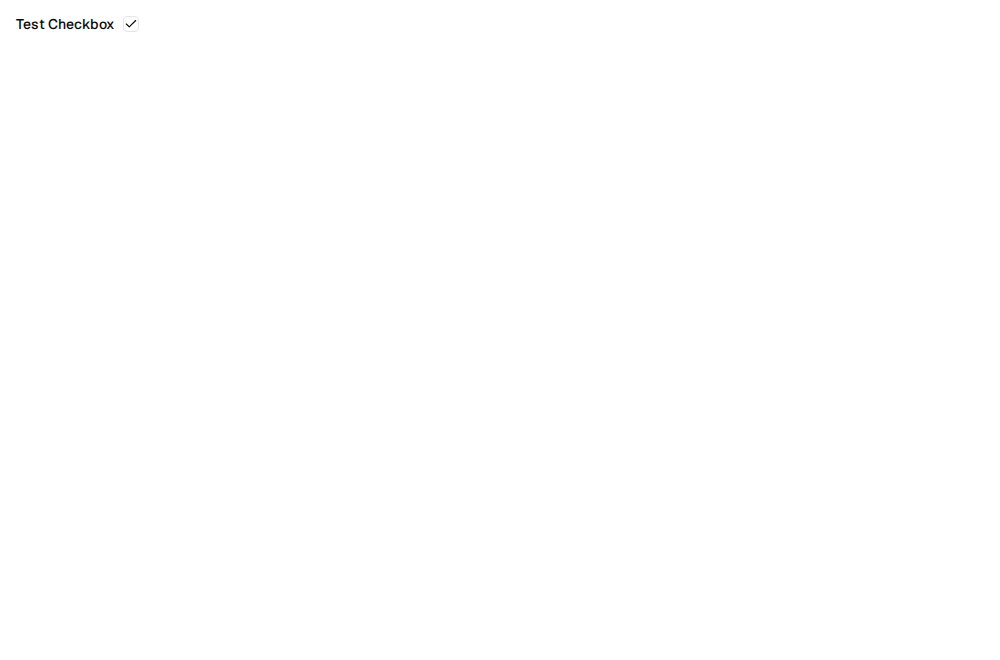

## ✅ test pages render without errors › checkbox--inside-label

## ✅ test pages render without errors › checkbox--labeled-with-aria-labeled-by

## ✅ test pages render without errors › checkbox--with-hint-and-error

## ✅ test pages render without errors › code-block--actions

## ✅ test pages render without errors › code-block--basic

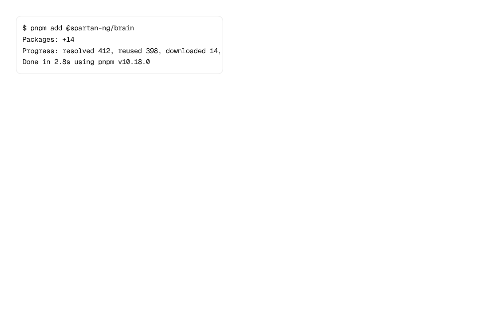

## ✅ test pages render without errors › code-block--default

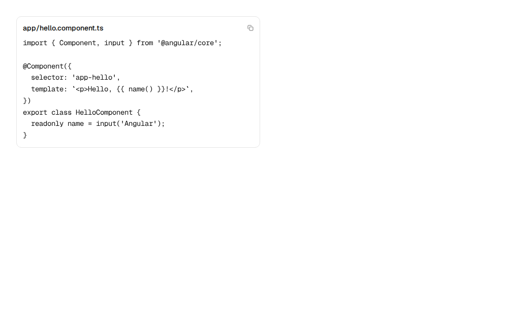

## ✅ test pages render without errors › code-block--destructive

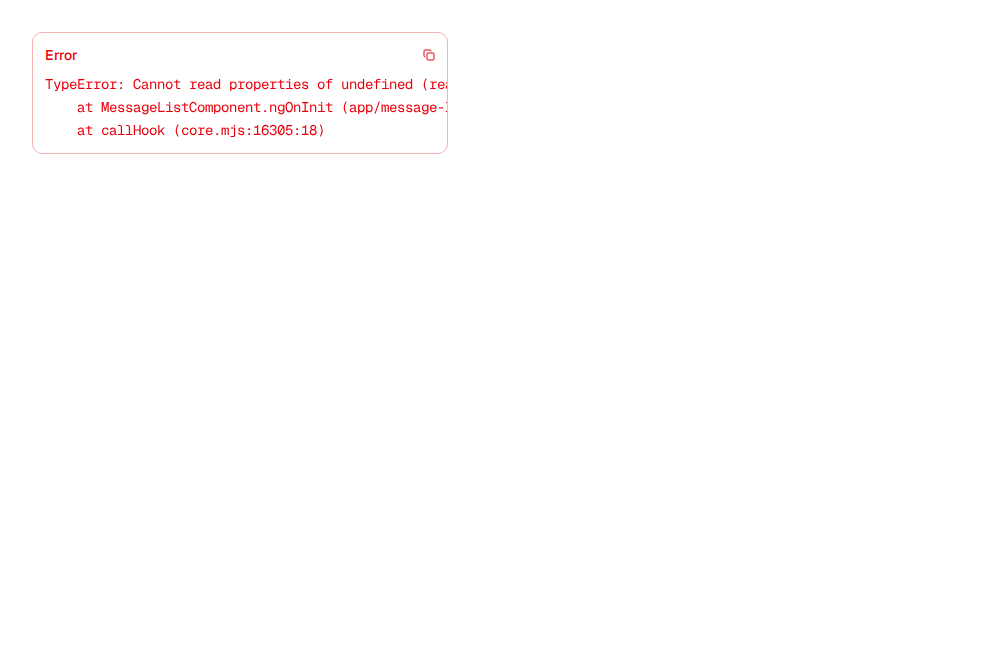

## ✅ test pages render without errors › code-block--diff

## ✅ test pages render without errors › code-block--header

## ✅ test pages render without errors › code-block--highlighted-lines

## ✅ test pages render without errors › code-block--line-numbers

## ✅ test pages render without errors › code-block--size

## ✅ test pages render without errors › collapsible--default

## ✅ test pages render without errors › combobox--default

## ✅ test pages render without errors › combobox--multiple-with-hint-and-error

## ✅ test pages render without errors › combobox--popup

## ✅ test pages render without errors › combobox--popup-with-hint-and-error

## ✅ test pages render without errors › combobox--with-hint-and-error

## ✅ test pages render without errors › combobox--with-reactive-form

## ✅ test pages render without errors › command--bound-value

## ✅ test pages render without errors › command--default

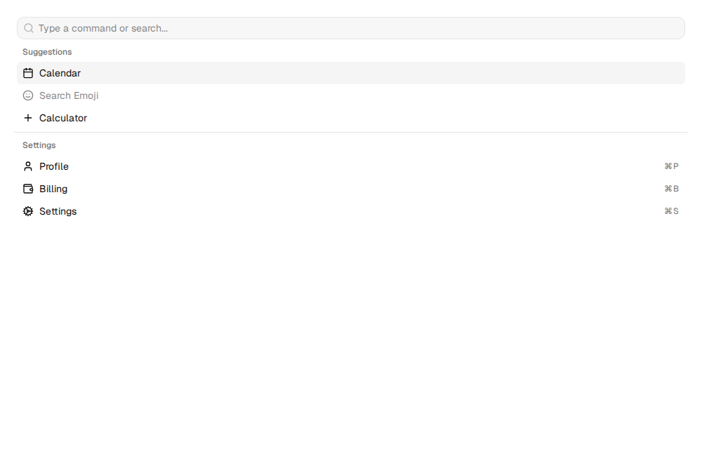

## ✅ test pages render without errors › command--dialog

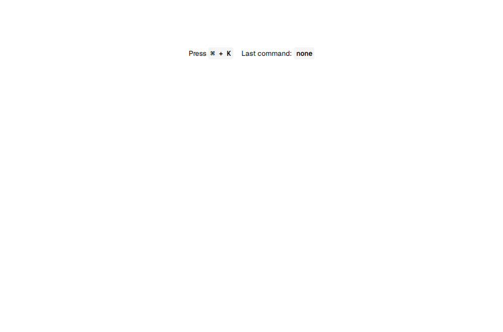

## ✅ test pages render without errors › command--dynamic-options

## ✅ test pages render without errors › command--reactive-form

## ✅ test pages render without errors › context-menu--default

## ✅ test pages render without errors › date-picker--default

## ✅ test pages render without errors › date-picker--input

## ✅ test pages render without errors › date-picker--preselected-end-of-month

## ✅ test pages render without errors › date-picker--preselected-with-min-date

## ✅ test pages render without errors › date-picker--with-hint-and-error

## ✅ test pages render without errors › date-picker-jalali-persian--default

## ✅ test pages render without errors › date-picker-multi--default

## ✅ test pages render without errors › date-picker-multi--input

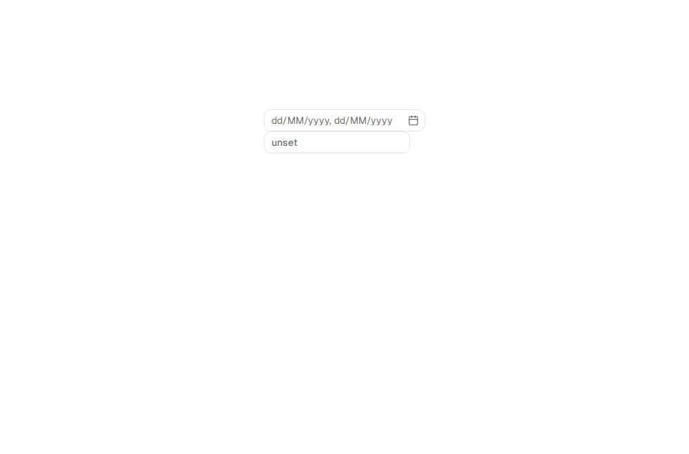

## ✅ test pages render without errors › date-picker-multi--with-hint-and-error

## ✅ test pages render without errors › date-range-picker--default

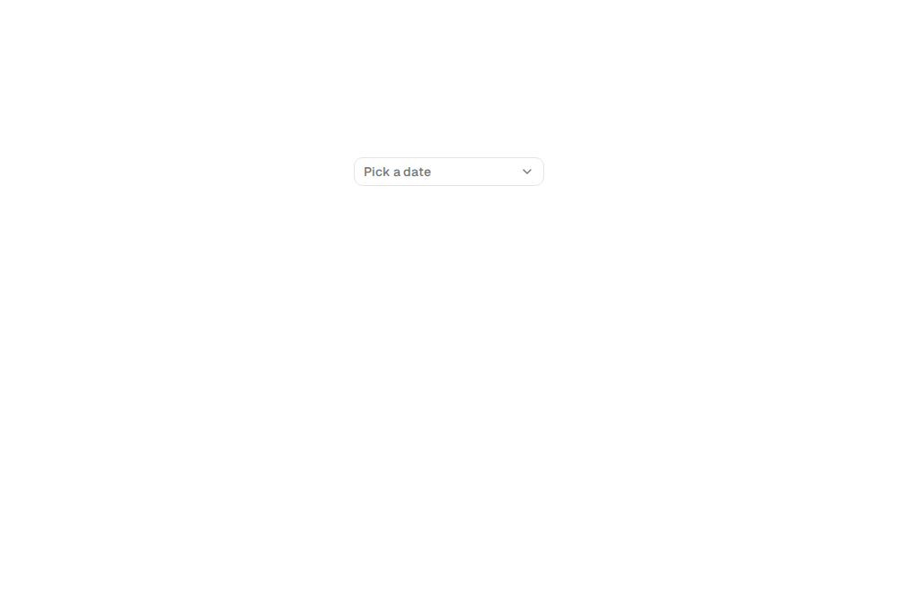

## ✅ test pages render without errors › date-range-picker--input

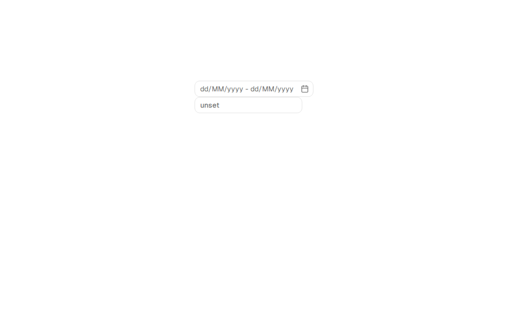

## ✅ test pages render without errors › date-range-picker--with-hint-and-error

## ✅ test pages render without errors › dialog--context-menu

## ✅ test pages render without errors › dialog--default

## ✅ test pages render without errors › dialog--dynamic-component

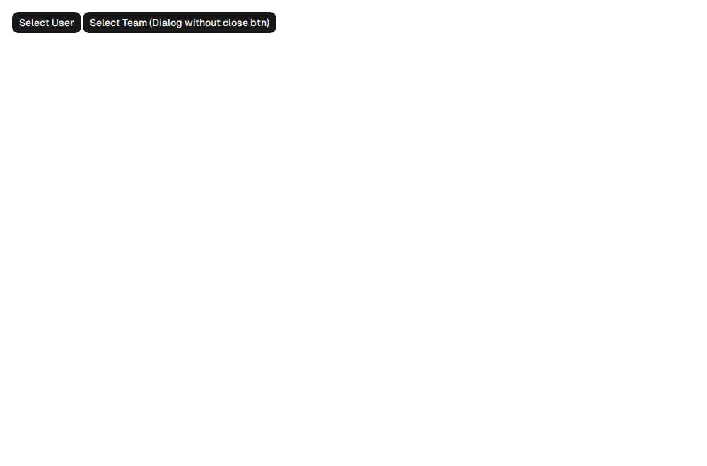

## ✅ test pages render without errors › dialog--dynamic-component-with-default-options

## ✅ test pages render without errors › dialog--nested-dialog

## ✅ test pages render without errors › dialog--nested-dynamic-component

## ✅ test pages render without errors › dropdown-menu--default

## ✅ test pages render without errors › dropdown-menu--stateful

## ✅ test pages render without errors › dropdown-menu--submenu

## ✅ test pages render without errors › empty--custom-layout

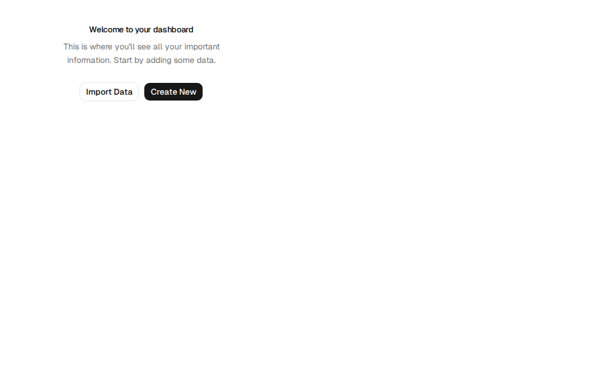

## ✅ test pages render without errors › empty--default

## ✅ test pages render without errors › empty--file-not-found

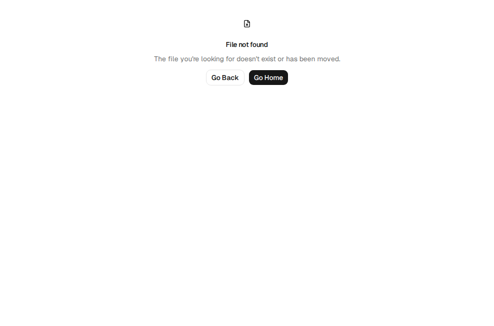

## ✅ test pages render without errors › empty--minimal-text

## ✅ test pages render without errors › empty--no-connection

## ✅ test pages render without errors › empty--search-results

## ✅ test pages render without errors › empty--with-action

## ✅ test pages render without errors › field--complex-form

- Accessibility: **button-name** (critical), Buttons must have discernible text. 2 elements.

## ✅ test pages render without errors › field--default

## ✅ test pages render without errors › field--field-group

## ✅ test pages render without errors › field--horizontal-orientation

## ✅ test pages render without errors › field--with-checkbox

## ✅ test pages render without errors › field--with-error

## ✅ test pages render without errors › field--with-field-content

## ✅ test pages render without errors › field--with-field-title

## ✅ test pages render without errors › field--with-input

## ✅ test pages render without errors › field--with-radio

## ✅ test pages render without errors › field--with-select

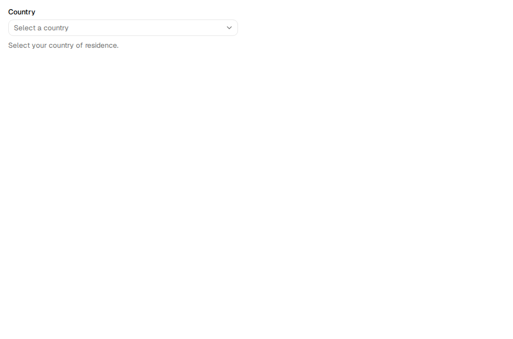

## ✅ test pages render without errors › field--with-switch

## ✅ test pages render without errors › field--with-textarea

## ✅ test pages render without errors › hover-card--default

## ✅ test pages render without errors › input--default

## ✅ test pages render without errors › input--disabled

## ✅ test pages render without errors › input--error

## ✅ test pages render without errors › input--file

## ✅ test pages render without errors › input--required

## ✅ test pages render without errors › input--with-button

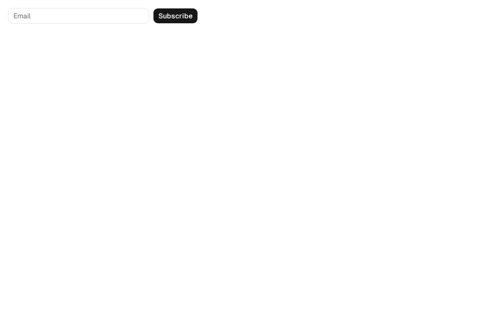

## ✅ test pages render without errors › input--with-hint-and-error

## ✅ test pages render without errors › input-group--default

- Accessibility: **button-name** (critical), Buttons must have discernible text. 2 elements.

## ✅ test pages render without errors › input-otp--default

- Accessibility: **label** (critical), Form elements must have labels. 1 elements.

## ✅ test pages render without errors › input-otp--masked

- Accessibility: **label** (critical), Form elements must have labels. 1 elements.

## ✅ test pages render without errors › item--avatar

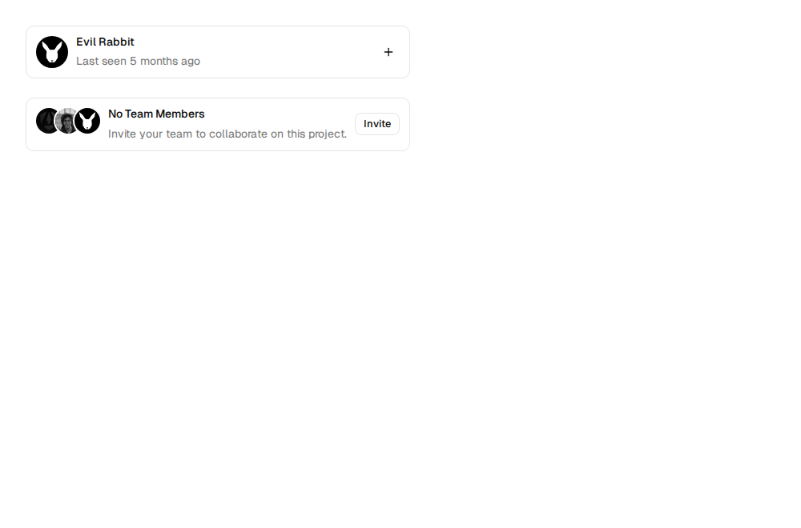

## ✅ test pages render without errors › item--default

## ✅ test pages render without errors › item--dropdown

## ✅ test pages render without errors › item--group

## ✅ test pages render without errors › item--header

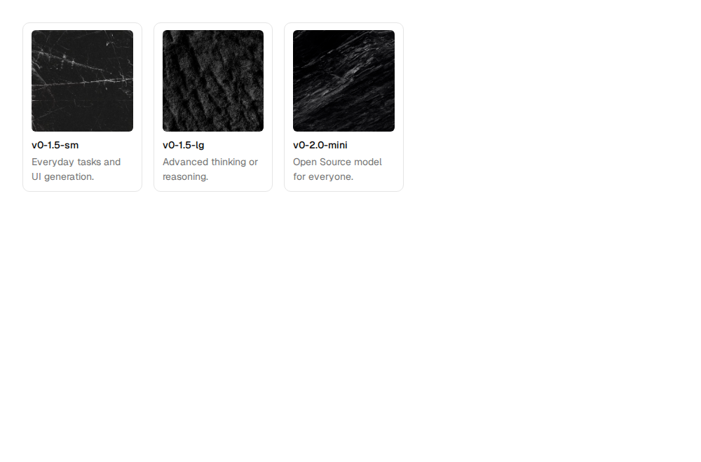

## ✅ test pages render without errors › item--icon

## ✅ test pages render without errors › item--image

- Accessibility: **aria-allowed-role** (minor), ARIA role should be appropriate for the element. 3 elements.

## ✅ test pages render without errors › item--link

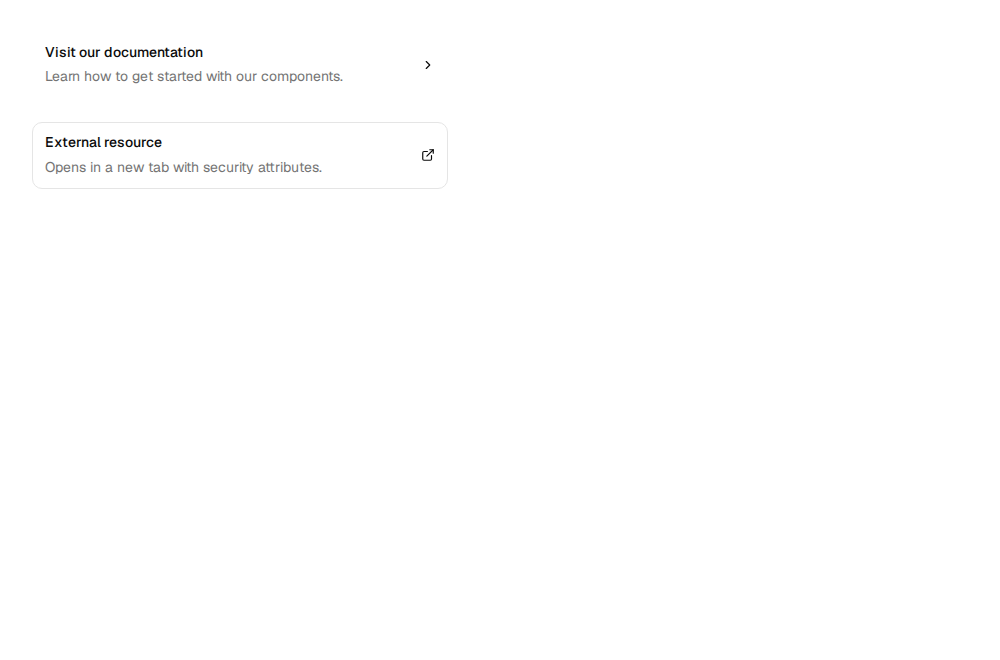

## ✅ test pages render without errors › item--size

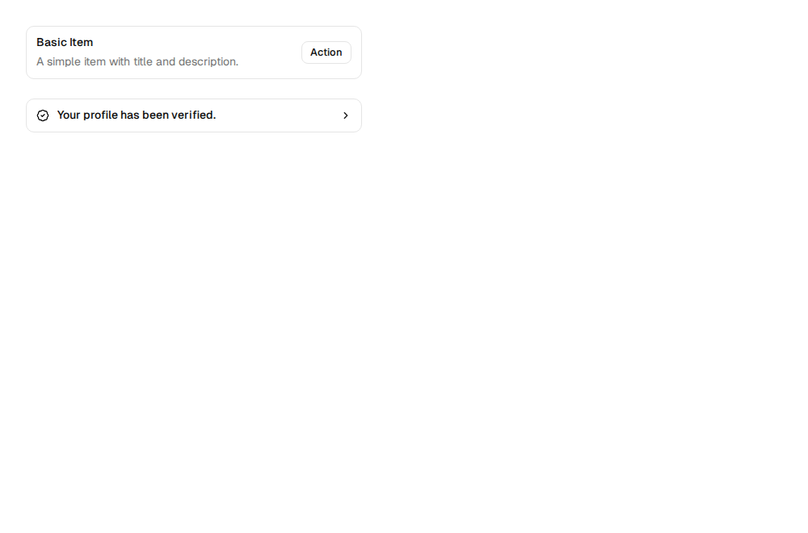

## ✅ test pages render without errors › item--variants

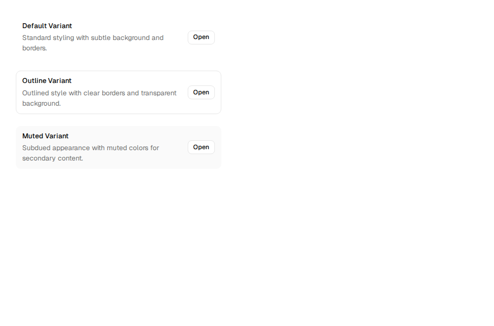

## ✅ test pages render without errors › kbd--default

- Accessibility: **color-contrast** (serious), Elements must meet minimum color contrast ratio thresholds. 1 elements.

## ✅ test pages render without errors › label--custom-id

## ✅ test pages render without errors › label--default

## ✅ test pages render without errors › label--input-required

## ✅ test pages render without errors › marker--default

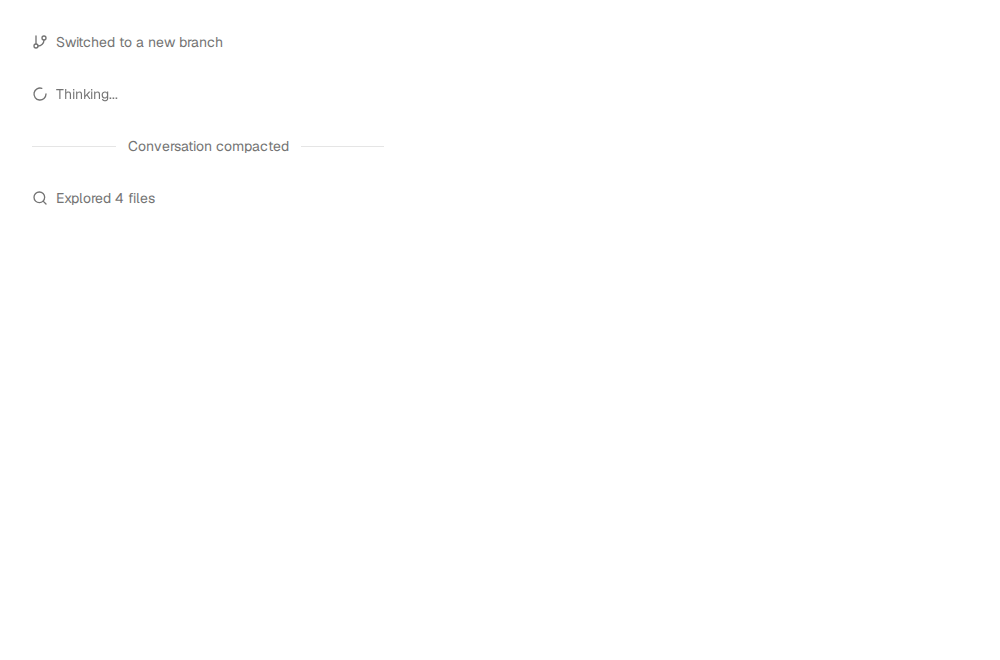

## ✅ test pages render without errors › menubar--default

## ✅ test pages render without errors › message--conversation

- Accessibility: **color-contrast** (serious), Elements must meet minimum color contrast ratio thresholds. 2 elements.

## ✅ test pages render without errors › message-scroller--auto-scroll

## ✅ test pages render without errors › message-scroller--default

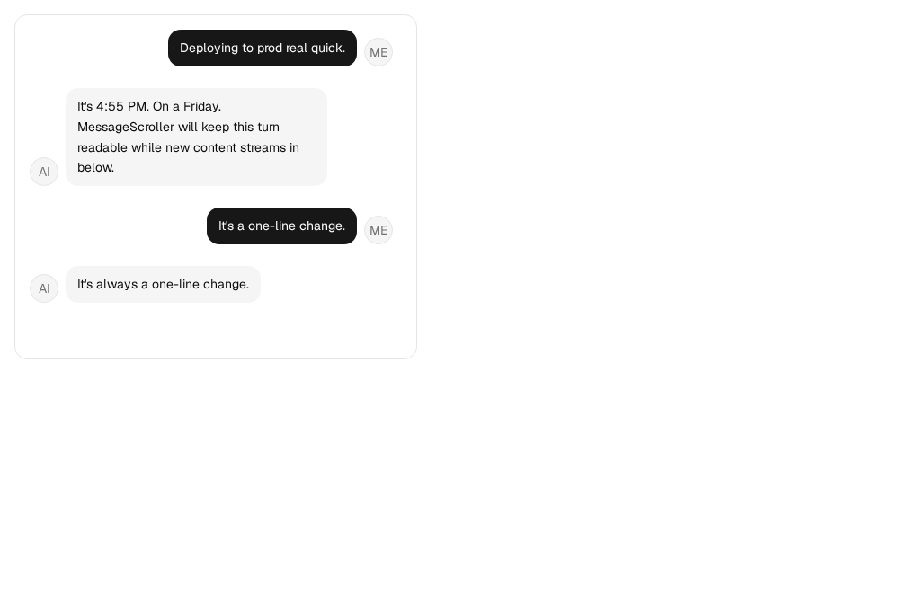

## ✅ test pages render without errors › message-scroller--opening-start

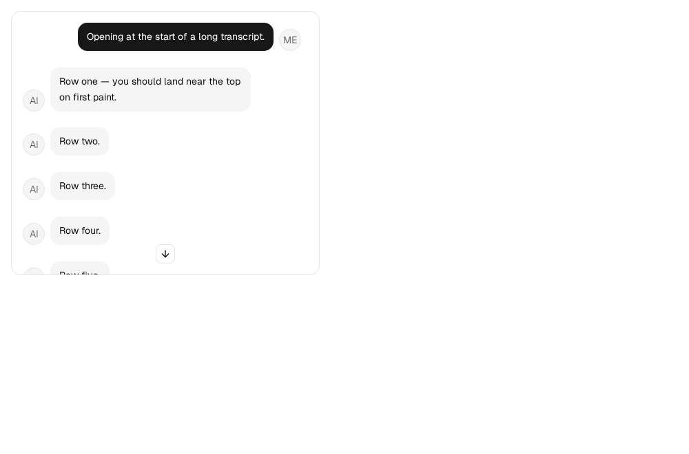

## ✅ test pages render without errors › message-scroller--scroll-anchors

## ✅ test pages render without errors › month-year-picker--default

## ✅ test pages render without errors › month-year-picker--input

## ✅ test pages render without errors › native-select--default

- Accessibility: **select-name** (critical), Select element must have an accessible name. 1 elements.

## ✅ test pages render without errors › native-select--with-hint-and-error

## ✅ test pages render without errors › navigation-menu--click-to-open

## ✅ test pages render without errors › navigation-menu--default

## ✅ test pages render without errors › pagination--default

## ✅ test pages render without errors › popover--close-on-scroll

## ✅ test pages render without errors › popover--default

## ✅ test pages render without errors › popover--near-viewport-edge

## ✅ test pages render without errors › popover--scroll-container

## ✅ test pages render without errors › progress--complete

## ✅ test pages render without errors › progress--indeterminate

## ✅ test pages render without errors › progress--loading-not-started

## ✅ test pages render without errors › progress--loading-started

## ✅ test pages render without errors › questionnaire--default

## ✅ test pages render without errors › questionnaire--freeform

## ✅ test pages render without errors › questionnaire--multiple

## ✅ test pages render without errors › radio-group--default

## ✅ test pages render without errors › radio-group--label-for

## ✅ test pages render without errors › radio-group--validation

- Accessibility: **label** (critical), Form elements must have labels. 3 elements.

## ✅ test pages render without errors › radio-group--with-hint-and-error

- Accessibility: **label** (critical), Form elements must have labels. 3 elements.

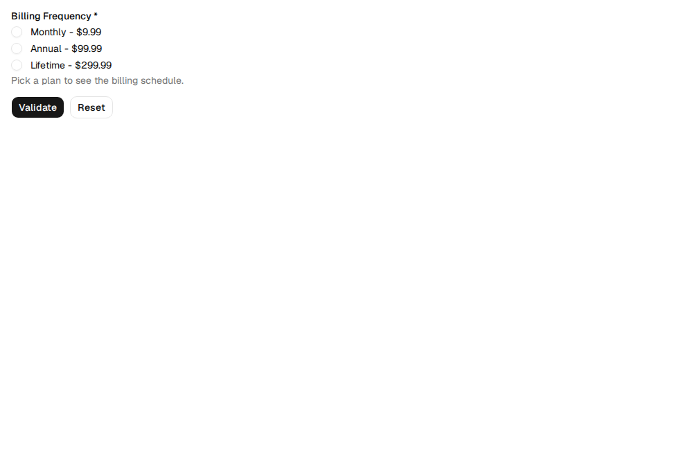

## ✅ test pages render without errors › resizable--default

- Accessibility: **aria-required-attr** (critical), Required ARIA attributes must be provided. 2 elements.

## ✅ test pages render without errors › resizable--dynamic-panels

- Accessibility: **aria-required-attr** (critical), Required ARIA attributes must be provided. 1 elements.

## ✅ test pages render without errors › scroll-area--default

- Accessibility: **scrollable-region-focusable** (serious), Scrollable region must have keyboard access. 1 elements.

## ✅ test pages render without errors › scroll-area--vertical

- Accessibility: **scrollable-region-focusable** (serious), Scrollable region must have keyboard access. 1 elements.

## ✅ test pages render without errors › select--custom-placeholder

- Accessibility: **button-name** (critical), Buttons must have discernible text. 1 elements.

## ✅ test pages render without errors › select--default

- Accessibility: **button-name** (critical), Buttons must have discernible text. 1 elements.

## ✅ test pages render without errors › select--disabled-option

- Accessibility: **button-name** (critical), Buttons must have discernible text. 1 elements.

## ✅ test pages render without errors › select--dynamic-options-multi-select

- Accessibility: **button-name** (critical), Buttons must have discernible text. 1 elements.

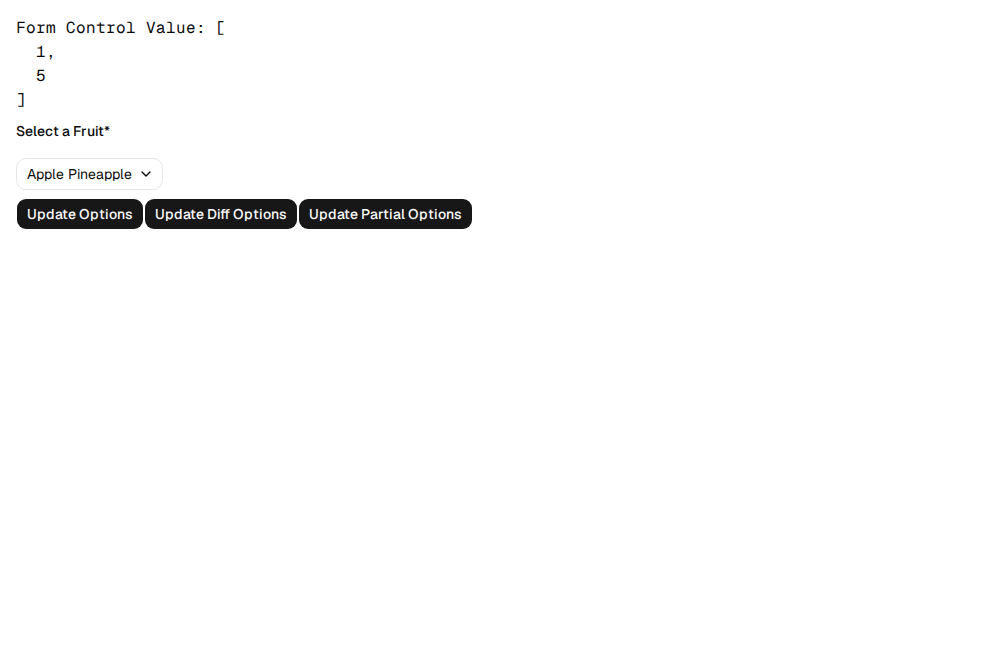

## ✅ test pages render without errors › select--falsy-value

- Accessibility: **button-name** (critical), Buttons must have discernible text. 1 elements.

## ✅ test pages render without errors › select--multiple

- Accessibility: **button-name** (critical), Buttons must have discernible text. 1 elements.

## ✅ test pages render without errors › select--ng-model-form-control

- Accessibility: **button-name** (critical), Buttons must have discernible text. 1 elements.

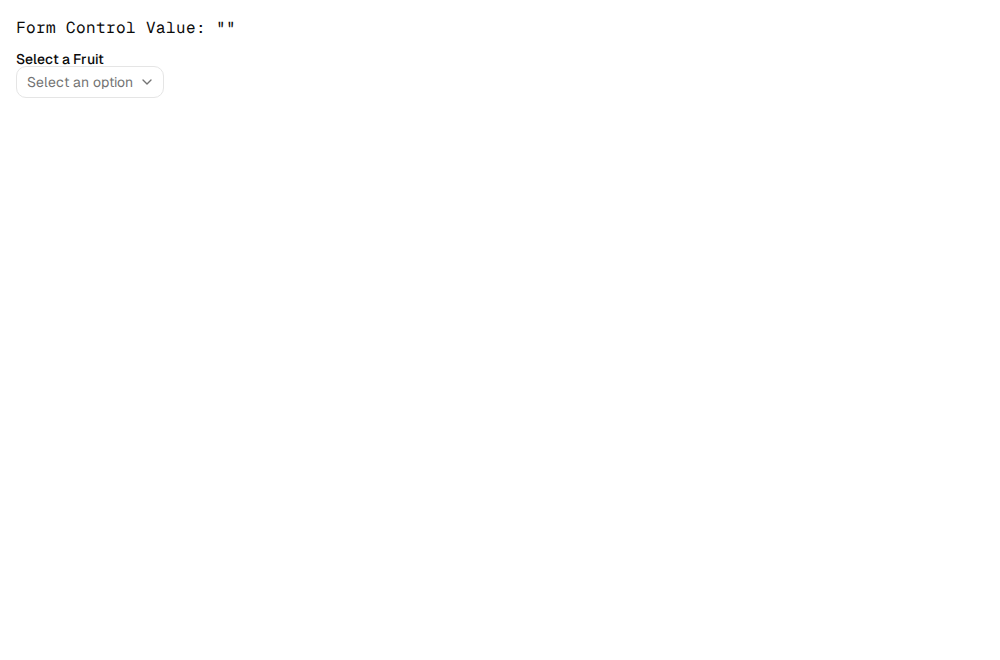

## ✅ test pages render without errors › select--ng-model-form-control-initial-value

- Accessibility: **button-name** (critical), Buttons must have discernible text. 1 elements.

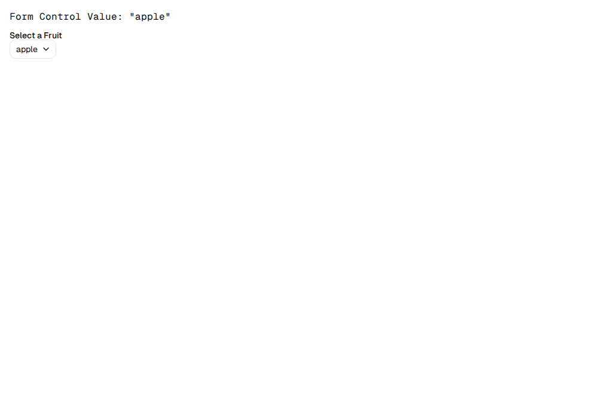

## ✅ test pages render without errors › select--reactive-form-control

- Accessibility: **button-name** (critical), Buttons must have discernible text. 1 elements.

## ✅ test pages render without errors › select--reactive-form-control-with-for-and-initial-value

- Accessibility: **button-name** (critical), Buttons must have discernible text. 1 elements.

## ✅ test pages render without errors › select--reactive-form-control-with-for-and-initial-value-and-multiple

- Accessibility: **button-name** (critical), Buttons must have discernible text. 1 elements.

## ✅ test pages render without errors › select--reactive-form-control-with-validation

- Accessibility: **button-name** (critical), Buttons must have discernible text. 1 elements.

## ✅ test pages render without errors › select--reactive-form-control-with-validation-with-label

- Accessibility: **button-name** (critical), Buttons must have discernible text. 1 elements.

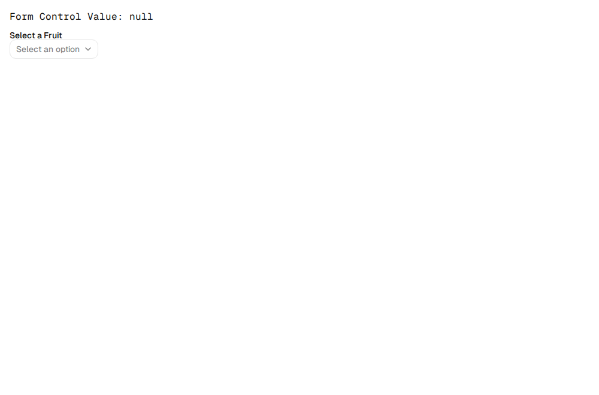

## ✅ test pages render without errors › select--scrollable

- Accessibility: **button-name** (critical), Buttons must have discernible text. 1 elements.

## ✅ test pages render without errors › select--select-item-to-string

- Accessibility: **button-name** (critical), Buttons must have discernible text. 1 elements.

## ✅ test pages render without errors › select--select-with-label

## ✅ test pages render without errors › select--with-hint-and-error

## ✅ test pages render without errors › select--with-label-and-form

- Accessibility: **button-name** (critical), Buttons must have discernible text. 1 elements.

## ✅ test pages render without errors › separator--default

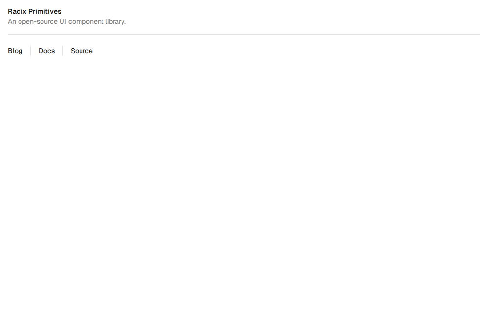

## ✅ test pages render without errors › sheet--default

## ✅ test pages render without errors › sidebar--default

- Accessibility: **button-name** (critical), Buttons must have discernible text. 2 elements.
- Accessibility: **landmark-main-is-top-level** (moderate), Main landmark should not be contained in another landmark. 1 elements.
- Accessibility: **landmark-no-duplicate-main** (moderate), Document should not have more than one main landmark. 1 elements.
- Accessibility: **list** (serious), <ul> and <ol> must only directly contain <li>, <script> or <template> elements. 1 elements.

## ✅ test pages render without errors › sidebar--right-side

- Accessibility: **button-name** (critical), Buttons must have discernible text. 2 elements.
- Accessibility: **landmark-main-is-top-level** (moderate), Main landmark should not be contained in another landmark. 1 elements.
- Accessibility: **landmark-no-duplicate-main** (moderate), Document should not have more than one main landmark. 1 elements.
- Accessibility: **list** (serious), <ul> and <ol> must only directly contain <li>, <script> or <template> elements. 1 elements.

## ✅ test pages render without errors › skeleton--default

## ✅ test pages render without errors › slider--default

## ✅ test pages render without errors › slider--disabled

## ✅ test pages render without errors › slider--draggable-range

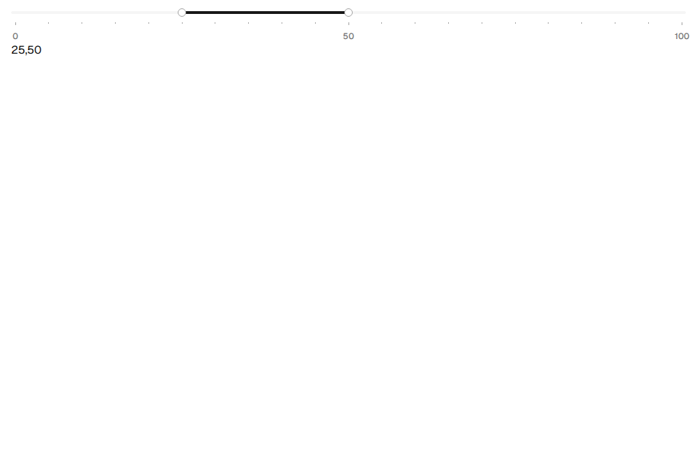

## ✅ test pages render without errors › slider--draggable-range-only

## ✅ test pages render without errors › slider--inverted

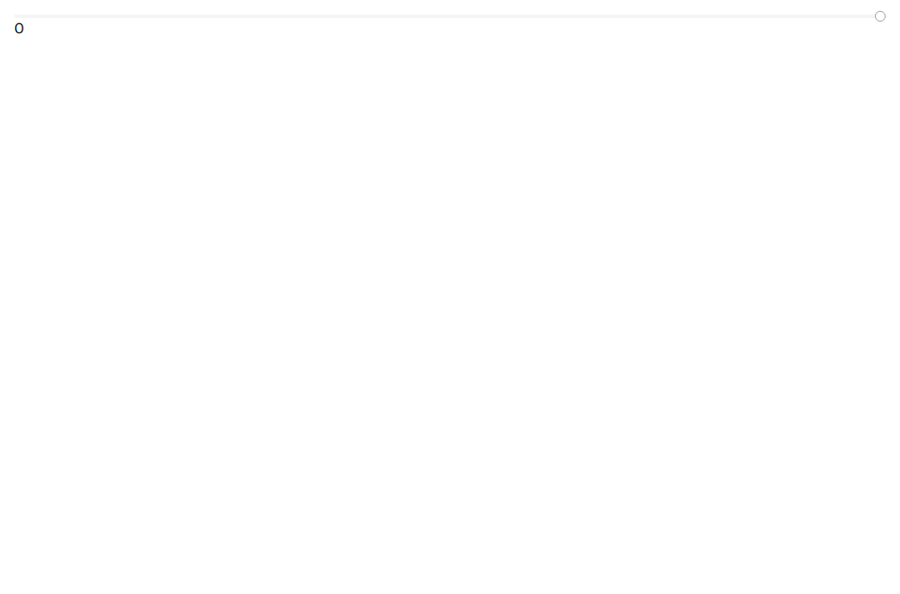

## ✅ test pages render without errors › slider--max

## ✅ test pages render without errors › slider--min

## ✅ test pages render without errors › slider--min-max

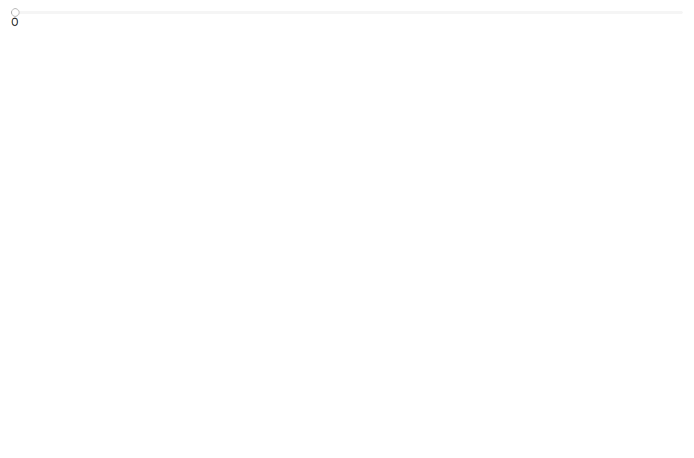

## ✅ test pages render without errors › slider--min-steps-between-thumbs

## ✅ test pages render without errors › slider--range

## ✅ test pages render without errors › slider--reactive-form-control

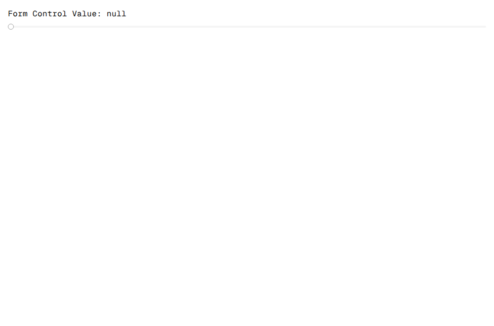

## ✅ test pages render without errors › slider--reactive-form-control-with-initial-value

## ✅ test pages render without errors › slider--step

## ✅ test pages render without errors › slider--template-driven-form

## ✅ test pages render without errors › slider--tick-label-interval

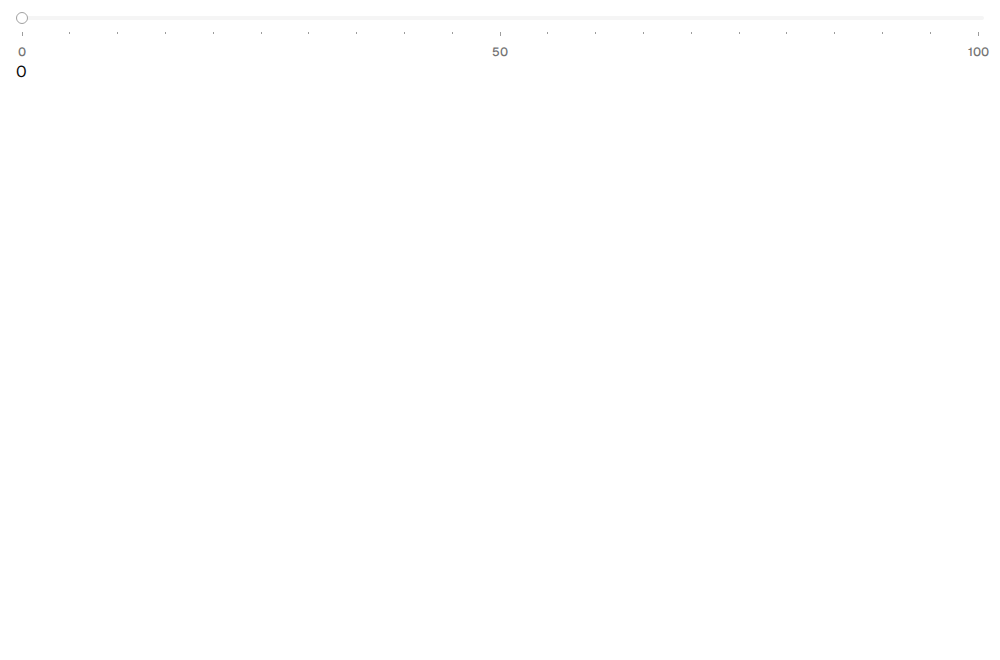

## ✅ test pages render without errors › slider--ticks

## ✅ test pages render without errors › slider--validation

## ✅ test pages render without errors › slider--vertical

## ✅ test pages render without errors › sonner--default

## ✅ test pages render without errors › spinner--default

## ✅ test pages render without errors › switch--default

## ✅ test pages render without errors › switch--disabled

## ✅ test pages render without errors › switch--form

## ✅ test pages render without errors › switch--form-true

## ✅ test pages render without errors › switch--inside-label

## ✅ test pages render without errors › switch--labeled-with-aria-labeled-by

## ✅ test pages render without errors › switch--with-hint-and-error

## ✅ test pages render without errors › table--default

## ✅ test pages render without errors › tabs--brn-only

## ✅ test pages render without errors › tabs--default

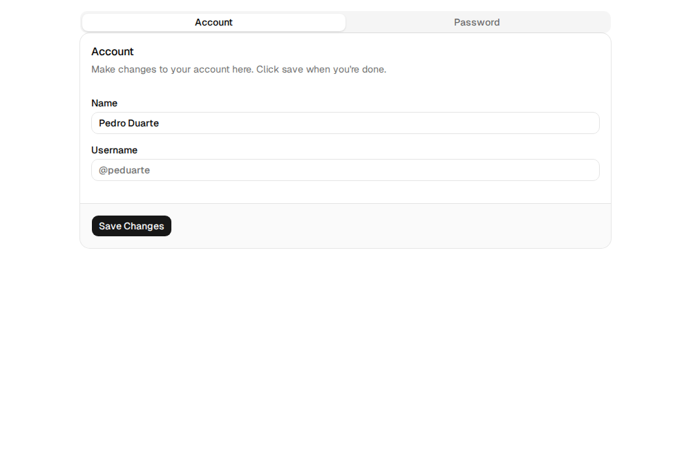

## ✅ test pages render without errors › tabs--disabled

- Accessibility: **aria-valid-attr-value** (critical), ARIA attributes must conform to valid values. 1 elements.

## ✅ test pages render without errors › tabs--lazy-loading

## ✅ test pages render without errors › tabs--paginated

## ✅ test pages render without errors › tabs--vertical

## ✅ test pages render without errors › textarea--default

## ✅ test pages render without errors › textarea--disabled

## ✅ test pages render without errors › textarea--error

## ✅ test pages render without errors › textarea--required

## ✅ test pages render without errors › textarea--with-button

## ✅ test pages render without errors › textarea--with-hint-and-error

## ✅ test pages render without errors › toggle--default

## ✅ test pages render without errors › toggle--with-text

## ✅ test pages render without errors › toggle-group--default

## ✅ test pages render without errors › toggle-group--disabled

## ✅ test pages render without errors › toggle-group--large

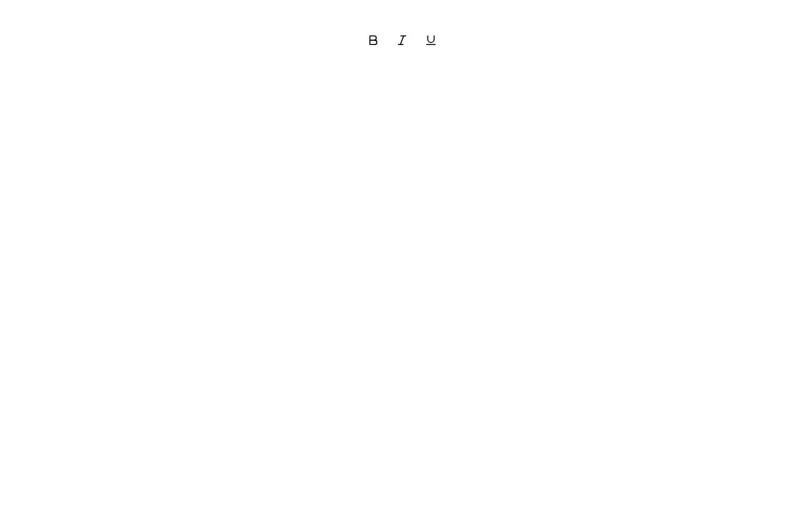

## ✅ test pages render without errors › toggle-group--outline

## ✅ test pages render without errors › toggle-group--small

## ✅ test pages render without errors › toggle-group--toggle-group-disabled

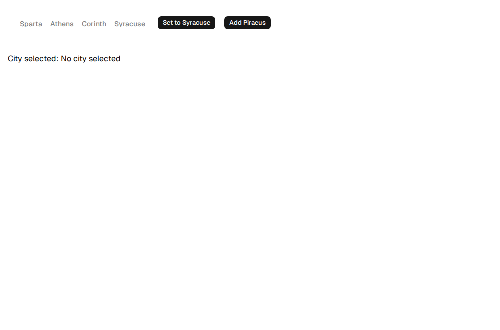

## ✅ test pages render without errors › toggle-group--toggle-group-form

## ✅ test pages render without errors › toggle-group--toggle-group-multiple

## ✅ test pages render without errors › toggle-group--toggle-group-multiple-nullable

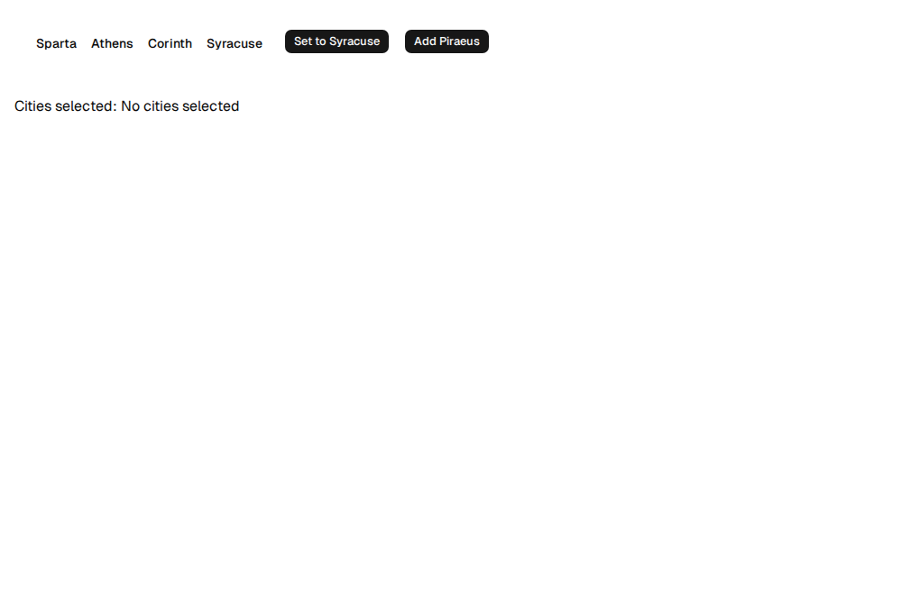

## ✅ test pages render without errors › toggle-group--toggle-group-single

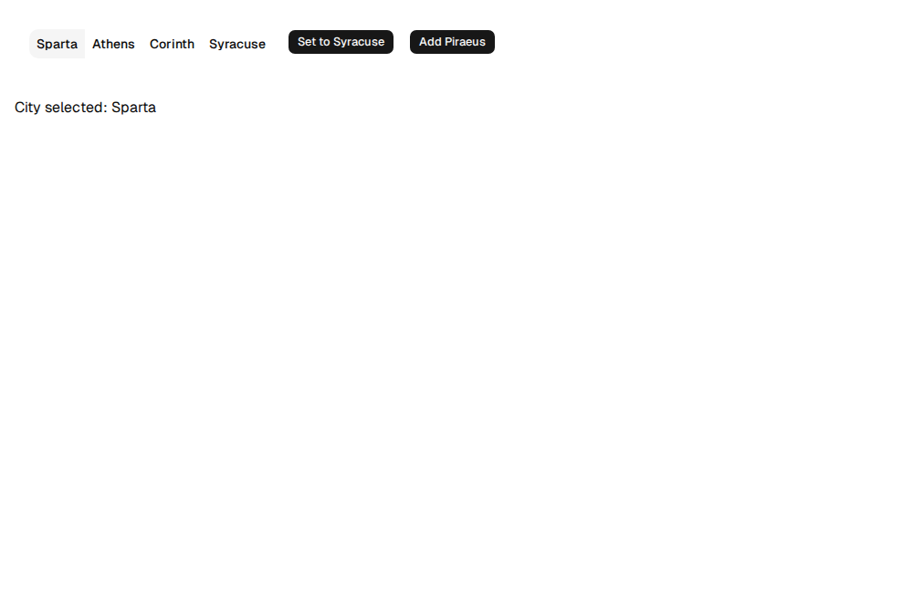

## ✅ test pages render without errors › toggle-group--toggle-group-single-nullable

## ✅ test pages render without errors › tooltip--default

## ✅ test pages render without errors › tooltip--disabled

## ✅ test pages render without errors › tooltip--simple

- Accessibility: **button-name** (critical), Buttons must have discernible text. 1 elements.

## ✅ test pages render without errors › trace--default

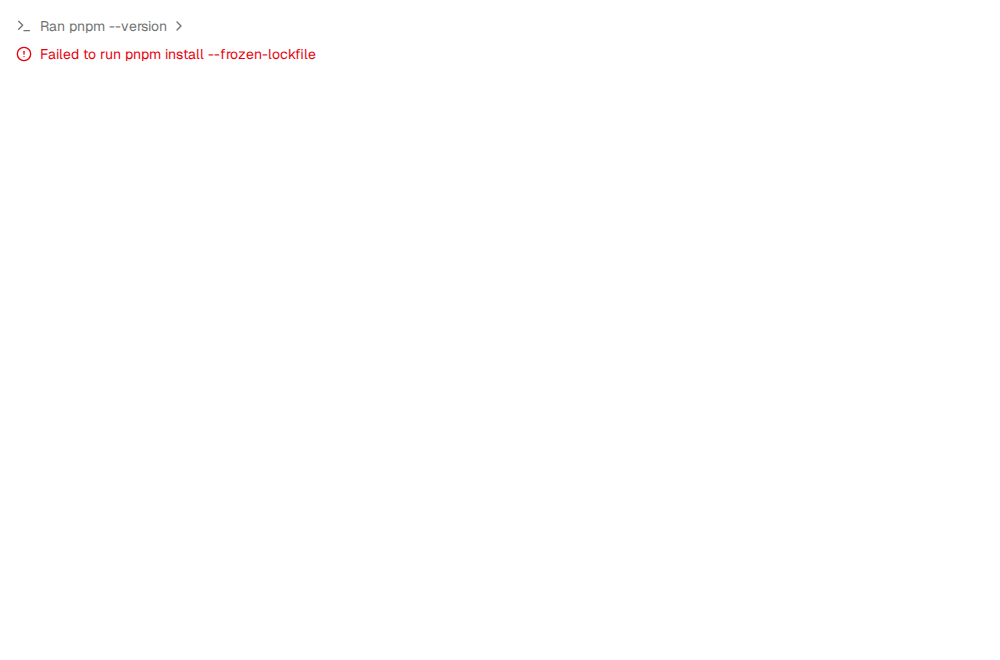

## ✅ test pages render without errors › typography--default

