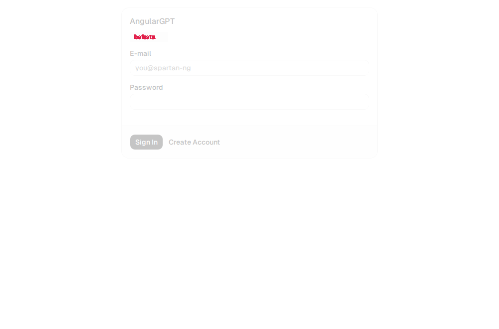

# Every page loads

[All checks](README.md)

## ✅ test pages render without errors › badge--default

| Before | After | Difference |
| --- | --- | --- |
|  |  |  |

## ✅ test pages render without errors › badge--destructive

- Accessibility: **color-contrast** (serious), Elements must meet minimum color contrast ratio thresholds. 1 elements.

| Before | After | Difference |
| --- | --- | --- |
|  |  |  |

## ✅ test pages render without errors › badge--outline

| Before | After | Difference |
| --- | --- | --- |
|  |  |  |

## ✅ test pages render without errors › badge--secondary

| Before | After | Difference |
| --- | --- | --- |
|  |  |  |

## ✅ test pages render without errors › card--default

## ✅ test pages render without errors › card--transposed

| Before | After | Difference |
| --- | --- | --- |
|  |  |  |
