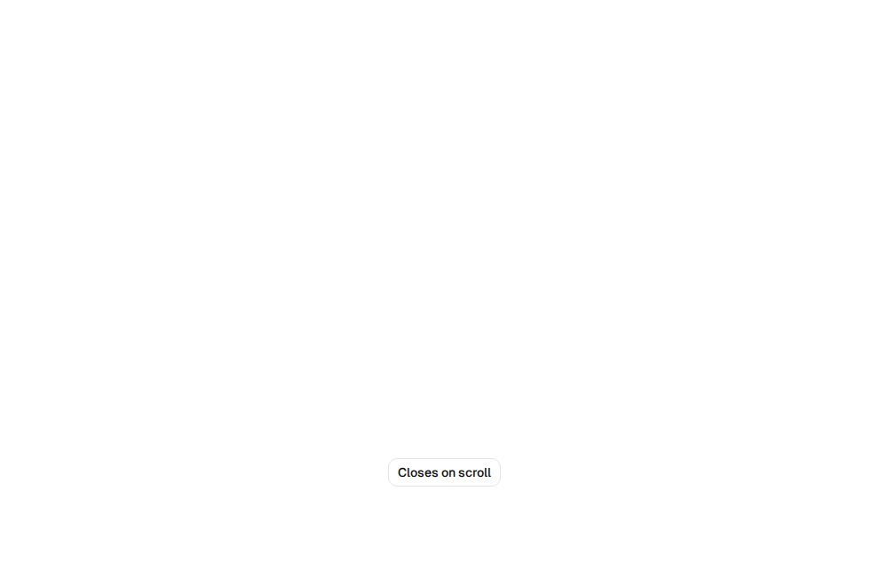

# popover

[All checks](README.md)

## ✅ popover--near-viewport-edge › keeps content at its own width rather than squeezing it into the space left

## ✅ popover--near-viewport-edge › follows a trigger that scrolls out of view instead of holding itself against the edge

## ✅ popover--close-on-scroll › honours the scroll strategy the wrapper now forwards

## ✅ popover--scroll-container › keeps the panel on its trigger when the enclosing container scrolls

## ✅ popover--default › default › click on trigger should open, click on close should close, click outside should close

## ✅ popover--default › default › clicking an outside button should close the popover and activate the button

## ✅ popover--default › default › tab and enter on trigger should open, escape should close

## ✅ popover--default › default › tab and space on trigger should open, tab through content, escape should close

