# popover

[All checks](README.md)

## ✅ popover--near-viewport-edge › keeps content at its own width rather than squeezing it into the space left

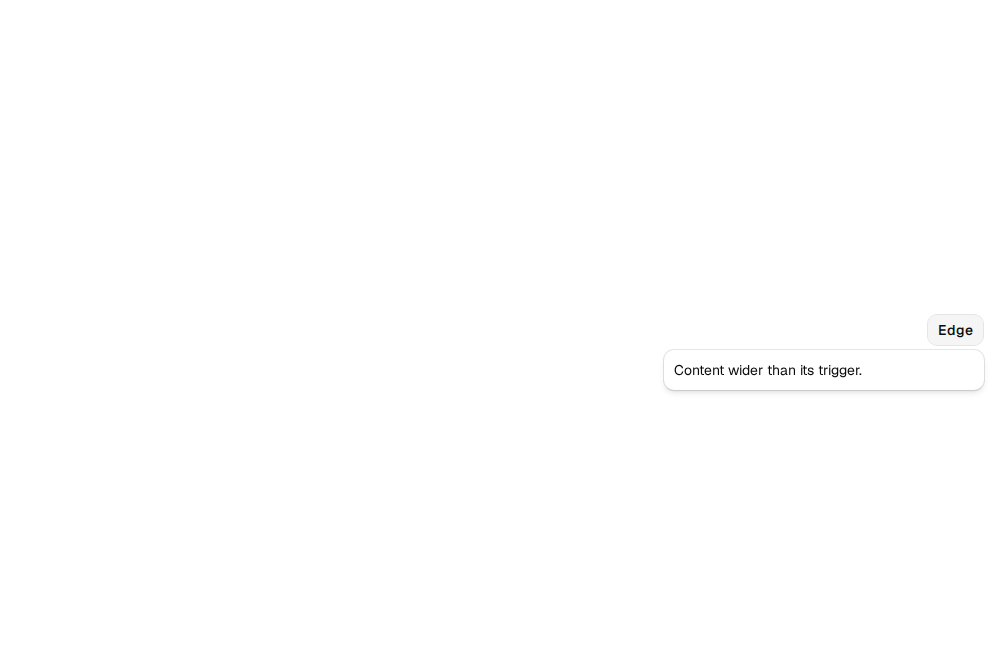

## ✅ popover--near-viewport-edge › follows a trigger that scrolls out of view instead of holding itself against the edge

## ✅ popover--close-on-scroll › honours the scroll strategy the wrapper now forwards

| Before | After | Difference |
| --- | --- | --- |
|  | 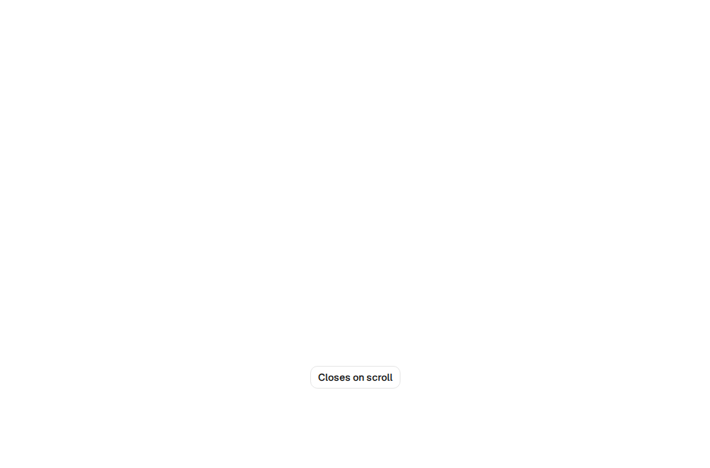 | 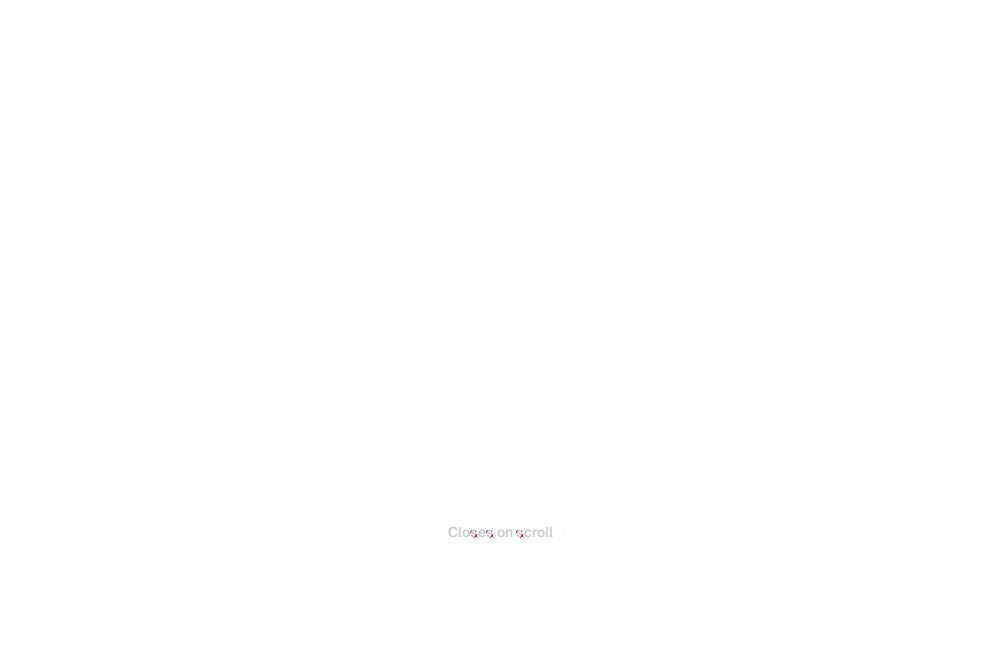 |

## ✅ popover--scroll-container › keeps the panel on its trigger when the enclosing container scrolls

| Before | After | Difference |
| --- | --- | --- |
|  | 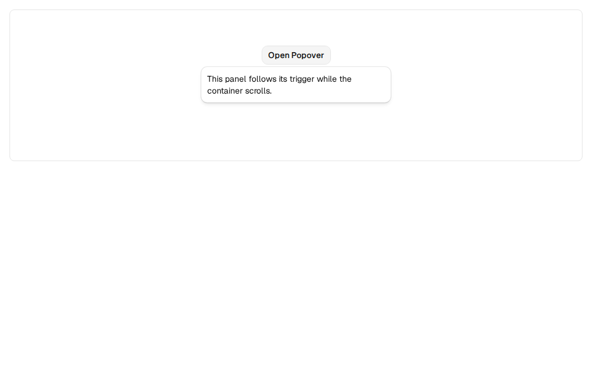 | 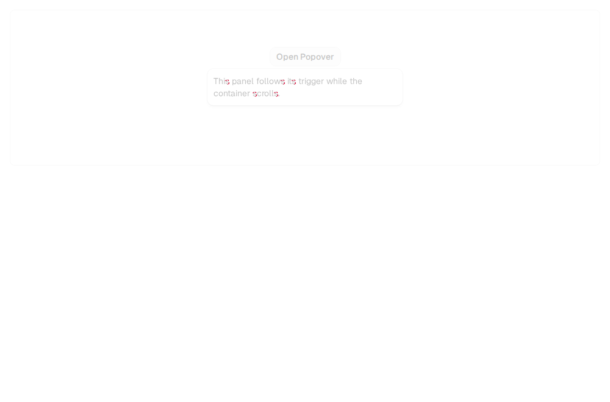 |

## ✅ popover--default › default › click on trigger should open, click on close should close, click outside should close

| Before | After | Difference |
| --- | --- | --- |
| 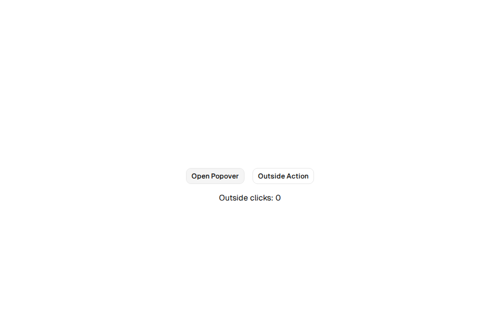 |  | 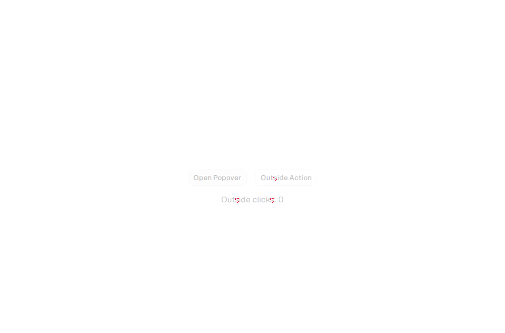 |

## ✅ popover--default › default › clicking an outside button should close the popover and activate the button

| Before | After | Difference |
| --- | --- | --- |
| 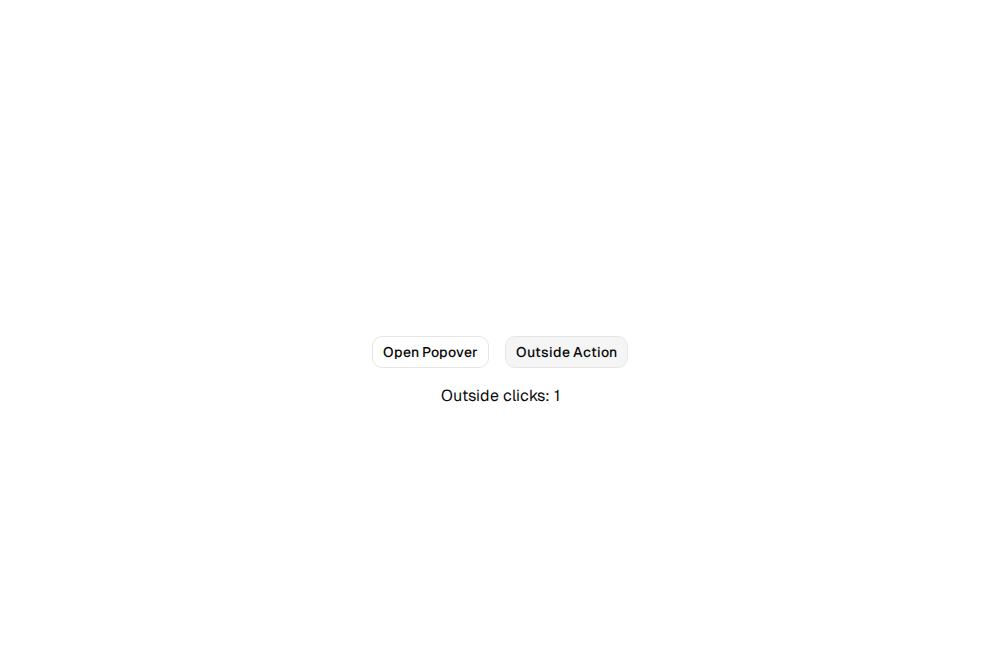 |  | 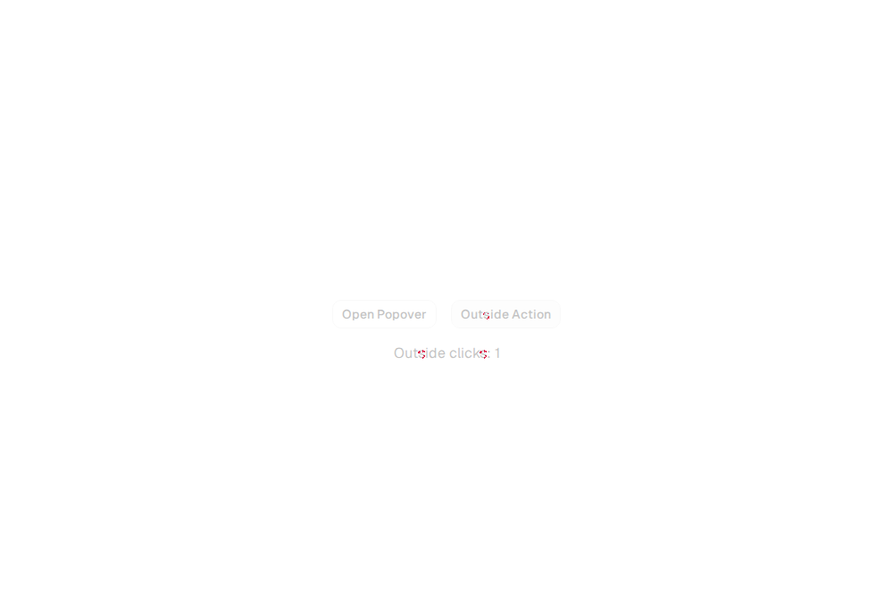 |

## ✅ popover--default › default › tab and enter on trigger should open, escape should close

| Before | After | Difference |
| --- | --- | --- |
| 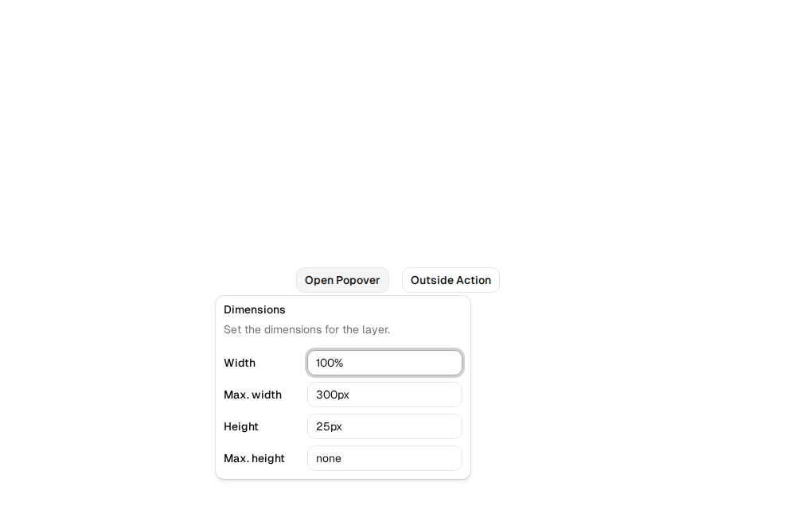 |  | 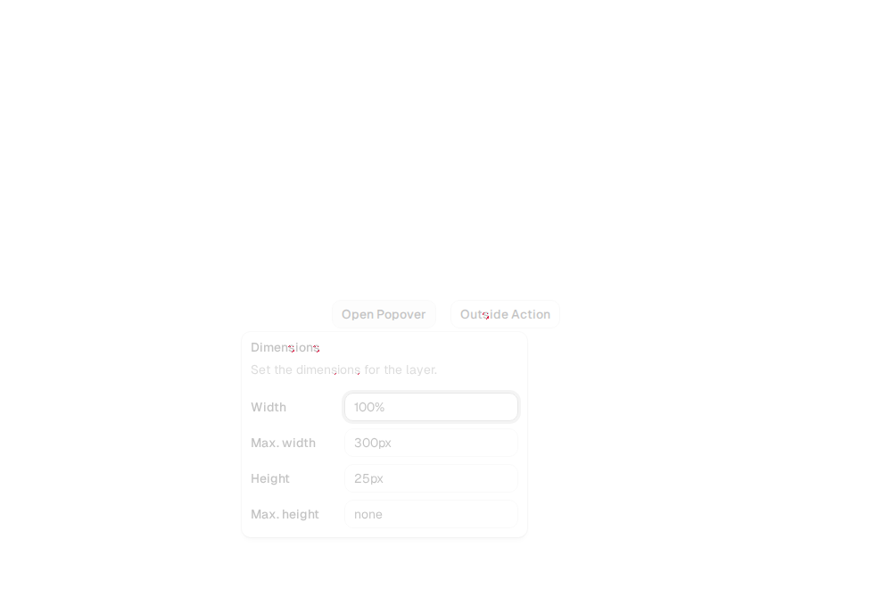 |

## ✅ popover--default › default › tab and space on trigger should open, tab through content, escape should close

| Before | After | Difference |
| --- | --- | --- |
|  |  |  |
