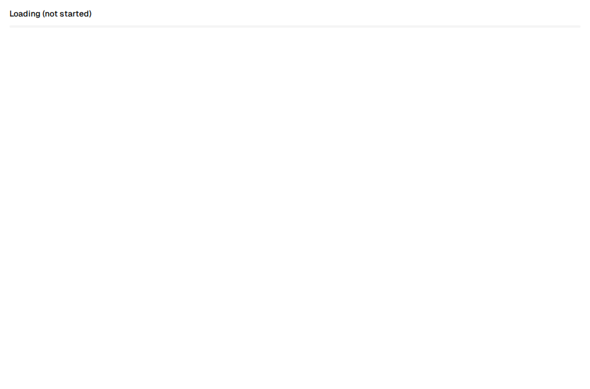
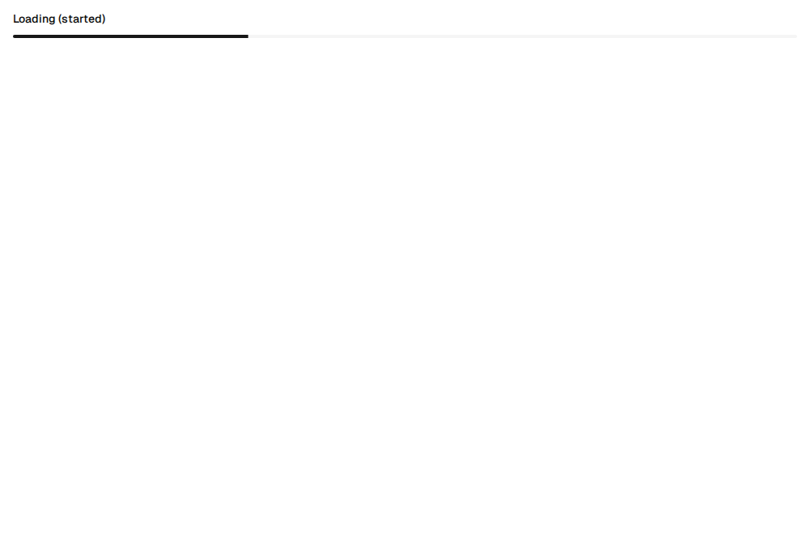
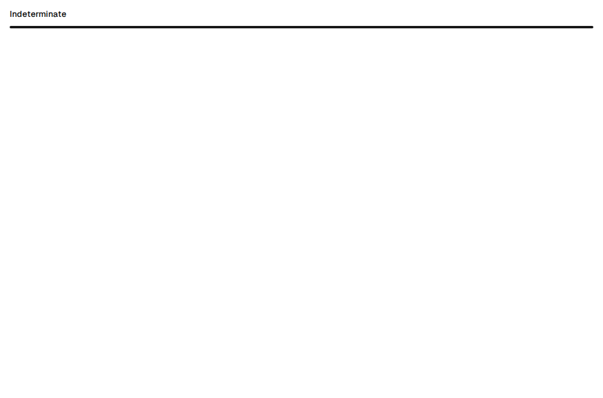
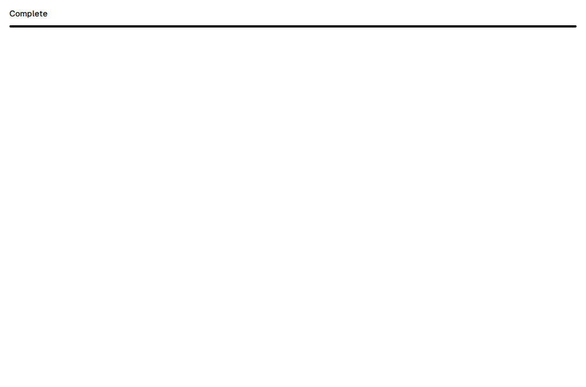

# progress

[All checks](README.md)

## ✅ progress › LoadingNotStarted › should give the correct roles and data values to indicators with values and indeterminate if null

## ✅ progress › LoadingStarted › should give the correct roles and data values to indicators with values and indeterminate if null

## ✅ progress › Indeterminate › should give the correct roles and data values to indicators with values and indeterminate if null

## ✅ progress › Complete › should give the correct roles and data values to indicators with values and indeterminate if null

