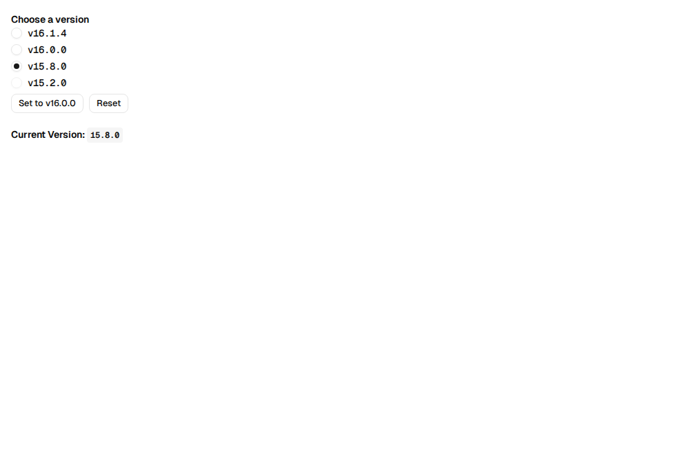
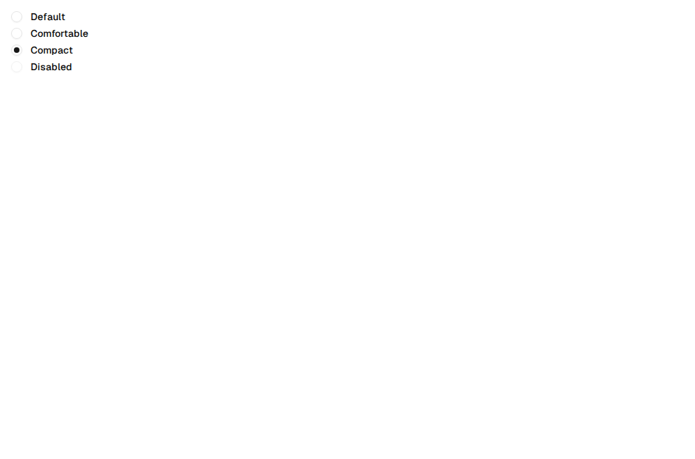

# radio-group

[All checks](README.md)

## ✅ radio-group › default › 
    1. should display default version.
    2. should update based on click of outside button setting to 16.0.0.
    3. should uncheck all checked radios when reset to none.
    4. should check correct version when clicked on 15.8.0 radio
    5. should not change when clicked on disabled radio
    

## ✅ radio-group › default › 
    1. should display default version.
    2. should focus first radio when tabbed in.
    3. should jump to next button when tabbed out and set version correctly when enter is hit on it
    4. should jump to newly selected radio when focus moved back to group
    5. should move checked radio with up and down arrows.
    6. should move checked radio with left and right arrows.
    5. should not move to disabled radio
    

## ✅ radio-group › default › labelFor › should check the option when clicking the label

