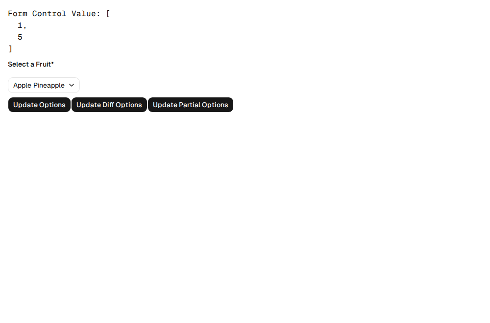
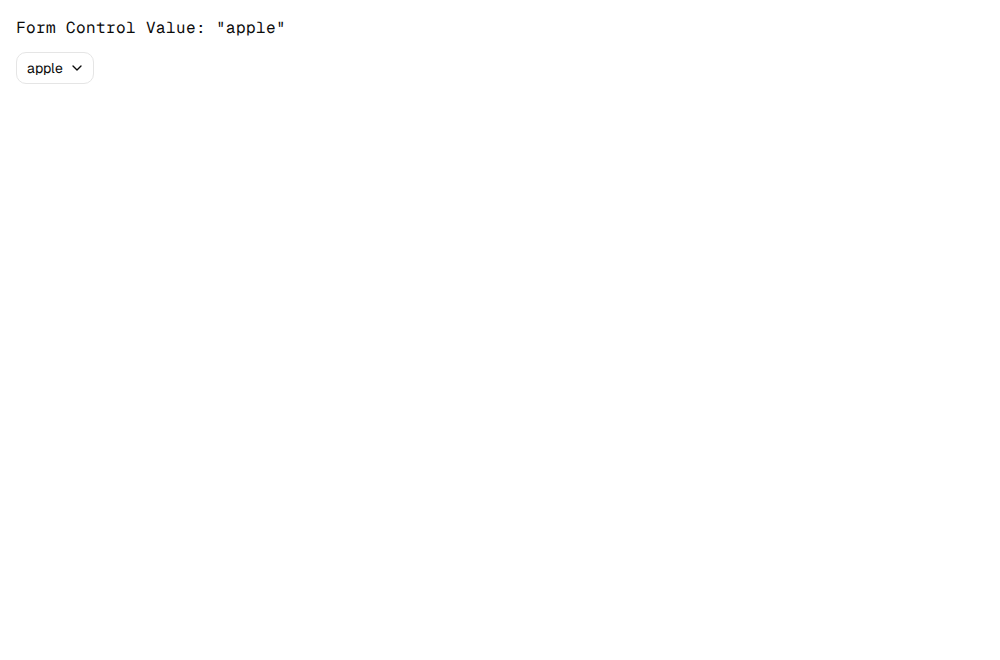

# select

[All checks](README.md)

## ✅ select trigger name › is named by the label that targets it in a form

## ✅ select trigger name › is named by the label of the field it sits in

## ✅ select trigger name › is named by the visually hidden label of the default story

## ✅ select trigger name › is named in the multiple select

## ✅ select › default › click on trigger should open and close it content

## ✅ select › default › click outside should close the content

## ✅ select › default › second click on trigger should close the content

## ✅ select › default › should close after selecting an option in single mode

## ✅ select › multiple › should stay open after selecting an option in multi mode

## ✅ select › multiple › should stay open after selecting an option in multi mode (2)

## ✅ select › multiple › should toggle an item on keypress

## ✅ select › disabled › should not open if disabled

## ✅ select › scrollable › should be scrollable

## ✅ select › disabled option › should not be able to select a disabled option

## ✅ select › form validation › should have form validation classes and reflect control status

## ✅ select › form validation › should have initial value set correctly when options are provided in a for loop

## ✅ select › form validation › should have form validation classes and reflect control status with label

## ✅ select › form validation › should have form validation classes and reflect control status when assigned with initial value

## ✅ select › form validation › should have form validation classes and reflect control status (2)

## ✅ select › falsy value › should select an option with a falsy value on enter keypress

