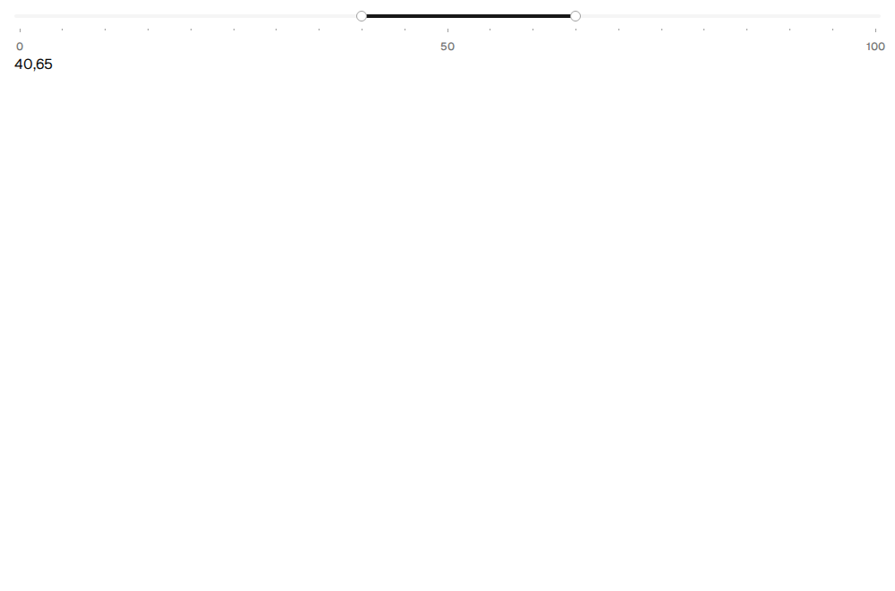
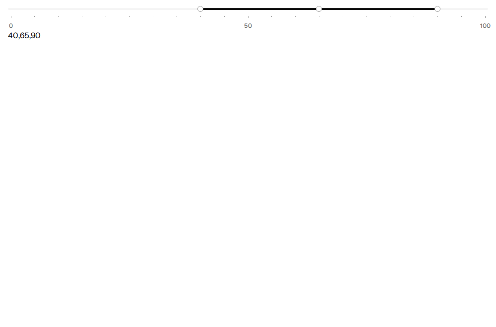

# slider

[All checks](README.md)

## ✅ Slider › should allow dragging to change the value

## ✅ Slider › should support keyboard interactions

## ✅ Slider › should drag the whole range when draggableRange is enabled

| Before | After | Difference |
| --- | --- | --- |
|  |  |  |

## ✅ Slider › should drag all thumbs together when draggableRangeOnly is enabled

| Before | After | Difference |
| --- | --- | --- |
|  |  |  |

## ✅ Slider › should render the slider with the correct initial value

