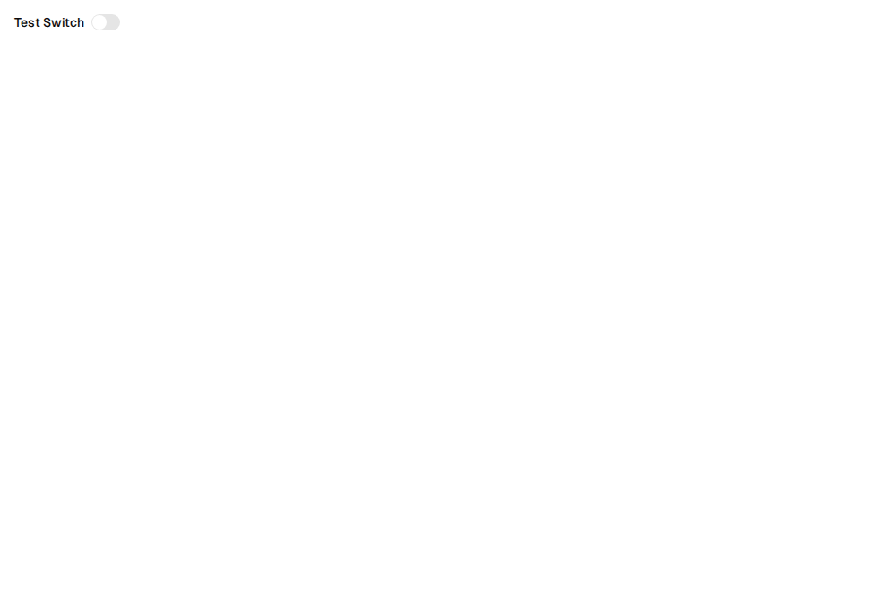
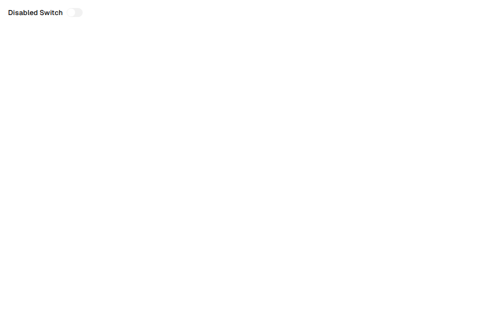
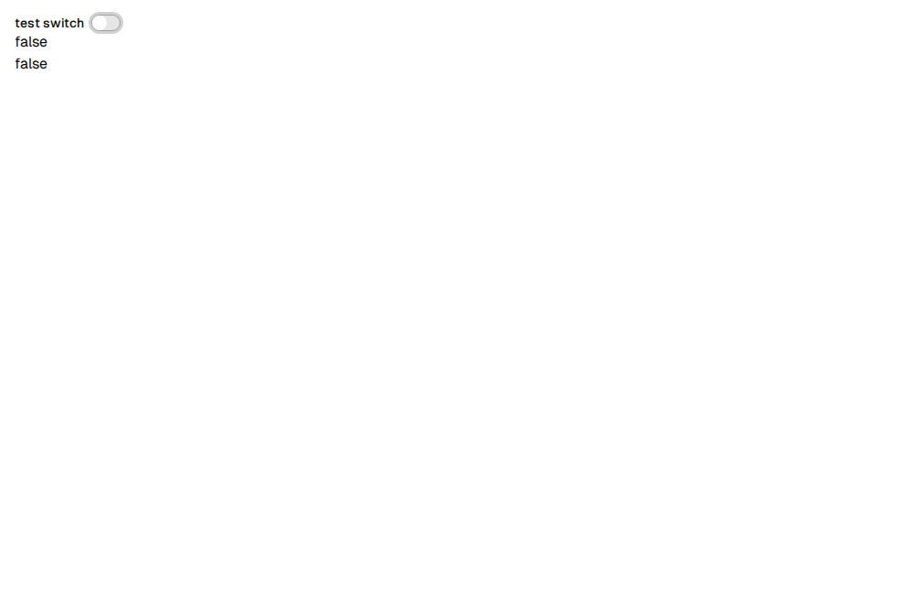

# switch

[All checks](README.md)

## ✅ brn-switch accessibility and functionality tests › default › should toggle switch state on component click

## ✅ brn-switch accessibility and functionality tests › default › should show visible focus indication for keyboard users

## ✅ brn-switch accessibility and functionality tests › inside label › should toggle switch state on component click

## ✅ brn-switch accessibility and functionality tests › labeled with aria-labelledby › should toggle switch state on component click

## ✅ brn-switch accessibility and functionality tests › disabled switch › should not be interactive when disabled

## ✅ brn-switch accessibility and functionality tests › default › should toggle switch state on thumb click

## ✅ brn-switch accessibility and functionality tests › default › should toggle switch state using [Tab][Enter] keys

## ✅ brn-switch accessibility and functionality tests › default › should toggle switch state using [Tab][Space] keys

## ✅ brn-switch accessibility and functionality tests › inside label › should toggle switch state by clicking on the label

## ✅ brn-switch accessibility and functionality tests › inside label › should toggle switch state on thumb click

## ✅ brn-switch accessibility and functionality tests › inside label › should toggle switch state using [Tab][Enter] keys

## ✅ brn-switch accessibility and functionality tests › inside label › should toggle switch state using [Tab][Space] keys

## ✅ brn-switch accessibility and functionality tests › labeled with aria-labelledby › should toggle switch state by clicking on the label

## ✅ brn-switch accessibility and functionality tests › labeled with aria-labelledby › should toggle switch state on thumb click

## ✅ brn-switch accessibility and functionality tests › labeled with aria-labelledby › should toggle switch state using [Tab][Enter] keys

## ✅ brn-switch accessibility and functionality tests › labeled with aria-labelledby › should toggle switch state using [Tab][Space] keys

## ✅ brn-switch accessibility and functionality tests › form integration › should reflect changes in form values and touched state

