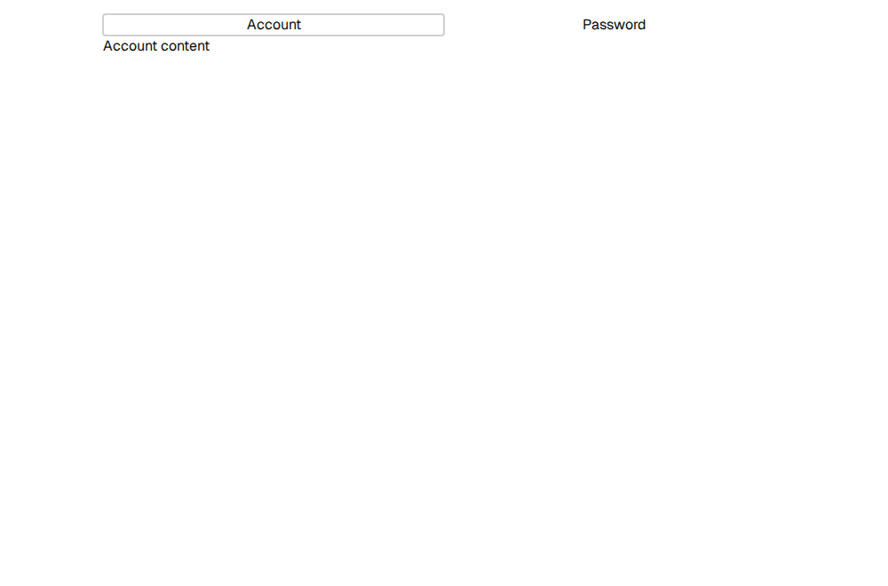
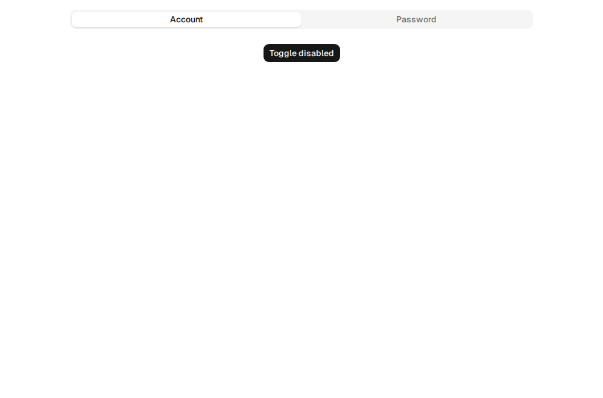
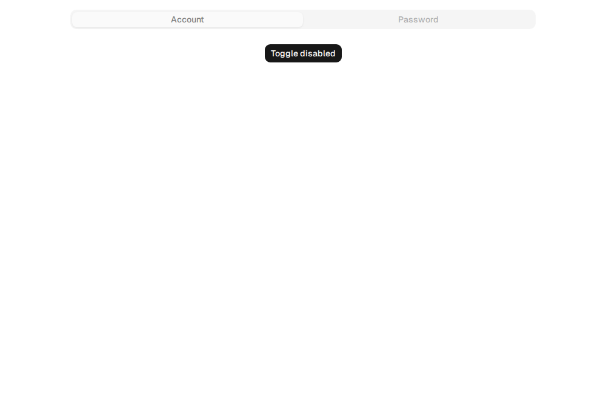
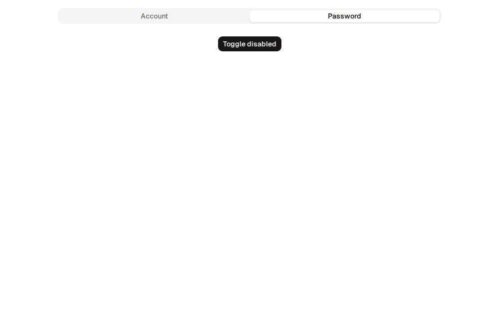

# tabs

[All checks](README.md)

## ✅ tabs--brnonly › default › click interactions should render with first tab selected and change to second tab when second tab is clicked

## ✅ tabs--brnonly › default › tab and arrow interactions should render with first tab selected and change to second tab when second tab is focused with arrow right, return to first tab with arrow left and do nothing on arrow up or down

## ✅ tabs--default--manual › default › click interactions should render with first tab selected and change to second tab when second tab is clicked

## ✅ tabs--default--manual › default › tab and arrow interactions should render with first tab selected and change to second tab when second tab is focused and confirmed with enter with arrow right, return to first tab with arrow left and do nothing on arrow up or down

## ✅ tabs--default › default › click interactions should render with first tab selected and change to second tab when second tab is clicked

## ✅ tabs--default › default › tab and arrow interactions should render with first tab selected and change to second tab when second tab is focused with arrow right, return to first tab with arrow left and do nothing on arrow up or down

## ✅ tabs--disabled › default › click interactions should render with first tab selected and change to second tab when second tab is clicked

## ✅ tabs--disabled › default › should default to disabled with aria tags

## ✅ tabs--disabled › default › should toggle to active with no disabled attributes or classes

## ✅ tabs--vertical › default › click interactions should render with first tab selected and change to second tab when second tab is clicked

## ✅ tabs--vertical › default › tab and arrow interactions should render with first tab selected and change to second tab when second tab is focused with arrow right, return to first tab with arrow left and do nothing on arrow up or down

