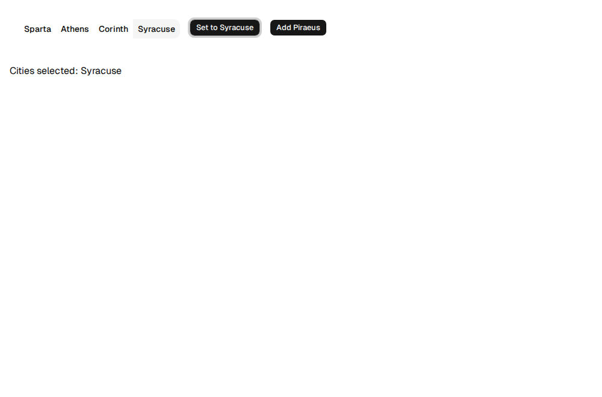
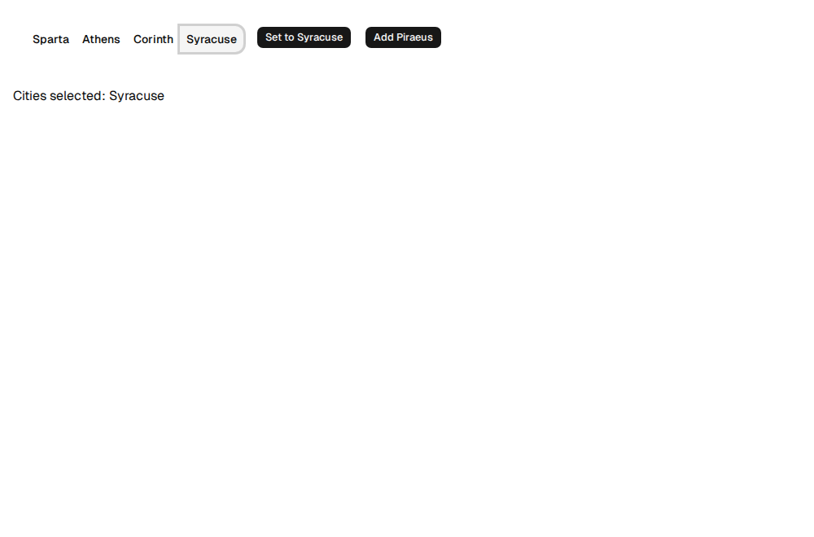

# toggle-group

[All checks](README.md)

## ✅ toggle-group--toggle-group-single › default › 
    1. should sparta selected by default.
    2. should have toggle-group with role=group and 3 buttons toggled off and sparta toggled on.
    3. click on sparta should not unselect sparta.
    4. click on syracuse should unselect sparta and select syracuse
    

## ✅ toggle-group--toggle-group-multiple-nullable › default › 
    1. should have no city selected by default.
    2. should have toggle-group with role=group and 4 buttons all toggled off.
    3. click on sparta should select sparta.
    4. click on syracuse should keep sparta selected and select syracuse
    5. click on athens should keep sparta, syracuse selected and select athens
    6. click on syracuse should unselect syracuse, but keep sparta and athens selected
    7. click on set-to-syracuse button should unselect all others but syracuse
    

## ✅ toggle-group--toggle-group-multiple-nullable › default › 
    1. should have no city selected by default.
    2. should have toggle-group with role=group and 4 buttons all toggled off.
    3. tab to and space on sparta should select sparta.
    4. tab to and enter on syracuse should keep sparta selected and select syracuse
    5. tab to and space on athens should keep sparta, syracuse selected and select athens
    6. tab to and enter on syracuse should unselect syracuse, but keep sparta and athens selected
    7. tab to and space on set-to-syracuse button should unselect all others but syracuse
    

## ✅ toggle-group--toggle-group-multiple › default › 
    1. should have sparta selected by default.
    2. should have toggle-group with role=group and 3 buttons toggled off and sparta toggled on.
    3. click on sparta should not unselect sparta.
    4. click on syracuse should keep sparta selected and select syracuse
    5. click on athens should keep sparta, syracuse selected and select athens
    6. click on syracuse should unselect syracuse, but keep sparta and athens selected
    7. click on set-to-syracuse button should unselect all others but syracuse
    8. click on syracuse should not unselect syracuse
    

## ✅ toggle-group--toggle-group-multiple › default › 
    1. should have sparta selected by default.
    2. should have toggle-group with role=group and 3 buttons toggled off and sparta toggled on.
    3. tab to and space on sparta should select sparta.
    4. tab to and enter on syracuse should keep sparta selected and select syracuse
    5. tab to and space on athens should keep sparta, syracuse selected and select athens
    6. tab to and enter on syracuse should unselect syracuse, but keep sparta and athens selected
    7. tab to and space on set-to-syracuse button should unselect all others but syracuse
    8. tab to and enter syracuse should not unselect syracuse
    

## ✅ toggle-group--toggle-group-dynamic-options › default › 
    1. should sparta selected by default.
    2. should have toggle-group with role=group and 3 buttons toggled off and sparta toggled on.
    3. click on sparta should not unselect sparta.
    4. click on syracuse should unselect sparta and select syracuse
    5. click on athens should unselect syracuse and select athens
    6. click on set-to-syracuse button should unselect athens and select syracuse
    7. click on syracuse should not unselect syracuse
    8. click on add piraeus should dynamically add the city
    9. click on piraeus should unselect syracuse and select piraeus
    10. click on piraeus should not unselect piraeus
    

## ✅ toggle-group--toggle-group-dynamic-options › default › 
    1. should sparta selected by default.
    2. should have toggle-group with role=group and 3 buttons toggled off and sparta toggled on.
    3. tab to and space on sparta should not unselect sparta.
    4. tab to and enter on syracuse should unselect sparta and select syracuse
    5. tab to and space on athens should unselect syracuse and select athens
    6. tab to and enter on set-to-syracuse button should unselect athens and select syracuse
    7. tab to and space on syracuse should not unselect syracuse
    8. tab to and enter on add piraeus should dynamically add the city
    9. tab to and space on piraeus should unselect syracuse and select piraeus
    10. tab to and enter on piraeus should not unselect piraeus
    

## ✅ toggle-group--toggle-group-single-nullable › default › 
    1. should have no city selected by default.
    2. should have toggle-group with role=group and 4 buttons all toggled off.
    3. click on sparta should select sparta.
    4. click on syracuse should unselect sparta and select syracuse
    5. click on athens should unselect syracuse and select athens
    6. click on set-to-syracuse button should unselect athens and select syracuse
    

## ✅ toggle-group--toggle-group-single-nullable › default › 
    1. should have no city selected by default.
    2. should have toggle-group with role=group and 4 buttons all toggled off.
    3. tab to and space on sparta should select sparta.
    4. tab to and enter on syracuse should unselect sparta and select syracuse
    5. tab to and space on athens should unselect syracuse and select athens
    6. tab to and enter on set-to-syracuse button should unselect athens and select syracuse
    

## ✅ toggle-group--toggle-group-single › default › 
    1. should sparta selected by default.
    2. should have toggle-group with role=group and 3 buttons toggled off and sparta toggled on.
    3. click on sparta should not unselect sparta.
    4. click on syracuse should unselect sparta and select syracuse
    5. click on athens should unselect syracuse and select athens
    6. click on set-to-syracuse button should unselect athens and select syracuse
    7. click on syracuse should not unselect syracuse
    

## ✅ toggle-group--toggle-group-single › default › 
    1. should sparta selected by default.
    2. should have toggle-group with role=group and 3 buttons toggled off and sparta toggled on.
    3. tab to and space on sparta should not unselect sparta.
    4. tab to and enter on syracuse should unselect sparta and select syracuse
    5. tab to and space on athens should unselect syracuse and select athens
    6. tab to and enter on set-to-syracuse button should unselect athens and select syracuse
    7. tab to and space on syracuse should not unselect syracuse
    

